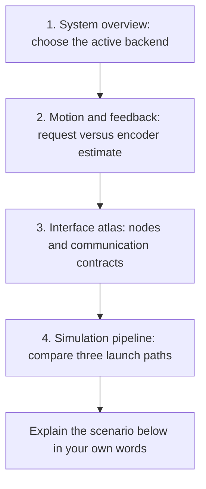

# Pinky Pro learning roadmap

Study the explanations, diagrams and worked examples in this Wiki. Source links are an audit trail; opening source files is optional. Progress is based on explaining the system in your own words, not memorizing filenames.

This overview adapts the common metadata and evidence sections of the existing code-analysis template. The learning order is an instructional **inference**, while behavior in linked lessons is source-confirmed or explicitly marked unverified.

## Your first complete study unit

**Goal:** explain how Pinky receives a motion request, reports movement, and places that movement in a frame tree. Complete this unit by reading; no robot or simulator needs to run.

Read [system overview](../01_Architecture/system-overview.md), [motion and feedback](../04_Features/motion-and-feedback.md), [interface atlas](../04_Features/ros2-interface-atlas.md), and [simulation pipeline](../01_Architecture/simulation-pipeline.md), in that order. Keep [description and TF](../01_Architecture/robot-description-and-tf.md) beside you for frame questions. These pages contain the explanations; source links are optional evidence.

**Paper exercise — a straight motion request.** Suppose the hardware node has initialized, a matching publisher supplies `cmd_vel` with `linear.x=0.10` and `angular.z=0`, and geometry is `r=0.027 m`, `L=0.0961 m`. Describe the following without assuming that the wheels actually move.

| Question | Model answer |
|---|---|
| What receives the request? | The `pinky_bringup` node subscribes to `cmd_vel`, a `Twist` topic. A topic is the communication path; it is not a node. |
| What motor request is calculated? | Approximately `+35.368` left RPM and `-35.368` right RPM, below the common 100 RPM cap. The right-side minus sign is part of the implementation. |
| What if no new encoder movement is measured? | Zero encoder increments produce zero integrated displacement for that successful update, even though a nonzero velocity was requested. |
| Which three outputs describe feedback? | `odom` carries estimated pose and velocity, TF relates `odom` to `base_footprint`, and `joint_states` carries wheel positions and velocities. |
| Does that locate the robot on a saved map? | No. This hardware node does not supply `map -> odom`; localization or mapping belongs to a separate pipeline. |
| What changes if `sim:=gz` is selected instead? | The simulator selector includes Gazebo launch and bridges. It does not start the hardware motor and battery executables. |

The numerical and no-displacement answers are **[Inference]** calculations from [wheel conversion and encoder integration](https://github.com/seljb/pinky_pro/blob/014a09f289e6988894fbffde2624fdb1e257815b/pinky_bringup/pinky_bringup/bringup.py#L104-L195), using [source geometry values](https://github.com/seljb/pinky_pro/blob/014a09f289e6988894fbffde2624fdb1e257815b/pinky_bringup/config/pinky_params.yaml#L1-L4). Interface declarations are **[Code confirmed]** in [the constructor](https://github.com/seljb/pinky_pro/blob/014a09f289e6988894fbffde2624fdb1e257815b/pinky_bringup/pinky_bringup/bringup.py#L84-L95); backend selection is **[Code confirmed]** in [the simulator entrypoint](https://github.com/seljb/pinky_pro/blob/014a09f289e6988894fbffde2624fdb1e257815b/pinky_bringup/launch/bringup_sim.launch.xml#L29-L47). Actual delivery, movement and TF connectivity remain **[Unverified]**.

**Completion check:** explain one node, one topic, one service, one action and one TF edge using the atlas. Use `set_led` for a request/response example and `navigate_to_pose` for a goal with a later result. Then choose a launch branch on paper and name which component owns odometry in that branch.

### Connect to the preserved bringup analysis

The English [motion lesson](../04_Features/motion-and-feedback.md) is the main explanation. Use the older detailed notes for a specific question:

| Question | Preserved reference |
|---|---|
| Which executable and dependencies belong to bringup? | [Bringup package](../02_Packages/pinky_bringup.md) |
| What starts on hardware versus in simulation? | [Bringup pipeline](../01_Architecture/pinky-bringup-pipeline.md) |
| How do RPM limits, serial writes and cleanup work? | [Motor control](../05_Code_Analysis/pinky_bringup--motor-control.md) |
| How do counts become pose, TF and wheel state? | [State publishing](../05_Code_Analysis/pinky_bringup--state-publishing.md) |
| Which settings are ROS parameters rather than constants? | [Parameter catalog](../03_Parameters/pinky_bringup-parameters.md) |

These references retain their original Korean text and history. They are optional for the English first unit.

## 1. Session 1 — See the whole robot

Read [system overview](../01_Architecture/system-overview.md). Draw two arrows: requested motion into the robot, and observed state coming back. Name the roles of bringup, navigation, description and simulators.

**Ready to continue:** explain why a package existing in the repository does not mean its node is running. The actual robot launch includes description and LiDAR and starts bringup/battery; the simulator launch instead selects a simulator. [pinky_bringup/launch/bringup_robot.launch.xml:3-29](https://github.com/seljb/pinky_pro/blob/014a09f289e6988894fbffde2624fdb1e257815b/pinky_bringup/launch/bringup_robot.launch.xml#L3-L29), [pinky_bringup/launch/bringup_sim.launch.xml:13-48](https://github.com/seljb/pinky_pro/blob/014a09f289e6988894fbffde2624fdb1e257815b/pinky_bringup/launch/bringup_sim.launch.xml#L13-L48).

## 2. Session 2 — Understand one complete movement

Read [motion and feedback](../04_Features/motion-and-feedback.md). Work through `v=0.10`, `w=0`, and the one-revolution encoder example. Draw command RPM separately from measured encoder position.

**Ready to continue:** explain the right-wheel sign convention, common 100 RPM scaling, the nominal 30 Hz feedback timer, and why encoder position rather than the last command drives pose. [pinky_bringup/pinky_bringup/bringup.py:84-88](https://github.com/seljb/pinky_pro/blob/014a09f289e6988894fbffde2624fdb1e257815b/pinky_bringup/pinky_bringup/bringup.py#L84-L88), [pinky_bringup/pinky_bringup/bringup.py:104-161](https://github.com/seljb/pinky_pro/blob/014a09f289e6988894fbffde2624fdb1e257815b/pinky_bringup/pinky_bringup/bringup.py#L104-L161).

## 3. Session 3 — Attach frames to the robot

Read [robot description and TF](../01_Architecture/robot-description-and-tf.md) and [description package](../02_Packages/pinky_description.md). Trace `map`, `odom`, `base_footprint`, `base_link` and `rplidar_link`. Distinguish a body link from its connecting joint.

**Ready to continue:** describe which frame edge comes from wheel odometry, which comes from localization, and which are fixed robot geometry. Identify the recorded hardware/Xacro joint-name mismatch.

## 4. Session 4 — Compare simulation backends

Read [simulation pipeline](../01_Architecture/simulation-pipeline.md), then the [MuJoCo](../02_Packages/pinky_mujoco.md) and [Gazebo](../02_Packages/pinky_gz_sim.md) pages. Compare physics engine, ROS bridge, world selection, simulated sensors and clock.

**Ready to continue:** explain why similar topic names do not prove identical sensor coverage, geometry or runtime behavior. All simulations here were analyzed statically.

## 5. Session 5 — Follow navigation from goal to motion

Read [navigation pipeline](../01_Architecture/navigation-pipeline.md), [navigation package](../02_Packages/pinky_navigation.md), [navigation parameters](../03_Parameters/navigation-parameters.md), and [web control](../05_Code_Analysis/navigation-web-control.md).

**Ready to continue:** distinguish SLAM from localization against a stored map, trace a web goal into the navigation action client, identify local versus external YAML, and explain why an HTTP request-issued response is not action completion.

## 6. Session 6 — Add sensing and expression

Read [sensors and expression](../01_Architecture/sensors-and-expression.md) and the [interface atlas](../04_Features/ros2-interface-atlas.md). Use their links for IMU, ADC, lamp, LED, emotion and custom services.

**Ready to continue:** distinguish `batt_state` from `battery/voltage`, an interface definition from its service implementation, and source configuration from effective runtime values.

## 7. Final self-check

| Prompt | Expected explanation |
|---|---|
| A robot receives a goal. What lies between that and wheel motion? | The goal enters navigation; configured planning/controller components generate velocity; the active real/sim backend consumes velocity. Launch, TF, lifecycle and parameters must also be consistent. |
| A sensor package exists. Why might there be no sensor topic? | It may not be launched; hardware initialization, dependencies, namespace or runtime errors may also matter. Existence alone proves none of those conditions. |
| Which evidence proves a runtime configuration? | A captured parameter/graph/runtime result from that execution. A YAML value proves only source configuration. |
| Which source version do these lessons describe? | Commit `014a09f289e6988894fbffde2624fdb1e257815b`; local untracked files are excluded, as recorded in the evidence report. |
| How do you investigate a future behavior change? | Start with the relevant lesson, follow its package/pipeline/parameter links, then consult immutable source evidence and the change log. |

Suggested answers are conceptual syntheses of the linked lessons. They are not experimental observations.

## 8. Study notes

Keep personal notes in a new note in this Vault and link back to the lesson. Obsidian can open ordinary relative Markdown links and Mermaid fences in reading view. The Wiki content is on this PC at `/home/ljb/dev_ws/pinky_pro_wiki`; source links point to the analyzed commit for optional auditing.

[Home](../README.md) · [Full index](../index.md) · [Latest validation](../06_Change_History/2026-11-19-learning-wiki-review.md) · [Previous evidence](../06_Change_History/2026-11-18-learning-wiki-evidence.md)

> 작업 메모: 학습 본문은 영어로, 코드 주석과 작업 메모는 한국어로 유지한다. 이 순서는 학습 설계이며 실제 로봇 실험 순서가 아니다.
