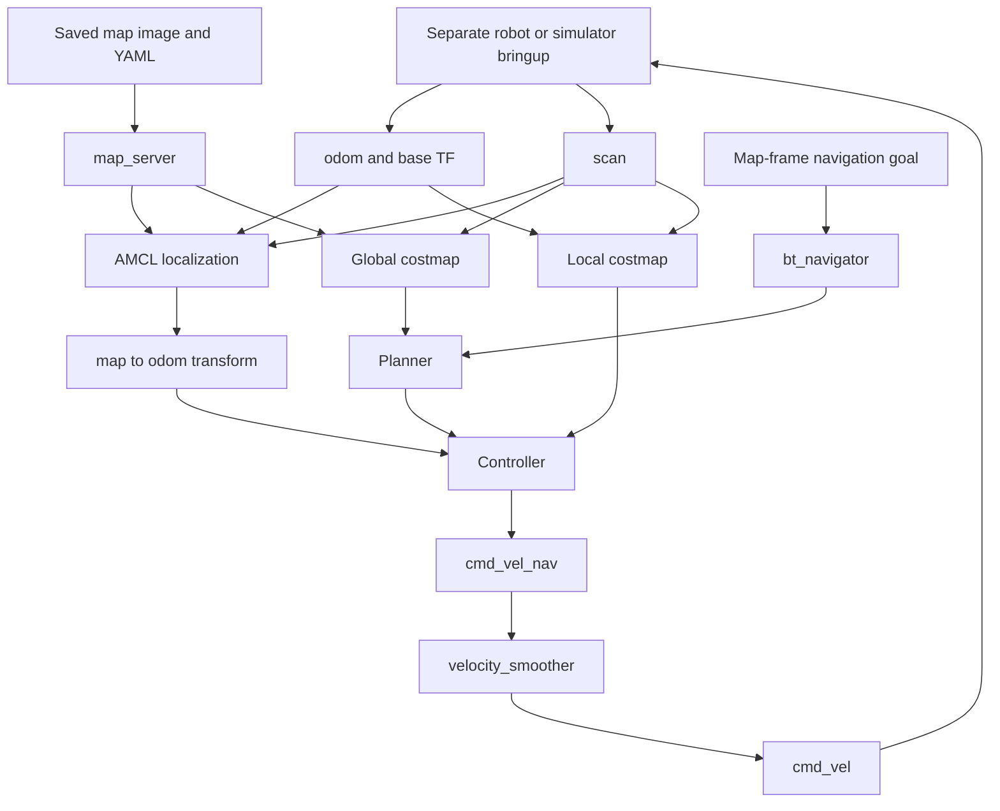
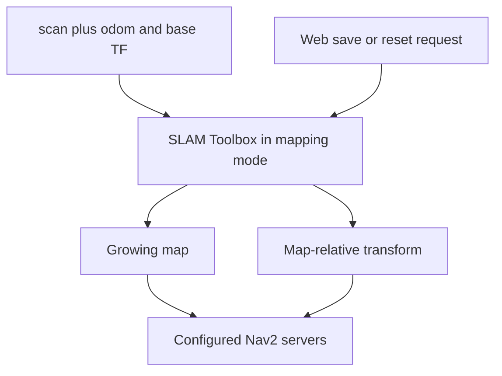

# Navigation and SLAM: from a map goal to velocity commands

## 1. Purpose

This page explains how configured localization, planning and control connect to the already documented robot base. It also separates navigation on a saved map from creating a new map. All diagrams describe source configuration and intended contracts; no live robot graph was observed.

## 2. Complete data flow

**Evidence boundary:** Launch files create map server/AMCL, Nav2 servers and velocity remaps. YAML configures frames, sensor inputs, plugins and costmaps. The functional arrows inside external Nav2 are a learning interpretation of those component contracts, not a trace of external implementation or an executed behavior tree. **[Code verified / Inference]** [pinky_navigation/launch/localization_launch.xml:17–39](https://github.com/seljb/pinky_pro/blob/014a09f289e6988894fbffde2624fdb1e257815b/pinky_navigation/launch/localization_launch.xml#L17-L39); [pinky_navigation/launch/navigation_launch.xml:21–93](https://github.com/seljb/pinky_pro/blob/014a09f289e6988894fbffde2624fdb1e257815b/pinky_navigation/launch/navigation_launch.xml#L21-L93); [pinky_navigation/params/nav2_params.yaml:1–56](https://github.com/seljb/pinky_pro/blob/014a09f289e6988894fbffde2624fdb1e257815b/pinky_navigation/params/nav2_params.yaml#L1-L56); [pinky_navigation/params/nav2_params.yaml:173–250](https://github.com/seljb/pinky_pro/blob/014a09f289e6988894fbffde2624fdb1e257815b/pinky_navigation/params/nav2_params.yaml#L173-L250)

Odometry tracks local movement, while localization relates that movement to a map. The configured frame names express the intended chain `map → odom → base_footprint → base_link`; the web bridge directly requests `map → base_link`, allowing TF to resolve intermediate links when they exist. Actual transform availability and timing remain unverified. **[Inference from configuration]** [pinky_navigation/params/nav2_params.yaml:8–22](https://github.com/seljb/pinky_pro/blob/014a09f289e6988894fbffde2624fdb1e257815b/pinky_navigation/params/nav2_params.yaml#L8-L22); [pinky_navigation/params/mapper_params.yaml:13–16](https://github.com/seljb/pinky_pro/blob/014a09f289e6988894fbffde2624fdb1e257815b/pinky_navigation/params/mapper_params.yaml#L13-L16); [pinky_navigation/scripts/nav2_web_server.py:217–237](https://github.com/seljb/pinky_pro/blob/014a09f289e6988894fbffde2624fdb1e257815b/pinky_navigation/scripts/nav2_web_server.py#L217-L237); [base state analysis](../05_Code_Analysis/pinky_bringup--state-publishing.md).

### A worked goal, without running the robot

For a browser request `x=1.0, y=0.5, yaw=0`, the web bridge constructs a `NavigateToPose.Goal` in `map`, sets position `(1.0, 0.5)` and quaternion `(z=0, w=1)`, and submits it asynchronously. No wheel command is embedded in that request. **[Code verified]** [pinky_navigation/scripts/nav2_web_server.py:325–346](https://github.com/seljb/pinky_pro/blob/014a09f289e6988894fbffde2624fdb1e257815b/pinky_navigation/scripts/nav2_web_server.py#L325-L346)

The configured navigator/planner/controller pipeline is intended to turn that goal into route-following velocities. The controller's `cmd_vel` is remapped to `cmd_vel_nav`; the velocity smoother consumes that name and exposes `cmd_vel_smoothed` as `cmd_vel`. The robot base then converts the velocity command into wheel commands. **[Code verified / intended flow]** [pinky_navigation/launch/navigation_launch.xml:21–30](https://github.com/seljb/pinky_pro/blob/014a09f289e6988894fbffde2624fdb1e257815b/pinky_navigation/launch/navigation_launch.xml#L21-L30); [pinky_navigation/launch/navigation_launch.xml:78–87](https://github.com/seljb/pinky_pro/blob/014a09f289e6988894fbffde2624fdb1e257815b/pinky_navigation/launch/navigation_launch.xml#L78-L87); [motor control](../05_Code_Analysis/pinky_bringup--motor-control.md).

The web function returns `True` when the server was available and a request was issued, before goal acceptance or final result is checked. Therefore “request sent” and “goal reached” are different observations. **[Code verified]** [pinky_navigation/scripts/nav2_web_server.py:326–346](https://github.com/seljb/pinky_pro/blob/014a09f289e6988894fbffde2624fdb1e257815b/pinky_navigation/scripts/nav2_web_server.py#L326-L346)

### Mapping is a different localization path

`web_slam` and `gz_web_slam` include `navigation_launch.xml` plus `map_building.launch.xml`, not `localization_launch.xml`. The latter includes external `slam_toolbox/online_sync_launch.py` and passes the mapper file. That file selects `mode: mapping`, `map`, `odom`, `base_footprint` and `/scan`. **[Code verified]** [pinky_navigation/launch/web_slam.launch.xml:15–23](https://github.com/seljb/pinky_pro/blob/014a09f289e6988894fbffde2624fdb1e257815b/pinky_navigation/launch/web_slam.launch.xml#L15-L23); [pinky_navigation/launch/gz_web_slam.launch.xml:15–23](https://github.com/seljb/pinky_pro/blob/014a09f289e6988894fbffde2624fdb1e257815b/pinky_navigation/launch/gz_web_slam.launch.xml#L15-L23); [pinky_navigation/launch/map_building.launch.xml:3–8](https://github.com/seljb/pinky_pro/blob/014a09f289e6988894fbffde2624fdb1e257815b/pinky_navigation/launch/map_building.launch.xml#L3-L8); [pinky_navigation/params/mapper_params.yaml:13–17](https://github.com/seljb/pinky_pro/blob/014a09f289e6988894fbffde2624fdb1e257815b/pinky_navigation/params/mapper_params.yaml#L13-L17)

The mapper's output replaces the saved-map/AMCL role in this intended architecture. Starting both localization providers together is not implied by the SLAM wrapper. **[Inference from launch graph]** Sources above; external SLAM behavior was not executed.

## 3. ROS 2 components

| Component | Data / interface in this repository | Learning role | Evidence |
|---|---|---|---|
| Map server / AMCL | Map filename override; scan and frames in YAML | Relate a saved map to the moving base | [pinky_navigation/launch/localization_launch.xml:18–32](https://github.com/seljb/pinky_pro/blob/014a09f289e6988894fbffde2624fdb1e257815b/pinky_navigation/launch/localization_launch.xml#L18-L32); [pinky_navigation/params/nav2_params.yaml:8–41](https://github.com/seljb/pinky_pro/blob/014a09f289e6988894fbffde2624fdb1e257815b/pinky_navigation/params/nav2_params.yaml#L8-L41) |
| Global costmap / planner | Static, obstacle and inflation layers; Navfn plugin | Plan a route through configured map costs | [pinky_navigation/params/nav2_params.yaml:216–250](https://github.com/seljb/pinky_pro/blob/014a09f289e6988894fbffde2624fdb1e257815b/pinky_navigation/params/nav2_params.yaml#L216-L250); [pinky_navigation/params/nav2_params.yaml:266–275](https://github.com/seljb/pinky_pro/blob/014a09f289e6988894fbffde2624fdb1e257815b/pinky_navigation/params/nav2_params.yaml#L266-L275) |
| Local costmap / controller | Rolling odom-frame window; RPP plugin | Follow the route using nearby observations | [pinky_navigation/params/nav2_params.yaml:78–125](https://github.com/seljb/pinky_pro/blob/014a09f289e6988894fbffde2624fdb1e257815b/pinky_navigation/params/nav2_params.yaml#L78-L125); [pinky_navigation/params/nav2_params.yaml:173–214](https://github.com/seljb/pinky_pro/blob/014a09f289e6988894fbffde2624fdb1e257815b/pinky_navigation/params/nav2_params.yaml#L173-L214) |
| Path smoother | `nav2_smoother::SimpleSmoother` | Smooth a path when requested by external navigation logic | [pinky_navigation/params/nav2_params.yaml:277–284](https://github.com/seljb/pinky_pro/blob/014a09f289e6988894fbffde2624fdb1e257815b/pinky_navigation/params/nav2_params.yaml#L277-L284) |
| Velocity smoother | OPEN_LOOP parameters; remapped velocity topics | Filter/limit command stream | [pinky_navigation/params/nav2_params.yaml:325–338](https://github.com/seljb/pinky_pro/blob/014a09f289e6988894fbffde2624fdb1e257815b/pinky_navigation/params/nav2_params.yaml#L325-L338); [pinky_navigation/launch/navigation_launch.xml:78–87](https://github.com/seljb/pinky_pro/blob/014a09f289e6988894fbffde2624fdb1e257815b/pinky_navigation/launch/navigation_launch.xml#L78-L87) |
| Lifecycle managers | `node_names` and `autostart` parameters | Request lifecycle transitions for named nodes | [pinky_navigation/launch/localization_launch.xml:35–39](https://github.com/seljb/pinky_pro/blob/014a09f289e6988894fbffde2624fdb1e257815b/pinky_navigation/launch/localization_launch.xml#L35-L39); [pinky_navigation/launch/navigation_launch.xml:89–93](https://github.com/seljb/pinky_pro/blob/014a09f289e6988894fbffde2624fdb1e257815b/pinky_navigation/launch/navigation_launch.xml#L89-L93) |
| Web bridge | TF, map/path/costmaps; goal and service requests | Browser observation and high-level control | [pinky_navigation/scripts/nav2_web_server.py:81–175](https://github.com/seljb/pinky_pro/blob/014a09f289e6988894fbffde2624fdb1e257815b/pinky_navigation/scripts/nav2_web_server.py#L81-L175) |

The table explains roles; a configured plugin does not prove that the installed external package accepts every option or that the default behavior tree invokes every server.

## 4. Execution and connection relationships

| Entry file | Includes / creates | Defaults and notable boundary | Source |
|---|---|---|---|
| `bringup_launch.xml` | Container, localization and navigation | Local YAML; `use_sim_time=False`; empty map argument; composition true | [pinky_navigation/launch/bringup_launch.xml:5–52](https://github.com/seljb/pinky_pro/blob/014a09f289e6988894fbffde2624fdb1e257815b/pinky_navigation/launch/bringup_launch.xml#L5-L52) |
| `gz_bringup_launch.xml` | Same navigation graph | Local YAML; simulated time true; bundled `my_map.yaml` | [pinky_navigation/launch/gz_bringup_launch.xml:5–52](https://github.com/seljb/pinky_pro/blob/014a09f289e6988894fbffde2624fdb1e257815b/pinky_navigation/launch/gz_bringup_launch.xml#L5-L52) |
| `navigation_launch.xml` alone | Navigation servers and manager | Defaults to **external** `nav2_bringup/params/nav2_params.yaml`; composition false | [pinky_navigation/launch/navigation_launch.xml:5–19](https://github.com/seljb/pinky_pro/blob/014a09f289e6988894fbffde2624fdb1e257815b/pinky_navigation/launch/navigation_launch.xml#L5-L19) |
| `localization_launch.xml` alone | Map server, AMCL and manager | Local YAML and bundled map; composition false | [pinky_navigation/launch/localization_launch.xml:5–15](https://github.com/seljb/pinky_pro/blob/014a09f289e6988894fbffde2624fdb1e257815b/pinky_navigation/launch/localization_launch.xml#L5-L15) |
| `web_nav2`, `gz_web_nav2` | Web node plus corresponding bringup launch | Sim-time argument forwarded to Nav2, omitted on web node | [pinky_navigation/launch/web_nav2.launch.xml:3–18](https://github.com/seljb/pinky_pro/blob/014a09f289e6988894fbffde2624fdb1e257815b/pinky_navigation/launch/web_nav2.launch.xml#L3-L18); [pinky_navigation/launch/gz_web_nav2.launch.xml:3–18](https://github.com/seljb/pinky_pro/blob/014a09f289e6988894fbffde2624fdb1e257815b/pinky_navigation/launch/gz_web_nav2.launch.xml#L3-L18) |
| `web_slam`, `gz_web_slam` | Web node, navigation and mapping launch | Local YAML explicitly passed; sim time also passed to web node | [pinky_navigation/launch/web_slam.launch.xml:3–23](https://github.com/seljb/pinky_pro/blob/014a09f289e6988894fbffde2624fdb1e257815b/pinky_navigation/launch/web_slam.launch.xml#L3-L23); [pinky_navigation/launch/gz_web_slam.launch.xml:3–23](https://github.com/seljb/pinky_pro/blob/014a09f289e6988894fbffde2624fdb1e257815b/pinky_navigation/launch/gz_web_slam.launch.xml#L3-L23) |
| RViz view launches | RViz only | Display configuration, not bringup/navigation startup | [pinky_navigation/launch/nav2_view.launch.xml:4–7](https://github.com/seljb/pinky_pro/blob/014a09f289e6988894fbffde2624fdb1e257815b/pinky_navigation/launch/nav2_view.launch.xml#L4-L7); [pinky_navigation/launch/gz_nav2_view.launch.xml:4–9](https://github.com/seljb/pinky_pro/blob/014a09f289e6988894fbffde2624fdb1e257815b/pinky_navigation/launch/gz_nav2_view.launch.xml#L4-L9) |

A `gz_` filename does not start Gazebo. These wrappers set navigation/display defaults for simulated data. The separate [bringup pipeline](pinky-bringup-pipeline.md) selects MuJoCo or Gazebo. **[Code verified]** [pinky_navigation/launch/gz_bringup_launch.xml:22–54](https://github.com/seljb/pinky_pro/blob/014a09f289e6988894fbffde2624fdb1e257815b/pinky_navigation/launch/gz_bringup_launch.xml#L22-L54); [pinky_bringup/launch/bringup_sim.launch.xml:14–46](https://github.com/seljb/pinky_pro/blob/014a09f289e6988894fbffde2624fdb1e257815b/pinky_bringup/launch/bringup_sim.launch.xml#L14-L46)

The launch source lists declarations and includes; it does not establish a successful startup order or readiness of map, TF, action servers and lifecycle nodes.

### Composition and lifecycle details

With composition true, the navigation/localization includes load components into the named container. Without composition they instantiate processes. The upper bringup creates a container unconditionally even if its `use_composition` argument is false. **[Code verified]** [pinky_navigation/launch/bringup_launch.xml:11–24](https://github.com/seljb/pinky_pro/blob/014a09f289e6988894fbffde2624fdb1e257815b/pinky_navigation/launch/bringup_launch.xml#L11-L24); [pinky_navigation/launch/localization_launch.xml:17–44](https://github.com/seljb/pinky_pro/blob/014a09f289e6988894fbffde2624fdb1e257815b/pinky_navigation/launch/localization_launch.xml#L17-L44); [pinky_navigation/launch/navigation_launch.xml:21–98](https://github.com/seljb/pinky_pro/blob/014a09f289e6988894fbffde2624fdb1e257815b/pinky_navigation/launch/navigation_launch.xml#L21-L98)

`navigation_launch.xml` defaults its lifecycle list to seven names, including `smoother_server`. Both upper bringup variants override the list with six names, omitting `smoother_server`, while still creating that server. The effect on an installed stack requires runtime inspection. **[Code verified / effect unverified]** [pinky_navigation/launch/navigation_launch.xml:13–19](https://github.com/seljb/pinky_pro/blob/014a09f289e6988894fbffde2624fdb1e257815b/pinky_navigation/launch/navigation_launch.xml#L13-L19); [pinky_navigation/launch/bringup_launch.xml:15–20](https://github.com/seljb/pinky_pro/blob/014a09f289e6988894fbffde2624fdb1e257815b/pinky_navigation/launch/bringup_launch.xml#L15-L20); [pinky_navigation/launch/bringup_launch.xml:45–52](https://github.com/seljb/pinky_pro/blob/014a09f289e6988894fbffde2624fdb1e257815b/pinky_navigation/launch/bringup_launch.xml#L45-L52); [pinky_navigation/launch/gz_bringup_launch.xml:15–20](https://github.com/seljb/pinky_pro/blob/014a09f289e6988894fbffde2624fdb1e257815b/pinky_navigation/launch/gz_bringup_launch.xml#L15-L20)

Several noncomposed node blocks supply `respawn`, `respawn_delay` and `log_level` as ROS parameters. Do not assume that passing them this way enables launch process respawn or log-level arguments. **[Code verified / behavior unverified]** [pinky_navigation/launch/navigation_launch.xml:98–103](https://github.com/seljb/pinky_pro/blob/014a09f289e6988894fbffde2624fdb1e257815b/pinky_navigation/launch/navigation_launch.xml#L98-L103); [pinky_navigation/launch/localization_launch.xml:44–50](https://github.com/seljb/pinky_pro/blob/014a09f289e6988894fbffde2624fdb1e257815b/pinky_navigation/launch/localization_launch.xml#L44-L50)

## 5. Main parameters

Use [navigation parameters](../03_Parameters/navigation-parameters.md) as the canonical values page. Begin by identifying the selected `params_file`, map, clock and frames; only then interpret controller speed, footprint or goal tolerances.

The configured local/global costmaps use `/scan`, while the web bridge uses mostly relative names and absolute SLAM service names. The top-level namespace argument therefore does not prove complete multi-robot isolation. **[Code verified / implication inferred]** [pinky_navigation/params/nav2_params.yaml:202–210](https://github.com/seljb/pinky_pro/blob/014a09f289e6988894fbffde2624fdb1e257815b/pinky_navigation/params/nav2_params.yaml#L202-L210); [pinky_navigation/params/nav2_params.yaml:234–242](https://github.com/seljb/pinky_pro/blob/014a09f289e6988894fbffde2624fdb1e257815b/pinky_navigation/params/nav2_params.yaml#L234-L242); [pinky_navigation/scripts/nav2_web_server.py:88–175](https://github.com/seljb/pinky_pro/blob/014a09f289e6988894fbffde2624fdb1e257815b/pinky_navigation/scripts/nav2_web_server.py#L88-L175)

## 6. Related documents

- [Navigation package](../02_Packages/pinky_navigation.md)
- [Navigation parameter catalog](../03_Parameters/navigation-parameters.md)
- [Web bridge walkthrough](../05_Code_Analysis/navigation-web-control.md)
- [Base odometry and TF](../05_Code_Analysis/pinky_bringup--state-publishing.md)
- [Base motor conversion](../05_Code_Analysis/pinky_bringup--motor-control.md)

## 7. Verification and open questions

**[Code verified]** Tracked launch inclusions, remaps, source parameter values and web request construction at the recorded SHA. **[Inference]** The functional arrows summarize intended navigation roles. **[Unverified]** External algorithm behavior, plugin support, lifecycle states, clock agreement, namespace resolution, QoS, TF completeness, actual map/goal success and physical stopping.

### Check yourself

1. Why can a map appear in the browser while no robot pose appears? **Answer:** The map callback and TF lookup are separate. The bridge can cache a map before `map → base_link` is available.
2. Which component transforms `cmd_vel_nav` into final `cmd_vel` in the configured normal control path? **Answer:** `velocity_smoother`; it is distinct from the path `smoother_server`.
3. Which source detail must be checked before interpreting the local YAML values? **Answer:** The entry launch and forwarded `params_file`; the standalone navigation launch selects an external default.

> 작업 메모: 다이어그램의 외부 Nav2 내부 흐름은 설정에서 해석한 학습용 구조다. 실행 결과나 실제 행동 트리 추적 결과로 기록하지 않았다.
