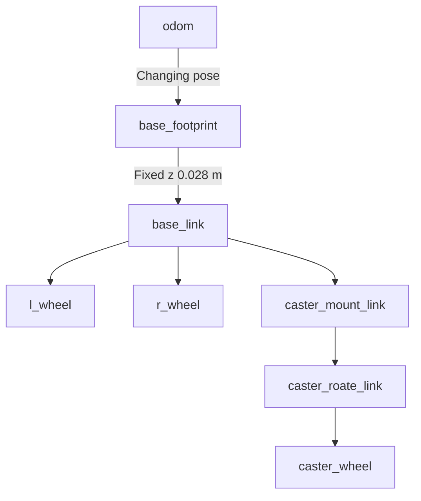
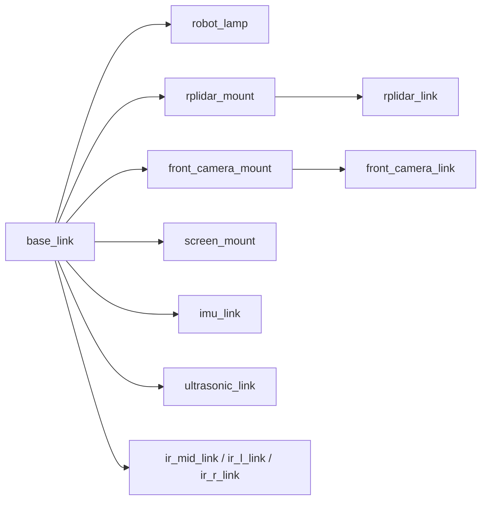
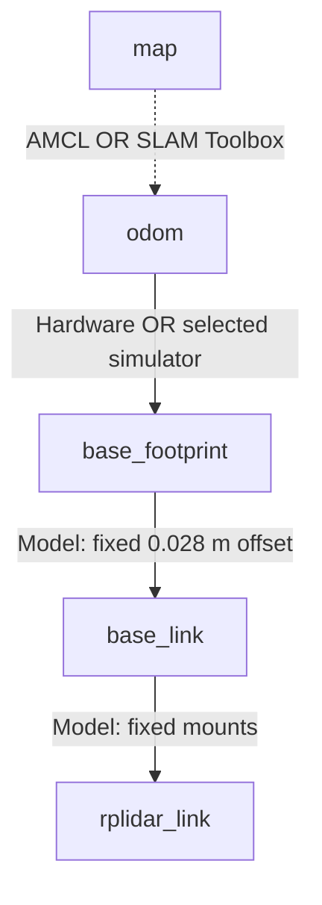

# Robot description and TF — geometry versus pose

## 1. Purpose

**Learning goal:** follow a sensor observation from its own frame into the robot frame and distinguish fixed model geometry from a changing robot pose. TF is the system's coordinate relationship graph. A frame's name identifies the coordinates used to interpret a position or orientation; a transform specifies how those coordinates relate to another frame. This paragraph is conceptual background; the concrete Pinky relationships below come from source.

The common model anchors `base_link` 0.028 m above `base_footprint`. Wheel and sensor joints are then attached beneath `base_link`. The MuJoCo bridge separately broadcasts the changing `odom → base_footprint` transform. Model geometry and odometry therefore have different owners. [Code-confirmed] [pinky_description/urdf/pinky.urdf.xacro:6-31](https://github.com/seljb/pinky_pro/blob/014a09f289e6988894fbffde2624fdb1e257815b/pinky_description/urdf/pinky.urdf.xacro#L6-L31), [pinky_mujoco/pinky_mujoco/bridge.py:188-205](https://github.com/seljb/pinky_pro/blob/014a09f289e6988894fbffde2624fdb1e257815b/pinky_mujoco/pinky_mujoco/bridge.py#L188-L205)

## 2. Overall data flow

Sensor and display branches attach to the same `base_link`:

Together, these diagrams show the source-defined robot tree with an odometry edge added from the bridge. `caster_roate_link` is the exact source spelling. It is not a corrected alias. Wheel/caster continuous joints change their angle; sensor mounts are fixed. Evidence: [pinky_description/urdf/pinky.urdf.xacro:54-143](https://github.com/seljb/pinky_pro/blob/014a09f289e6988894fbffde2624fdb1e257815b/pinky_description/urdf/pinky.urdf.xacro#L54-L143), [pinky_description/urdf/pinky.urdf.xacro:165-295](https://github.com/seljb/pinky_pro/blob/014a09f289e6988894fbffde2624fdb1e257815b/pinky_description/urdf/pinky.urdf.xacro#L165-L295).

A map frame is intentionally absent from this **model-and-odometry** diagram. The navigation configuration's global localization or mapping component is a separate layer; see [Navigation pipeline](navigation-pipeline.md).

### Add the navigation layer: who owns each edge?

The complete **intended** empty-namespace chain can be read as follows. Dashed edges identify the external localization layer; the remaining edges are emitted by the configured base/state publisher components. This is an ownership model assembled from the checked configuration, not a captured TF tree.

| Relationship | Owner selected by this code/configuration | Evidence status |
|---|---|---|
| `map` → `odom` | AMCL in localization mode, or SLAM Toolbox in mapping mode | **[Code confirmed]** Frame names and broadcast configuration; **[Inference]** expected external publisher behavior |
| `odom` → `base_footprint` | Hardware `Pinky._publish_tf`, MuJoCo `Bridge.publish_state`, or Gazebo DiffDrive via ROS/GZ bridge | **[Code confirmed]** Transform construction or plugin/bridge configuration |
| `base_footprint` → `base_link` and sensor mounts | Common Xacro passed to `robot_state_publisher` | **[Code confirmed]** Model and launch configuration; external publisher implementation is outside this repository |
| `base_link` → wheel links | Model plus matching joint-state names/angles | **[Code confirmed]** Required model names; hardware naming mismatch remains a review point below |

The checked AMCL settings use `map`, `odom`, `base_footprint` and `tf_broadcast: true`; the SLAM settings use the same three frame IDs and a nonzero transform publication period. Hardware explicitly broadcasts the odometry edge independently of its `Odometry` topic. [AMCL configuration:8-39](https://github.com/seljb/pinky_pro/blob/014a09f289e6988894fbffde2624fdb1e257815b/pinky_navigation/params/nav2_params.yaml#L8-L39), [SLAM configuration:12-27](https://github.com/seljb/pinky_pro/blob/014a09f289e6988894fbffde2624fdb1e257815b/pinky_navigation/params/mapper_params.yaml#L12-L27), [Pinky._publish_tf and _publish_odometry:163-183](https://github.com/seljb/pinky_pro/blob/014a09f289e6988894fbffde2624fdb1e257815b/pinky_bringup/pinky_bringup/bringup.py#L163-L183)

**Read the chain from the consumer's question.** The web bridge asks for the pose of `base_link` in `map` with `lookup_transform("map", "base_link", Time())`. Its request can be answered by composing the chain; a direct `map` → `base_link` broadcaster is not required. **[Inference]** Having `/odom` messages alone does not satisfy that TF lookup: the transform edges and usable times must also exist. **[Code confirmed]** The callback catches lookup exceptions without updating the cached pose. [Nav2WebBridge.update_pose_from_tf:218-237](https://github.com/seljb/pinky_pro/blob/014a09f289e6988894fbffde2624fdb1e257815b/pinky_navigation/scripts/nav2_web_server.py#L218-L237)

### Worked coordinate example

With zero camera pitch, the camera frame origin lies at `(0.020 + 0.015, 0, 0.0495 − 0.0121) = (0.035, 0, 0.0374)` metres relative to `base_link`. Adding the base fixed offset gives z = 0.0654 m relative to `base_footprint`. With nonzero pitch, rotate the camera-link offset by the mount pitch before adding it; simply adding xyz values would be wrong. This arithmetic is an inference from the two fixed-joint origins, not a measured calibration. [pinky_description/urdf/pinky.urdf.xacro:224-235](https://github.com/seljb/pinky_pro/blob/014a09f289e6988894fbffde2624fdb1e257815b/pinky_description/urdf/pinky.urdf.xacro#L224-L235), [pinky_description/urdf/pinky.urdf.xacro:27-31](https://github.com/seljb/pinky_pro/blob/014a09f289e6988894fbffde2624fdb1e257815b/pinky_description/urdf/pinky.urdf.xacro#L27-L31)

For lidar, mount origin is `(-0.017, 0, 0.067)` in `base_link`; `rplidar_link` adds `(0, 0, 0.030)` and yaw π. Its origin is therefore z = 0.097 m above `base_link`, while its horizontal axes are rotated 180°. The rotation matters when interpreting scan angles. [Code-confirmed values; inferred composition] [pinky_description/urdf/pinky.urdf.xacro:191-202](https://github.com/seljb/pinky_pro/blob/014a09f289e6988894fbffde2624fdb1e257815b/pinky_description/urdf/pinky.urdf.xacro#L191-L202)

## 3. ROS 2 components

| Owner | Input / output | Role | Evidence |
|---|---|---|---|
| Description upload | Expanded Xacro → `robot_description` parameter | Supplies model and `frame_prefix` to robot state publisher | [pinky_description/launch/upload_robot.launch.py:22-43](https://github.com/seljb/pinky_pro/blob/014a09f289e6988894fbffde2624fdb1e257815b/pinky_description/launch/upload_robot.launch.py#L22-L43) |
| Joint state source | Joint names + angles | Supplies moving wheel/caster state; MuJoCo publishes four joints | [pinky_mujoco/pinky_mujoco/bridge.py:146-148](https://github.com/seljb/pinky_pro/blob/014a09f289e6988894fbffde2624fdb1e257815b/pinky_mujoco/pinky_mujoco/bridge.py#L146-L148), [pinky_mujoco/pinky_mujoco/bridge.py:206-211](https://github.com/seljb/pinky_pro/blob/014a09f289e6988894fbffde2624fdb1e257815b/pinky_mujoco/pinky_mujoco/bridge.py#L206-L211) |
| MuJoCo bridge | `/odom`, `/tf` | Publishes encoder odometry and matching planar transform | [pinky_mujoco/pinky_mujoco/bridge.py:188-205](https://github.com/seljb/pinky_pro/blob/014a09f289e6988894fbffde2624fdb1e257815b/pinky_mujoco/pinky_mujoco/bridge.py#L188-L205) |
| Gazebo DiffDrive | `odom`, `/tf` in Gazebo transport | Declares odom and base frame IDs; ROS bridge converts outputs | [pinky_description/urdf/pinky_gz.urdf.xacro:18-24](https://github.com/seljb/pinky_pro/blob/014a09f289e6988894fbffde2624fdb1e257815b/pinky_description/urdf/pinky_gz.urdf.xacro#L18-L24), [pinky_gz_sim/params/pinky_bridge.yaml:7-11](https://github.com/seljb/pinky_pro/blob/014a09f289e6988894fbffde2624fdb1e257815b/pinky_gz_sim/params/pinky_bridge.yaml#L7-L11), [pinky_gz_sim/params/pinky_bridge.yaml:37-41](https://github.com/seljb/pinky_pro/blob/014a09f289e6988894fbffde2624fdb1e257815b/pinky_gz_sim/params/pinky_bridge.yaml#L37-L41) |

Robot-state-publisher behavior is external to this repository. The table documents how this repository configures it, not an observed ROS graph.

### Important sensor origins

All xyz values below are source metres and relative to the indicated parent. They do not certify the physical build.

| Child frame | Parent | xyz | Rotation / note |
|---|---|---|---|
| `base_link` | `base_footprint` | `0 0 0.028` | fixed |
| `rplidar_mount` | `base_link` | `-0.017 0 0.067` | fixed |
| `rplidar_link` | `rplidar_mount` | `0 0 0.030` | yaw π |
| `front_camera_mount` | `base_link` | `0.020 0 0.0495` | pitch from `cam_tilt_deg` |
| `front_camera_link` | `front_camera_mount` | `0.015 0 -0.0121` | fixed |
| `imu_link` | `base_link` | `-0.044 0 0.0525` | fixed |
| `ultrasonic_link` | `base_link` | `0.0267 0 0.009` | fixed |
| `ir_mid_link` | `base_link` | `0.0295 0 -0.015` | fixed |
| `ir_l_link` / `ir_r_link` | `base_link` | `0.0295 ±0.02 -0.015` | fixed |

Evidence: [pinky_description/urdf/pinky.urdf.xacro:27-31](https://github.com/seljb/pinky_pro/blob/014a09f289e6988894fbffde2624fdb1e257815b/pinky_description/urdf/pinky.urdf.xacro#L27-L31), [pinky_description/urdf/pinky.urdf.xacro:191-235](https://github.com/seljb/pinky_pro/blob/014a09f289e6988894fbffde2624fdb1e257815b/pinky_description/urdf/pinky.urdf.xacro#L191-L235), [pinky_description/urdf/pinky.urdf.xacro:263-295](https://github.com/seljb/pinky_pro/blob/014a09f289e6988894fbffde2624fdb1e257815b/pinky_description/urdf/pinky.urdf.xacro#L263-L295).

## 4. Execution and connections

For upload, the launch constructs Xacro with namespace, simulation flag and camera tilt, then creates the two state publishers. These are launch actions, not a readiness-ordered sequence. `use_sim_time` is taken from `is_sim` in this launch. The standalone view launch expands Xacro without the upload overrides and uses the joint GUI. [pinky_description/launch/upload_robot.launch.py:14-65](https://github.com/seljb/pinky_pro/blob/014a09f289e6988894fbffde2624fdb1e257815b/pinky_description/launch/upload_robot.launch.py#L14-L65), [pinky_description/launch/view_robot.launch.py:26-53](https://github.com/seljb/pinky_pro/blob/014a09f289e6988894fbffde2624fdb1e257815b/pinky_description/launch/view_robot.launch.py#L26-L53)

MuJoCo uses the common description with `is_sim=false` to omit Gazebo plugins, yet its ROS nodes have `use_sim_time=true`. Here `is_sim` means **include Gazebo extensions**, not **all simulation**. [pinky_mujoco/pinky_mujoco/description.py:6-12](https://github.com/seljb/pinky_pro/blob/014a09f289e6988894fbffde2624fdb1e257815b/pinky_mujoco/pinky_mujoco/description.py#L6-L12), [pinky_mujoco/launch/launch_sim.launch.py:72-79](https://github.com/seljb/pinky_pro/blob/014a09f289e6988894fbffde2624fdb1e257815b/pinky_mujoco/launch/launch_sim.launch.py#L72-L79)

### Clock argument review point

The hardware parent launch forwards an argument named `use_sim_time` to `upload_robot.launch.py`. The child instead declares `is_sim` and uses that name for both publishers' `use_sim_time` parameters. **[Code confirmed]** The forwarded and consumed argument names differ; the source does not express a direct connection from the parent's `use_sim_time` override to these child parameters. **[Unverified]** How the installed launch framework handles that extra include argument, and the resulting active clock settings, were not tested. This is a source review finding, not a measured launch failure. [Hardware include:4-10](https://github.com/seljb/pinky_pro/blob/014a09f289e6988894fbffde2624fdb1e257815b/pinky_bringup/launch/bringup_robot.launch.xml#L4-L10), [Child arguments and robot-state-publisher parameters:14-42](https://github.com/seljb/pinky_pro/blob/014a09f289e6988894fbffde2624fdb1e257815b/pinky_description/launch/upload_robot.launch.py#L14-L42), [Joint-state-publisher parameters:45-54](https://github.com/seljb/pinky_pro/blob/014a09f289e6988894fbffde2624fdb1e257815b/pinky_description/launch/upload_robot.launch.py#L45-L54)

## 5. Major parameters

See [Description package](../02_Packages/pinky_description.md#7-related-code-and-parameters) for entry-point defaults and [Simulation pipeline](simulation-pipeline.md#5-major-parameters) for simulator selection. Do not assume a namespace in a topic automatically changes message frame IDs or model link names: those strings are set separately in code.

## 6. Related documents

- [Description package](../02_Packages/pinky_description.md)
- [MuJoCo package](../02_Packages/pinky_mujoco.md)
- [Gazebo package](../02_Packages/pinky_gz_sim.md)
- [Bringup state publishing](../05_Code_Analysis/pinky_bringup--state-publishing.md)
- [Navigation pipeline](navigation-pipeline.md)

## 7. Verification and open questions

**Code-confirmed [코드 확인]:** names, source offsets, fixed/continuous types and transform construction. **Inference [추론]:** coordinate sums and likely consequences of name mismatches. **Unverified [미검증]:** actual TF tree, message timestamps, frame-prefix behavior and physical calibration. No ROS execution occurred.

Two review points deserve particular attention. Hardware joint names are `left_wheel_joint` / `right_wheel_joint`, while the empty-namespace model expects `l_wheel_joint` / `r_wheel_joint`. Also, MuJoCo's physical model is built from `base_link`, while ROS publishes a planar odometry edge to `base_footprint`; the ROS fixed offset still comes from the common model. [pinky_bringup/pinky_bringup/bringup.py:21-28](https://github.com/seljb/pinky_pro/blob/014a09f289e6988894fbffde2624fdb1e257815b/pinky_bringup/pinky_bringup/bringup.py#L21-L28), [pinky_description/urdf/pinky.urdf.xacro:54-63](https://github.com/seljb/pinky_pro/blob/014a09f289e6988894fbffde2624fdb1e257815b/pinky_description/urdf/pinky.urdf.xacro#L54-L63), [pinky_mujoco/pinky_mujoco/model.py:131-170](https://github.com/seljb/pinky_pro/blob/014a09f289e6988894fbffde2624fdb1e257815b/pinky_mujoco/pinky_mujoco/model.py#L131-L170), [pinky_mujoco/pinky_mujoco/bridge.py:188-205](https://github.com/seljb/pinky_pro/blob/014a09f289e6988894fbffde2624fdb1e257815b/pinky_mujoco/pinky_mujoco/bridge.py#L188-L205)

**Check yourself:** If the robot drives forward but its laser measurements rotate about the wrong point, which information should you inspect first? **Answer:** the sensor frame ID, fixed-joint origin/rotation, and timestamped TF chain. Changing a map parameter cannot repair incorrect sensor geometry. This is a diagnostic inference, not an observed fault.

> 작업 메모: 2026-11-19에 map→odom 소유권과 웹 TF 조회 연결, launch 시간 인자 불일치를 코드로 재확인했다. TF 도식은 소스의 이름을 그대로 유지했다. 실제 TF 출력은 수집하지 않았으며, 물리 모델의 위치와 ROS 프레임 기준을 동일하다고 가정하지 않았다.
