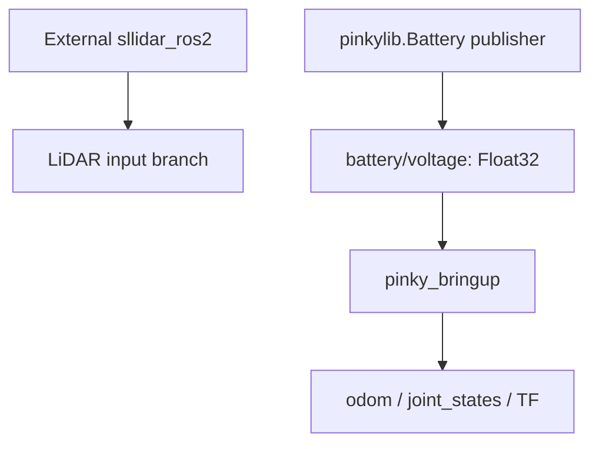
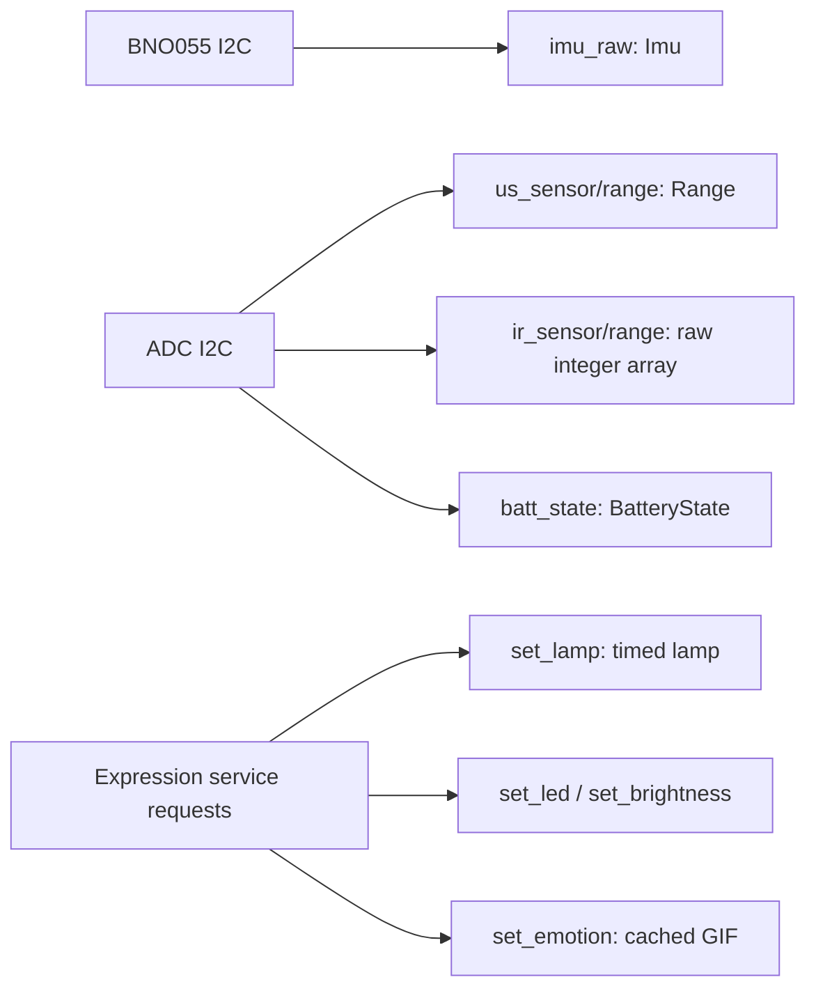

# Sensors and expression — optional branches around the drive system

## 1. Purpose

Understand which modules sense the world, which communicate robot state, and which display an expression. These branches are useful learning units, but they are not all started by the supplied real-robot bringup. The tracked launch includes robot description, external LiDAR, wheel bringup and `battery_publisher`; it has no IMU, ADC, lamp, LED or emotion node entry. **[Code confirmed]** [pinky_bringup/launch/bringup_robot.launch.xml:3-29](https://github.com/seljb/pinky_pro/blob/014a09f289e6988894fbffde2624fdb1e257815b/pinky_bringup/launch/bringup_robot.launch.xml#L3-L29)

Think of sensor topics as streams of observations and expression services as requests to change output state. A shared interface name or a package's presence on disk does not establish a running connection.

## 2. Overall data flow

Started by the tracked real-robot launch:

Available as separate nodes, without entries in that launch:

The diagrams separate launch membership from available source implementations; it is not a captured ROS graph. LiDAR internals live in an external package, so this repository establishes the include and its arguments rather than the complete driver implementation. [pinky_bringup/launch/bringup_robot.launch.xml:3-29](https://github.com/seljb/pinky_pro/blob/014a09f289e6988894fbffde2624fdb1e257815b/pinky_bringup/launch/bringup_robot.launch.xml#L3-L29) [pinky_imu_bno055/src/main_node.cpp:13-63](https://github.com/seljb/pinky_pro/blob/014a09f289e6988894fbffde2624fdb1e257815b/pinky_imu_bno055/src/main_node.cpp#L13-L63) [pinky_sensor_adc/src/main_node.cpp:14-91](https://github.com/seljb/pinky_pro/blob/014a09f289e6988894fbffde2624fdb1e257815b/pinky_sensor_adc/src/main_node.cpp#L14-L91) [pinky_lamp_control/src/main_node.cpp:32-104](https://github.com/seljb/pinky_pro/blob/014a09f289e6988894fbffde2624fdb1e257815b/pinky_lamp_control/src/main_node.cpp#L32-L104) [pinky_led/pinky_led/led_server.py:8-79](https://github.com/seljb/pinky_pro/blob/014a09f289e6988894fbffde2624fdb1e257815b/pinky_led/pinky_led/led_server.py#L8-L79) [pinky_emotion/pinky_emotion/emotion_server.py:10-83](https://github.com/seljb/pinky_pro/blob/014a09f289e6988894fbffde2624fdb1e257815b/pinky_emotion/pinky_emotion/emotion_server.py#L10-L83)

### Two battery paths

The core battery publisher constructs `pinkylib.Battery` and publishes `battery/voltage` and `battery/percent` as `Float32` every 5 seconds. Wheel bringup subscribes to the voltage topic for its low-voltage logic. Separately, the ADC node calculates a voltage and publishes `batt_state` as `BatteryState`. No adapter between these two contracts is created by these files. [pinky_bringup/pinky_bringup/battery_publisher.py:6-36](https://github.com/seljb/pinky_pro/blob/014a09f289e6988894fbffde2624fdb1e257815b/pinky_bringup/pinky_bringup/battery_publisher.py#L6-L36) [pinky_bringup/pinky_bringup/bringup.py:84-95](https://github.com/seljb/pinky_pro/blob/014a09f289e6988894fbffde2624fdb1e257815b/pinky_bringup/pinky_bringup/bringup.py#L84-L95) [pinky_sensor_adc/src/main_node.cpp:14-91](https://github.com/seljb/pinky_pro/blob/014a09f289e6988894fbffde2624fdb1e257815b/pinky_sensor_adc/src/main_node.cpp#L14-L91)

Thus seeing `batt_state` does not prove the wheel node receives its expected `battery/voltage`. The names, message types and producers differ. This distinction is a direct source comparison, not a claim about which physical measurement is more accurate.

## 3. ROS2 components

| Node literal | Interface(s) | Role | Evidence |
|---|---|---|---|
| `pinky_imu_bno055` | Publish `imu_raw` | Reads BNO055 and fills orientation/gyro/acceleration | [pinky_imu_bno055/src/main_node.cpp:13-63](https://github.com/seljb/pinky_pro/blob/014a09f289e6988894fbffde2624fdb1e257815b/pinky_imu_bno055/src/main_node.cpp#L13-L63) |
| `pinky_sensor_adc` | Publish `us_sensor/range`, `ir_sensor/range`, `batt_state` | Converts selected ADC channels | [pinky_sensor_adc/src/main_node.cpp:14-91](https://github.com/seljb/pinky_pro/blob/014a09f289e6988894fbffde2624fdb1e257815b/pinky_sensor_adc/src/main_node.cpp#L14-L91) |
| `battery_publihser` | Publish `battery/voltage`, `battery/percent` | External `pinkylib.Battery` wrapper; spelling preserved from source | [pinky_bringup/pinky_bringup/battery_publisher.py:6-36](https://github.com/seljb/pinky_pro/blob/014a09f289e6988894fbffde2624fdb1e257815b/pinky_bringup/pinky_bringup/battery_publisher.py#L6-L36) |
| `pinky_lamp_control` | Serve `set_lamp` | Stores target and renders a timed all-lamp pattern | [pinky_lamp_control/src/main_node.cpp:32-104](https://github.com/seljb/pinky_pro/blob/014a09f289e6988894fbffde2624fdb1e257815b/pinky_lamp_control/src/main_node.cpp#L32-L104) |
| `led_service_server` | Serve `set_led`, `set_brightness` | Delegates pixel/color/brightness to `pinkylib.LED` | [pinky_led/pinky_led/led_server.py:8-79](https://github.com/seljb/pinky_pro/blob/014a09f289e6988894fbffde2624fdb1e257815b/pinky_led/pinky_led/led_server.py#L8-L79) |
| `pinky_emotion` via `emotion_server` | Serve `set_emotion` | Switches cached GIF frames for LCD playback | [pinky_emotion/pinky_emotion/emotion_server.py:10-83](https://github.com/seljb/pinky_pro/blob/014a09f289e6988894fbffde2624fdb1e257815b/pinky_emotion/pinky_emotion/emotion_server.py#L10-L83) |

All names above are source literals. Actual fully qualified names depend on launch namespaces and remaps, which were not observed at runtime.

## 4. Execution and connection relationships

1. **Core launch:** description upload receives a `use_sim_time` argument; the external LiDAR launch receives `/dev/ttyAMA0`, `rplidar_link`, `inverted=false`, `angle_compensate=true` and `DenseBoost`; then the source declares wheel bringup and battery nodes. Declaration order is not evidence of device-readiness synchronization. [pinky_bringup/launch/bringup_robot.launch.xml:3-29](https://github.com/seljb/pinky_pro/blob/014a09f289e6988894fbffde2624fdb1e257815b/pinky_bringup/launch/bringup_robot.launch.xml#L3-L29)
2. **Hardware sensor processes:** IMU and ADC each initialize an I2C device in their constructor before starting their wall timer. Their `main_node` targets are built only for `aarch64`. Their source code does not insert itself into the core launch. [pinky_imu_bno055/src/main_node.cpp:13-63](https://github.com/seljb/pinky_pro/blob/014a09f289e6988894fbffde2624fdb1e257815b/pinky_imu_bno055/src/main_node.cpp#L13-L63) [pinky_sensor_adc/src/main_node.cpp:14-91](https://github.com/seljb/pinky_pro/blob/014a09f289e6988894fbffde2624fdb1e257815b/pinky_sensor_adc/src/main_node.cpp#L14-L91) [pinky_imu_bno055/CMakeLists.txt:16-29](https://github.com/seljb/pinky_pro/blob/014a09f289e6988894fbffde2624fdb1e257815b/pinky_imu_bno055/CMakeLists.txt#L16-L29) [pinky_sensor_adc/CMakeLists.txt:15-28](https://github.com/seljb/pinky_pro/blob/014a09f289e6988894fbffde2624fdb1e257815b/pinky_sensor_adc/CMakeLists.txt#L15-L28)
3. **Expression processes:** the lamp server creates a 100 Hz wall timer; LED waits for service requests; `emotion_server` preloads GIFs, then creates a 0.1-second ROS timer. Their response semantics and timing differ. [pinky_lamp_control/src/main_node.cpp:32-104](https://github.com/seljb/pinky_pro/blob/014a09f289e6988894fbffde2624fdb1e257815b/pinky_lamp_control/src/main_node.cpp#L32-L104) [pinky_led/pinky_led/led_server.py:8-79](https://github.com/seljb/pinky_pro/blob/014a09f289e6988894fbffde2624fdb1e257815b/pinky_led/pinky_led/led_server.py#L8-L79) [pinky_emotion/pinky_emotion/emotion_server.py:10-83](https://github.com/seljb/pinky_pro/blob/014a09f289e6988894fbffde2624fdb1e257815b/pinky_emotion/pinky_emotion/emotion_server.py#L10-L83)
4. **Simulation:** the Gazebo lamp plugin animates green material locally and publishes a Gazebo material message to a fixed world path. That is not a ROS implementation of `set_lamp`. The checked MuJoCo bridge core declarations publish clock/state/scan and subscribe to velocity commands; do not infer hardware-service parity from the simulator's visual appearance. [pinky_gz_sim/plugins/gz_lamp_control_plugin.cpp:34-67](https://github.com/seljb/pinky_pro/blob/014a09f289e6988894fbffde2624fdb1e257815b/pinky_gz_sim/plugins/gz_lamp_control_plugin.cpp#L34-L67) [pinky_mujoco/pinky_mujoco/bridge.py:127-146](https://github.com/seljb/pinky_pro/blob/014a09f289e6988894fbffde2624fdb1e257815b/pinky_mujoco/pinky_mujoco/bridge.py#L127-L146)

The older `pinky_emotion` executable has a callback-name mismatch; study [the emotion page](../02_Packages/pinky_emotion.md) before selecting an entrypoint. [pinky_emotion/pinky_emotion/pinky_emotion.py:10-19](https://github.com/seljb/pinky_pro/blob/014a09f289e6988894fbffde2624fdb1e257815b/pinky_emotion/pinky_emotion/pinky_emotion.py#L10-L19)

## 5. Main parameters

| Module | Declared defaults / request controls | Learning consequence |
|---|---|---|
| IMU | `interface=/dev/i2c-0`, `frame_id=imu_link`, `rate=100.0` | Constructor-time settings; frame label alone does not rotate samples |
| ADC | `interface=/dev/i2c-1`, `rate=20.0` | Five explicit 6 ms waits per callback bound useful sampling rate |
| Lamp | Request `color`, `mode`, `time`; 100 Hz hardcoded timer | Request data and ROS parameters are different concepts |
| LED | Request `command`, `pixels`, RGB or `brightness` | External library limits are not encoded in this wrapper |
| Emotion server | `load_frame_skip=2`, `play_frame_skip=1`; 0.1 s timer | Loading stride affects cache size; playback stride changes frame selection |

Source defaults are not verified active values. Detailed conversions, units and limitations remain in the owning package pages: [IMU](../02_Packages/pinky_imu_bno055.md), [ADC](../02_Packages/pinky_sensor_adc.md), [lamp](../02_Packages/pinky_lamp_control.md), [LED](../02_Packages/pinky_led.md), [emotion](../02_Packages/pinky_emotion.md). Parameter declarations and timer code: [pinky_imu_bno055/src/main_node.cpp:13-63](https://github.com/seljb/pinky_pro/blob/014a09f289e6988894fbffde2624fdb1e257815b/pinky_imu_bno055/src/main_node.cpp#L13-L63) [pinky_sensor_adc/src/main_node.cpp:14-91](https://github.com/seljb/pinky_pro/blob/014a09f289e6988894fbffde2624fdb1e257815b/pinky_sensor_adc/src/main_node.cpp#L14-L91) [pinky_lamp_control/src/main_node.cpp:32-104](https://github.com/seljb/pinky_pro/blob/014a09f289e6988894fbffde2624fdb1e257815b/pinky_lamp_control/src/main_node.cpp#L32-L104) [pinky_led/pinky_led/led_server.py:8-79](https://github.com/seljb/pinky_pro/blob/014a09f289e6988894fbffde2624fdb1e257815b/pinky_led/pinky_led/led_server.py#L8-L79) [pinky_emotion/pinky_emotion/emotion_server.py:10-83](https://github.com/seljb/pinky_pro/blob/014a09f289e6988894fbffde2624fdb1e257815b/pinky_emotion/pinky_emotion/emotion_server.py#L10-L83)

## 6. Related documents

- [Interface atlas](../04_Features/ros2-interface-atlas.md)
- [Service schemas](../02_Packages/pinky_interfaces.md)
- [Bringup pipeline](pinky-bringup-pipeline.md)
- [Robot description and TF](robot-description-and-tf.md)
- [Simulation pipeline](simulation-pipeline.md)
- [Navigation pipeline](navigation-pipeline.md)

## 7. Verification and open questions

**[Code confirmed]** Launch membership, source interface declarations and parameter defaults were checked. **[Inference]** Optional sensor data could support future behaviors if an appropriate consumer, transforms and configuration are added; this Wiki does not imply those integrations currently exist. **[Unverified]** Hardware, external library behavior, sensor units/calibration, actual ROS graph and simulator equivalence were not tested.

**Check yourself.** Why might ultrasonic data appear while navigation ignores it? **Answer:** A publisher creates data; a compatible consumer/configuration is a separate connection, and no integration is established by the ADC driver itself. Can a simulated blinking lamp verify `SetLamp`? **Answer:** The checked Gazebo plugin runs its own animation without that service contract.

> 작업 메모: 소스의 선택적 주변장치 구현과 기본 bringup의 실제 포함 항목을 구분했다. 센서가 존재한다는 사실을 Nav2 사용 여부로 확대하지 않는다.

[Wiki index](../index.md)
