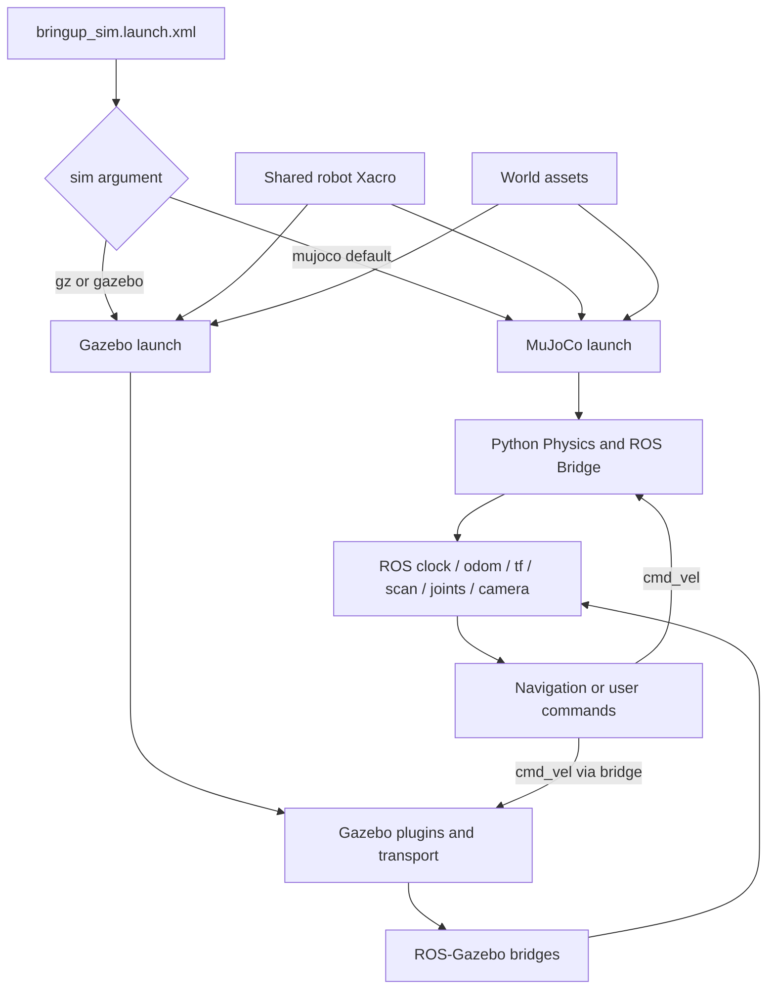
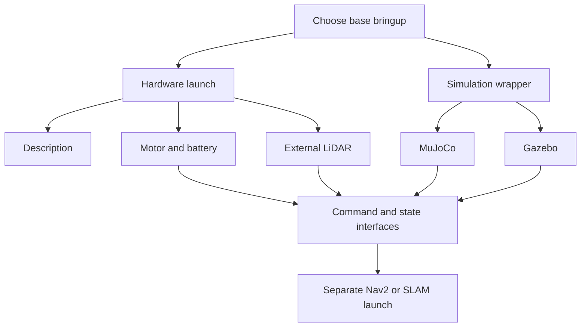

# Simulation pipeline — two engines, explicit ROS contracts

## 1. Purpose

**Learning goal:** explain what changes when selecting MuJoCo or Gazebo and identify the ROS messages navigation expects. The common bringup launch selects one simulator; its default is `mujoco`, while `gz` and `gazebo` select Gazebo. Other strings match neither condition, so the source contains no simulator include for them. [pinky_bringup/launch/bringup_sim.launch.xml:14-46](https://github.com/seljb/pinky_pro/blob/014a09f289e6988894fbffde2624fdb1e257815b/pinky_bringup/launch/bringup_sim.launch.xml#L14-L46)

The launch comment says the existing `gz_*` navigation launches work with either simulator. Treat that as the repository's intended contract. Actual compatibility, topic availability, QoS and timing remain untested in this Wiki session. [pinky_bringup/launch/bringup_sim.launch.xml:4-11](https://github.com/seljb/pinky_pro/blob/014a09f289e6988894fbffde2624fdb1e257815b/pinky_bringup/launch/bringup_sim.launch.xml#L4-L11)

## 2. Overall data flow

The diagram is a static interpretation of the launch and bridge definitions, not a captured runtime graph. MuJoCo uses the common model without Gazebo plugins; Gazebo includes those plugins. [pinky_mujoco/pinky_mujoco/description.py:6-12](https://github.com/seljb/pinky_pro/blob/014a09f289e6988894fbffde2624fdb1e257815b/pinky_mujoco/pinky_mujoco/description.py#L6-L12), [pinky_gz_sim/launch/launch_sim.launch.xml:22-35](https://github.com/seljb/pinky_pro/blob/014a09f289e6988894fbffde2624fdb1e257815b/pinky_gz_sim/launch/launch_sim.launch.xml#L22-L35), [pinky_description/urdf/pinky.urdf.xacro:298-301](https://github.com/seljb/pinky_pro/blob/014a09f289e6988894fbffde2624fdb1e257815b/pinky_description/urdf/pinky.urdf.xacro#L298-L301)

### Worked flow: a navigation velocity request

Suppose a navigation component produces `Twist(linear.x=0.10, angular.z=0)`:

1. **MuJoCo:** `/cmd_vel` callback validates/clamps it, records receipt time and sends it to `Physics.step`; wheel rates are computed, ramped and simulated.
2. **Gazebo:** YAML converts ROS `cmd_vel` to Gazebo `cmd_vel`; the DiffDrive plugin declares that command topic and the wheel joints it controls.
3. Each path returns odometry, scan and wheel state through its own implementation. MuJoCo integrates actual simulated wheel angles; Gazebo behavior belongs to the external DiffDrive plugin configured in Xacro.

This is a source-derived prediction. No velocity was published or robot moved. Evidence: [pinky_mujoco/pinky_mujoco/bridge.py:137-167](https://github.com/seljb/pinky_pro/blob/014a09f289e6988894fbffde2624fdb1e257815b/pinky_mujoco/pinky_mujoco/bridge.py#L137-L167), [pinky_mujoco/pinky_mujoco/model.py:214-236](https://github.com/seljb/pinky_pro/blob/014a09f289e6988894fbffde2624fdb1e257815b/pinky_mujoco/pinky_mujoco/model.py#L214-L236), [pinky_gz_sim/params/pinky_bridge.yaml:25-29](https://github.com/seljb/pinky_pro/blob/014a09f289e6988894fbffde2624fdb1e257815b/pinky_gz_sim/params/pinky_bridge.yaml#L25-L29), [pinky_description/urdf/pinky_gz.urdf.xacro:5-24](https://github.com/seljb/pinky_pro/blob/014a09f289e6988894fbffde2624fdb1e257815b/pinky_description/urdf/pinky_gz.urdf.xacro#L5-L24).

## 3. ROS 2 components

| Contract | MuJoCo implementation | Gazebo implementation |
|---|---|---|
| Clock | Publishes simulation data time | `clock` GZ→ROS mapping |
| Velocity command | `/cmd_vel` and `/cmd_vel_stamped`; stamped header ignored | `cmd_vel` Twist ROS→GZ; no stamped mapping in supplied YAML |
| Odom / moving TF | Python encoder odom and TransformBroadcaster | DiffDrive output with YAML odom/tf mappings |
| Scan | 360 ray samples; sensor-data QoS | 640-sample GPU lidar declaration; YAML scan mapping |
| Joints | Four wheel/caster joints | Xacro joint plugin lists two drive wheels |
| Camera | Offscreen RGB render + camera info | Gazebo camera + separate image bridges and info mapping |
| Ground truth | `/ground_truth` planar pose in `world` | No corresponding mapping in supplied YAML |
| IMU | No publisher created in bridge | Sensor declared, but no IMU YAML mapping |

Sources: [pinky_mujoco/pinky_mujoco/bridge.py:137-151](https://github.com/seljb/pinky_pro/blob/014a09f289e6988894fbffde2624fdb1e257815b/pinky_mujoco/pinky_mujoco/bridge.py#L137-L151), [pinky_mujoco/pinky_mujoco/bridge.py:165-215](https://github.com/seljb/pinky_pro/blob/014a09f289e6988894fbffde2624fdb1e257815b/pinky_mujoco/pinky_mujoco/bridge.py#L165-L215), [pinky_mujoco/config/mujoco.yaml:29-55](https://github.com/seljb/pinky_pro/blob/014a09f289e6988894fbffde2624fdb1e257815b/pinky_mujoco/config/mujoco.yaml#L29-L55), [pinky_description/urdf/pinky_gz.urdf.xacro:26-30](https://github.com/seljb/pinky_pro/blob/014a09f289e6988894fbffde2624fdb1e257815b/pinky_description/urdf/pinky_gz.urdf.xacro#L26-L30), [pinky_description/urdf/pinky_gz.urdf.xacro:68-132](https://github.com/seljb/pinky_pro/blob/014a09f289e6988894fbffde2624fdb1e257815b/pinky_description/urdf/pinky_gz.urdf.xacro#L68-L132), [pinky_gz_sim/params/pinky_bridge.yaml:1-41](https://github.com/seljb/pinky_pro/blob/014a09f289e6988894fbffde2624fdb1e257815b/pinky_gz_sim/params/pinky_bridge.yaml#L1-L41), [pinky_gz_sim/launch/launch_sim.launch.xml:33-35](https://github.com/seljb/pinky_pro/blob/014a09f289e6988894fbffde2624fdb1e257815b/pinky_gz_sim/launch/launch_sim.launch.xml#L33-L35).

The common topic contract does not imply identical sensor resolution, dynamic model, command limits, timeout behavior or frame handling. Use the package pages for exact source values.

## 4. Execution and connections

### 4.1 Choose the producer before studying its consumers

**[Code confirmed]** Hardware and simulation use separate entrypoints. The simulation wrapper does not include the hardware wheel node or hardware battery publisher. Conversely, the robot launch does not include a simulator. Choosing `sim` applies only to `bringup_sim.launch.xml`; it is not a switch inside the robot launch.

| Entry point | What the local launch declares | Where command and feedback are implemented |
|---|---|---|
| `pinky_bringup/bringup_robot.launch.xml` | Description publishers, external `sllidar_ros2` launch, `bringup`, `battery_publisher` | Wheel driver and encoder callbacks; physical sensor implementation is external |
| `pinky_bringup/bringup_sim.launch.xml`, default `sim=mujoco` | MuJoCo launch include with world/render arguments | Python `Bridge` and `Physics` |
| `pinky_bringup/bringup_sim.launch.xml`, `sim=gz` or `sim=gazebo` | Gazebo launch include with world/camera/namespace arguments | Gazebo plugins plus ROS bridges |

Hardware evidence: [bringup_robot.launch.xml:3–29](https://github.com/seljb/pinky_pro/blob/014a09f289e6988894fbffde2624fdb1e257815b/pinky_bringup/launch/bringup_robot.launch.xml#L3-L29). Simulation conditions and forwarded arguments: [bringup_sim.launch.xml:14–47](https://github.com/seljb/pinky_pro/blob/014a09f289e6988894fbffde2624fdb1e257815b/pinky_bringup/launch/bringup_sim.launch.xml#L14-L47). Read the [English motion lesson](../04_Features/motion-and-feedback.md) for the hardware callbacks, then the preserved [bringup analysis](pinky-bringup-pipeline.md) for the detailed evidence.

**[Inference]** These paths are alternative producers of overlapping odometry, transform and joint-state contracts. Starting more than one would require deliberate isolation and a choice of authoritative state; the diagram does not describe launching them together.

The base launch is also separate from navigation. For example, `pinky_navigation/gz_bringup_launch.xml` declares the Nav2 container and includes localization/navigation, while `gz_map_building.launch.xml` includes SLAM Toolbox. Neither starts a simulator. `gz_nav2_view.launch.xml` starts RViz only. These files use simulation time by default. [gz_bringup_launch.xml:5–53](https://github.com/seljb/pinky_pro/blob/014a09f289e6988894fbffde2624fdb1e257815b/pinky_navigation/launch/gz_bringup_launch.xml#L5-L53), [gz_map_building.launch.xml:3–9](https://github.com/seljb/pinky_pro/blob/014a09f289e6988894fbffde2624fdb1e257815b/pinky_navigation/launch/gz_map_building.launch.xml#L3-L9), [gz_nav2_view.launch.xml:3–9](https://github.com/seljb/pinky_pro/blob/014a09f289e6988894fbffde2624fdb1e257815b/pinky_navigation/launch/gz_nav2_view.launch.xml#L3-L9)

### 4.2 Follow setup actions without assuming readiness

**MuJoCo path:** expand common Xacro → write an expanded URDF into the model directory → resolve and check the world file → declare bridge and robot state publisher. Bridge startup generates an MJCF scene, loads physics, initializes ROS and runs a loop paced with monotonic wall time. `use_sim_time=true` is supplied to its nodes, and `/clock` comes from simulation state. [pinky_mujoco/launch/launch_sim.launch.py:31-79](https://github.com/seljb/pinky_pro/blob/014a09f289e6988894fbffde2624fdb1e257815b/pinky_mujoco/launch/launch_sim.launch.py#L31-L79), [pinky_mujoco/pinky_mujoco/bridge.py:218-266](https://github.com/seljb/pinky_pro/blob/014a09f289e6988894fbffde2624fdb1e257815b/pinky_mujoco/pinky_mujoco/bridge.py#L218-L266)

**Gazebo path:** include a server and GUI → upload description with `is_sim=true` → declare a spawn request and ROS bridges. There is no explicit readiness barrier in this local launch between those declarations. The server/GUI processes and external launch implementation determine actual startup behavior. [pinky_gz_sim/launch/launch_sim.launch.xml:13-35](https://github.com/seljb/pinky_pro/blob/014a09f289e6988894fbffde2624fdb1e257815b/pinky_gz_sim/launch/launch_sim.launch.xml#L13-L35)

**Hardware path:** include the description launch and external lidar launch, then declare the wheel and battery executables. The XML contains no explicit wait for sensor availability, TF, battery data or motor readiness before other actions. The external lidar launch itself was not inspected here, so its node name, scan publication and readiness behavior are not established by these local declarations. [bringup_robot.launch.xml:8–27](https://github.com/seljb/pinky_pro/blob/014a09f289e6988894fbffde2624fdb1e257815b/pinky_bringup/launch/bringup_robot.launch.xml#L8-L27)

The order shown in the files describes launch actions and includes. **[Unverified]** It does not establish the order in which processes finish initialization, messages become available or Nav2 becomes active. These descriptions explain code execution paths; no launch was run during Wiki creation.

### 4.3 Trace time, generated files and environment separately

| Concern | Source-confirmed behavior | Learning implication |
|---|---|---|
| Hardware description time | The parent declares and forwards `use_sim_time`; `upload_robot.launch.py` declares `is_sim` and uses **`is_sim`** for the publishers' `use_sim_time` parameters | Do not infer that changing the parent's similarly named argument changes the child's clock setting |
| Gazebo description time | Gazebo forwards `is_sim=True`; the description launch uses it both for Xacro and publisher time | In this path the name `is_sim` controls two different concerns |
| MuJoCo description time | `expand_urdf()` forces Xacro `is_sim=false` to omit Gazebo plugins, while its launch sets both ROS nodes' `use_sim_time=True` | A model without Gazebo plugins can still use simulation time |
| MuJoCo generated model | `PINKY_MODEL_DIR`, or `~/.cache/pinky_mujoco`, receives `robot.urdf` before checking that the world file exists | This launch performs local file writes during setup; no such launch writes were performed for this Wiki |
| Gazebo resources | Sets `GZ_SIM_RESOURCE_PATH` to package/model locations and `~/.gazebo/models` | A declared path is not proof that every required asset exists |

Evidence: [bringup_robot.launch.xml:4–10](https://github.com/seljb/pinky_pro/blob/014a09f289e6988894fbffde2624fdb1e257815b/pinky_bringup/launch/bringup_robot.launch.xml#L4-L10), [upload_robot.launch.py:14–16](https://github.com/seljb/pinky_pro/blob/014a09f289e6988894fbffde2624fdb1e257815b/pinky_description/launch/upload_robot.launch.py#L14-L16), [upload_robot.launch.py:22–54](https://github.com/seljb/pinky_pro/blob/014a09f289e6988894fbffde2624fdb1e257815b/pinky_description/launch/upload_robot.launch.py#L22-L54), [Gazebo launch:11–26](https://github.com/seljb/pinky_pro/blob/014a09f289e6988894fbffde2624fdb1e257815b/pinky_gz_sim/launch/launch_sim.launch.xml#L11-L26), [MuJoCo description:6–12](https://github.com/seljb/pinky_pro/blob/014a09f289e6988894fbffde2624fdb1e257815b/pinky_mujoco/pinky_mujoco/description.py#L6-L12), [MuJoCo launch:41–78](https://github.com/seljb/pinky_pro/blob/014a09f289e6988894fbffde2624fdb1e257815b/pinky_mujoco/launch/launch_sim.launch.py#L41-L78).

**Worked reading exercise:** You see `is_sim=false` in the MuJoCo model expansion. Does that mean the bridge uses wall-clock ROS timestamps? **Answer:** No. That Xacro setting disables Gazebo plugins. The launch separately sets ROS `use_sim_time=true`, and the bridge publishes `/clock` from simulation time. Command expiry and loop pacing use monotonic wall time, which is another independent clock choice. [bridge.py:158–169](https://github.com/seljb/pinky_pro/blob/014a09f289e6988894fbffde2624fdb1e257815b/pinky_mujoco/pinky_mujoco/bridge.py#L158-L169), [bridge.py:251–266](https://github.com/seljb/pinky_pro/blob/014a09f289e6988894fbffde2624fdb1e257815b/pinky_mujoco/pinky_mujoco/bridge.py#L251-L266).

## 5. Major parameters

| Entry point / setting | Source default or routing | Consequence |
|---|---|---|
| common `sim` | `mujoco` | Selects Python simulator by default |
| common `world_name` | `pinky_factory.world` | Passed to either simulator |
| common `cam_tilt_deg` | `8` | Shared wrapper override |
| common `namespace` | empty; passed only to Gazebo | MuJoCo wrapper has no namespace propagation |
| MuJoCo `world` | empty; nonempty overrides `world_name` | Explicit world path routing |
| MuJoCo `use_gpu` | `false` | Forces Mesa software GL env and simplified rendering |
| MuJoCo `viewer`, `camera` | both `true` | Optional viewer/image paths |
| Gazebo `bridge_params` | `params/pinky_bridge.yaml` | Typed ROS/Gazebo contract |

Evidence: [pinky_bringup/launch/bringup_sim.launch.xml:14-46](https://github.com/seljb/pinky_pro/blob/014a09f289e6988894fbffde2624fdb1e257815b/pinky_bringup/launch/bringup_sim.launch.xml#L14-L46), [pinky_mujoco/launch/launch_sim.launch.py:31-38](https://github.com/seljb/pinky_pro/blob/014a09f289e6988894fbffde2624fdb1e257815b/pinky_mujoco/launch/launch_sim.launch.py#L31-L38), [pinky_mujoco/launch/launch_sim.launch.py:55-68](https://github.com/seljb/pinky_pro/blob/014a09f289e6988894fbffde2624fdb1e257815b/pinky_mujoco/launch/launch_sim.launch.py#L55-L68), [pinky_gz_sim/launch/launch_sim.launch.xml:4-9](https://github.com/seljb/pinky_pro/blob/014a09f289e6988894fbffde2624fdb1e257815b/pinky_gz_sim/launch/launch_sim.launch.xml#L4-L9).

[MuJoCo parameter details](../02_Packages/pinky_mujoco.md#7-related-code-and-parameters) and [Gazebo parameter details](../02_Packages/pinky_gz_sim.md#7-related-code-and-parameters) distinguish file settings from effective runtime state. For navigation consumers, see [Navigation parameters](../03_Parameters/navigation-parameters.md).

## 6. Related documents

- [MuJoCo package](../02_Packages/pinky_mujoco.md)
- [Gazebo package](../02_Packages/pinky_gz_sim.md)
- [Description package](../02_Packages/pinky_description.md)
- [Robot description and TF](robot-description-and-tf.md)
- [Bringup pipeline](pinky-bringup-pipeline.md)
- [Navigation pipeline](navigation-pipeline.md)

## 7. Verification and open questions

**Code-confirmed [코드 확인]:** simulator selection, source contracts, configuration routing and launch actions. **Inference [추론]:** what a command is expected to traverse and where mismatches could arise. **Unverified [미검증]:** both simulators' execution, navigation success, realized topic graph and rates. No build, simulation, repository test or hardware command was executed.

Useful source-level checks before any later runtime study:

- **Names:** Gazebo has configurable namespace but fixed unprefixed bridge YAML; MuJoCo's bridge uses absolute core topic names and literal unprefixed frame/joint names. A nonempty namespace is not established as supported end to end. [pinky_gz_sim/launch/launch_sim.launch.xml:4-9](https://github.com/seljb/pinky_pro/blob/014a09f289e6988894fbffde2624fdb1e257815b/pinky_gz_sim/launch/launch_sim.launch.xml#L4-L9), [pinky_description/urdf/pinky_gz.urdf.xacro:16-29](https://github.com/seljb/pinky_pro/blob/014a09f289e6988894fbffde2624fdb1e257815b/pinky_description/urdf/pinky_gz.urdf.xacro#L16-L29), [pinky_mujoco/pinky_mujoco/bridge.py:137-148](https://github.com/seljb/pinky_pro/blob/014a09f289e6988894fbffde2624fdb1e257815b/pinky_mujoco/pinky_mujoco/bridge.py#L137-L148)
- **Geometry:** Gazebo declares track 0.0961 m; MuJoCo derives 0.0971 m from collision centers. This is a source difference, not proof of a bad physical fit. [pinky_description/urdf/pinky_gz.urdf.xacro:8-9](https://github.com/seljb/pinky_pro/blob/014a09f289e6988894fbffde2624fdb1e257815b/pinky_description/urdf/pinky_gz.urdf.xacro#L8-L9), [pinky_mujoco/pinky_mujoco/model.py:198-202](https://github.com/seljb/pinky_pro/blob/014a09f289e6988894fbffde2624fdb1e257815b/pinky_mujoco/pinky_mujoco/model.py#L198-L202)
- **Assets:** MuJoCo reuses Gazebo world/model assets but imports supported geometry rather than Gazebo plugins. Required resources may still be absent on a particular PC. [pinky_mujoco/pinky_mujoco/world.py:41-74](https://github.com/seljb/pinky_pro/blob/014a09f289e6988894fbffde2624fdb1e257815b/pinky_mujoco/pinky_mujoco/world.py#L41-L74), [pinky_mujoco/pinky_mujoco/world.py:116-148](https://github.com/seljb/pinky_pro/blob/014a09f289e6988894fbffde2624fdb1e257815b/pinky_mujoco/pinky_mujoco/world.py#L116-L148)
- **Camera:** MuJoCo may disable or slow camera rendering independently of physics. The configured fps is a request, not a validated result. [pinky_mujoco/pinky_mujoco/bridge.py:63-104](https://github.com/seljb/pinky_pro/blob/014a09f289e6988894fbffde2624fdb1e257815b/pinky_mujoco/pinky_mujoco/bridge.py#L63-L104)

**Check yourself:** Why can a launch with `gz` in its filename be used with MuJoCo in this repository? **Answer:** the navigation layer is intended to consume ROS messages such as scan, odom, TF and clock. The simulator adapter supplies that contract. The filename is historical context, while actual compatibility still needs runtime verification.

> 작업 메모: 공통 ROS 인터페이스와 시뮬레이터별 차이를 함께 기록했다. 파일 이름의 gz 표기만으로 Gazebo 프로세스가 반드시 실행된다고 해석하지 않았다.

> 작업 메모 (2026-11-19): 기존 시뮬레이션 설명을 보존하고 실물·MuJoCo·Gazebo 선택, navigation 별도 기동, launch 선언 순서와 준비 완료의 차이, is_sim/use_sim_time 전달 차이를 소스로 재확인했다. 런타임은 실행하지 않았다.
