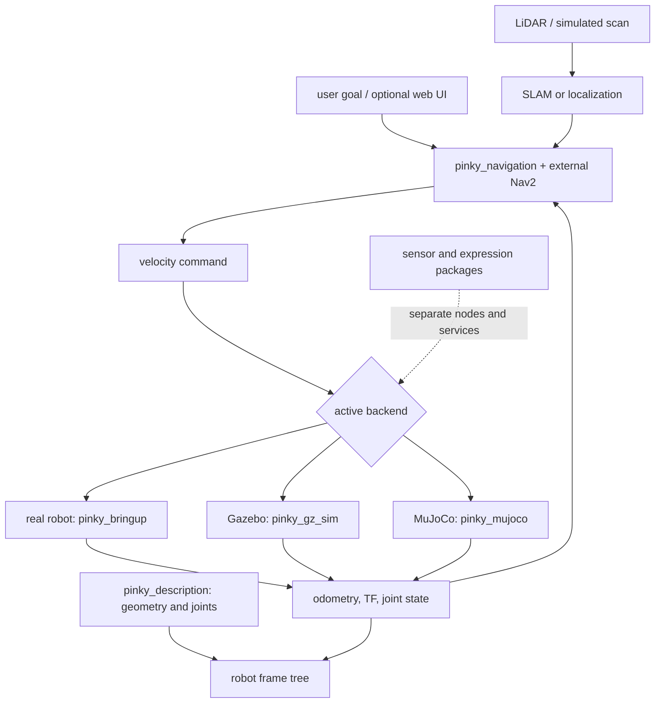

# Pinky Pro system overview

## 1. System purpose

Pinky Pro combines a mobile base, a robot description, navigation configuration, sensor drivers, expression services and two simulator backends. Learn it as a collection of cooperating processes. A ROS package is a unit of code/configuration; a node is a ROS participant with interfaces, and one process can host one or several nodes. A launch file selects and connects the pieces. This distinction is visible in the package's console entry points, launch includes and nodes: [pinky_bringup/setup.py:24-28](https://github.com/seljb/pinky_pro/blob/014a09f289e6988894fbffde2624fdb1e257815b/pinky_bringup/setup.py#L24-L28), [pinky_bringup/launch/bringup_robot.launch.xml:3-29](https://github.com/seljb/pinky_pro/blob/014a09f289e6988894fbffde2624fdb1e257815b/pinky_bringup/launch/bringup_robot.launch.xml#L3-L29), [pinky_bringup/launch/bringup_sim.launch.xml:13-48](https://github.com/seljb/pinky_pro/blob/014a09f289e6988894fbffde2624fdb1e257815b/pinky_bringup/launch/bringup_sim.launch.xml#L13-L48).

This page gives the source-defined architecture, not a captured runtime graph. **Code-confirmed / [코드 확인]** refers to inspected source; **Inference / [추론]** to conceptual synthesis; **Unverified / [미검증]** to behavior requiring execution evidence.

## 2. Main components

| Role | Packages | Learning question | Primary lesson |
|---|---|---|---|
| Real motion and feedback | `pinky_bringup` | How do velocity and encoders become movement and pose? | [Motion and feedback](../04_Features/motion-and-feedback.md) |
| Body model | `pinky_description` | Where are wheels, body and sensors relative to one another? | [Description and TF](robot-description-and-tf.md) |
| Gazebo simulation | `pinky_gz_sim` | How do Gazebo plugins and ROS bridging expose a simulated robot? | [Gazebo package](../02_Packages/pinky_gz_sim.md) |
| MuJoCo simulation | `pinky_mujoco` | How is the common description converted into physics and ROS data? | [MuJoCo package](../02_Packages/pinky_mujoco.md) |
| Mapping/localization/navigation | `pinky_navigation` | How does a goal become a path and velocity? | [Navigation pipeline](navigation-pipeline.md) |
| Inertial sensing | `pinky_imu_bno055` | How does the I2C device become an IMU message? | [IMU package](../02_Packages/pinky_imu_bno055.md) |
| Analog sensing | `pinky_sensor_adc` | How do raw channels become range, IR and battery messages? | [ADC package](../02_Packages/pinky_sensor_adc.md) |
| Shared service contracts | `pinky_interfaces` | What data do lamp, LED and emotion requests carry? | [Interface definitions](../02_Packages/pinky_interfaces.md) |
| Lamp | `pinky_lamp_control` | How are color/mode/time applied? | [Lamp package](../02_Packages/pinky_lamp_control.md) |
| LED strip/pixels | `pinky_led` | How are pixels and brightness requested? | [LED package](../02_Packages/pinky_led.md) |
| Screen expression | `pinky_emotion` | How are named GIF expressions displayed? | [Emotion package](../02_Packages/pinky_emotion.md) |

These 11 package roles are supported by the per-package source references in the linked lessons and by the preserved [complete package inventory](../00_Overview/package-inventory.md). Package boundaries do not imply that all 11 run in one launch.

## 3. Data flow

The diagram is a conceptual synthesis. Backend selection is explicit in [pinky_bringup/launch/bringup_sim.launch.xml:13-48](https://github.com/seljb/pinky_pro/blob/014a09f289e6988894fbffde2624fdb1e257815b/pinky_bringup/launch/bringup_sim.launch.xml#L13-L48); hardware feedback in [pinky_bringup/pinky_bringup/bringup.py:84-95](https://github.com/seljb/pinky_pro/blob/014a09f289e6988894fbffde2624fdb1e257815b/pinky_bringup/pinky_bringup/bringup.py#L84-L95), [pinky_bringup/pinky_bringup/bringup.py:127-195](https://github.com/seljb/pinky_pro/blob/014a09f289e6988894fbffde2624fdb1e257815b/pinky_bringup/pinky_bringup/bringup.py#L127-L195); Nav2 composition in [pinky_navigation/launch/bringup_launch.xml:22-53](https://github.com/seljb/pinky_pro/blob/014a09f289e6988894fbffde2624fdb1e257815b/pinky_navigation/launch/bringup_launch.xml#L22-L53). Simulator and peripheral edges are expanded and cited in their dedicated lessons. The dotted edge does not mean that the default bringup starts every peripheral.

## 4. Two loops to keep separate

**Motion loop:** a command requests body velocity; the active backend turns it into wheel motion; feedback describes estimated or simulated state. For hardware, body-to-wheel equations and encoder integration live in `Pinky`. [pinky_bringup/pinky_bringup/bringup.py:104-195](https://github.com/seljb/pinky_pro/blob/014a09f289e6988894fbffde2624fdb1e257815b/pinky_bringup/pinky_bringup/bringup.py#L104-L195).

**Navigation loop (conceptual inference):** localization/mapping and configured planning/control components use state and sensor data to decide velocity. The repository supplies the launch/configuration around external Nav2 and SLAM Toolbox; it does not implement their underlying algorithms. The top navigation launch includes localization and navigation; the map-building launch includes external SLAM Toolbox. [pinky_navigation/launch/bringup_launch.xml:34-53](https://github.com/seljb/pinky_pro/blob/014a09f289e6988894fbffde2624fdb1e257815b/pinky_navigation/launch/bringup_launch.xml#L34-L53), [pinky_navigation/launch/map_building.launch.xml:3-9](https://github.com/seljb/pinky_pro/blob/014a09f289e6988894fbffde2624fdb1e257815b/pinky_navigation/launch/map_building.launch.xml#L3-L9).

A stored map does not move the robot. A velocity command does not establish map location. The [navigation lesson](navigation-pipeline.md) connects these concepts through source configuration.

## 5. Launch boundaries and dependencies

| Entry | What the inspected source selects | What to verify separately |
|---|---|---|
| `bringup_robot.launch.xml` | description upload, external SLLIDAR C1 launch, `bringup`, `battery_publisher` | hardware availability, external drivers and resulting graph |
| `bringup_sim.launch.xml` | MuJoCo by default; `gz`/`gazebo` selects Gazebo | installed dependencies, simulation startup and bridge outputs |
| `pinky_navigation/launch/bringup_launch.xml` | localization and navigation composition | active robot/simulator backend, map and effective parameters |
| `pinky_navigation/launch/map_building.launch.xml` | external SLAM Toolbox synchronous launch | active scan/odometry/frame inputs and generated map |

Evidence: [pinky_bringup/launch/bringup_robot.launch.xml:3-29](https://github.com/seljb/pinky_pro/blob/014a09f289e6988894fbffde2624fdb1e257815b/pinky_bringup/launch/bringup_robot.launch.xml#L3-L29), [pinky_bringup/launch/bringup_sim.launch.xml:13-48](https://github.com/seljb/pinky_pro/blob/014a09f289e6988894fbffde2624fdb1e257815b/pinky_bringup/launch/bringup_sim.launch.xml#L13-L48), [pinky_navigation/launch/bringup_launch.xml:5-53](https://github.com/seljb/pinky_pro/blob/014a09f289e6988894fbffde2624fdb1e257815b/pinky_navigation/launch/bringup_launch.xml#L5-L53), [pinky_navigation/launch/map_building.launch.xml:3-9](https://github.com/seljb/pinky_pro/blob/014a09f289e6988894fbffde2624fdb1e257815b/pinky_navigation/launch/map_building.launch.xml#L3-L9).

The real bringup lists no IMU, ADC, lamp, LED or emotion node. Their presence in the repository does not add them to this launch. LiDAR and battery-library internals are external to this repository. [pinky_bringup/launch/bringup_robot.launch.xml:3-29](https://github.com/seljb/pinky_pro/blob/014a09f289e6988894fbffde2624fdb1e257815b/pinky_bringup/launch/bringup_robot.launch.xml#L3-L29), [pinky_bringup/pinky_bringup/battery_publisher.py:4-10](https://github.com/seljb/pinky_pro/blob/014a09f289e6988894fbffde2624fdb1e257815b/pinky_bringup/pinky_bringup/battery_publisher.py#L4-L10).

### Process selection and startup readiness

**[Code confirmed]** Description upload declares `robot_state_publisher` and `joint_state_publisher`; it does not implement wheel control. [Description upload:22-59](https://github.com/seljb/pinky_pro/blob/014a09f289e6988894fbffde2624fdb1e257815b/pinky_description/launch/upload_robot.launch.py#L22-L59). The motor constructor opens serial, initializes motors, sends zero RPM and reads initial encoders before creating its interfaces and timer. [Motor startup:43-101](https://github.com/seljb/pinky_pro/blob/014a09f289e6988894fbffde2624fdb1e257815b/pinky_bringup/pinky_bringup/bringup.py#L43-L101).

**[Inference]** Ask two different questions: which processes are requested, and when is each ready? The hardware launch contains no readiness event waiting for motor initialization before starting the other declared components. Textual include order alone does not prove a working motor connection, LiDAR or TF tree. [Hardware composition:3-29](https://github.com/seljb/pinky_pro/blob/014a09f289e6988894fbffde2624fdb1e257815b/pinky_bringup/launch/bringup_robot.launch.xml#L3-L29). Actual startup timing and failures remain **[Unverified]**.

There is a concrete argument mismatch: the hardware include forwards `use_sim_time`, while the uploader declares and reads `is_sim` to set its nodes' `use_sim_time`. This is a **[Code confirmed]** name mismatch; resulting launch behavior and effective clocks remain **[Unverified]**. [Caller:4-10](https://github.com/seljb/pinky_pro/blob/014a09f289e6988894fbffde2624fdb1e257815b/pinky_bringup/launch/bringup_robot.launch.xml#L4-L10), [callee arguments:14-16](https://github.com/seljb/pinky_pro/blob/014a09f289e6988894fbffde2624fdb1e257815b/pinky_description/launch/upload_robot.launch.py#L14-L16), [callee clocks:22-54](https://github.com/seljb/pinky_pro/blob/014a09f289e6988894fbffde2624fdb1e257815b/pinky_description/launch/upload_robot.launch.py#L22-L54). Follow the [simulation lesson](simulation-pipeline.md) for each branch's time and environment settings.

## 6. Parameters, time and frames

Start with three questions when reading a behavior:

1. **Which entry selected the process?** A launch default can differ from a direct node default.
2. **Which file/argument supplies its settings?** YAML source values are not a query of effective runtime values.
3. **Which clock and frames does it use?** The hardware feedback code uses its node clock and emits `odom -> base_footprint`; simulation and localization have additional choices.

These are reading heuristics, not tested configuration rules. The first two are illustrated by YAML plus explicit geometry arguments in [pinky_bringup/launch/bringup_robot.launch.xml:20-24](https://github.com/seljb/pinky_pro/blob/014a09f289e6988894fbffde2624fdb1e257815b/pinky_bringup/launch/bringup_robot.launch.xml#L20-L24); clock and feedback frames by [pinky_bringup/pinky_bringup/bringup.py:127-179](https://github.com/seljb/pinky_pro/blob/014a09f289e6988894fbffde2624fdb1e257815b/pinky_bringup/pinky_bringup/bringup.py#L127-L179). See [navigation parameters](../03_Parameters/navigation-parameters.md), [description and TF](robot-description-and-tf.md), and [simulation pipeline](simulation-pipeline.md) for the remaining paths.

## 7. Related pages and study route

[Learning roadmap](../00_Overview/learning-roadmap.md) → [Motion and feedback](../04_Features/motion-and-feedback.md) → [Description and TF](robot-description-and-tf.md) → [Simulation](simulation-pipeline.md) → [Navigation](navigation-pipeline.md) → [Sensors and expression](sensors-and-expression.md).

Use the [interface atlas](../04_Features/ros2-interface-atlas.md) to find a topic/service, and the [full index](../index.md) to find a package. Source file links are optional audit trails; the lessons contain the explanations needed to study.

## 8. Evidence, questions and limitations

Source repository: `seljb/pinky_pro`; fixed commit `014a09f289e6988894fbffde2624fdb1e257815b`. External package internals, effective runtime parameters, device behavior and actual ROS graphs were not verified. Local untracked files are excluded from commit evidence; see [evidence report](../06_Change_History/2026-11-18-learning-wiki-evidence.md).

**Check yourself:** Does the navigation launch also start the physical motors? **Answer:** not in the inspected launch; it composes localization/navigation, so bringup is a separate boundary.

**Check yourself:** Why learn command and feedback separately? **Answer:** the first expresses intent while the second supports state estimation; this implementation computes odometry from encoders, not from the command.

> 작업 메모: 이 그림은 소스의 실행 관계를 학습용으로 요약한 것이다. 실제 실행 그래프나 로봇 동작을 확인한 결과가 아니다.
