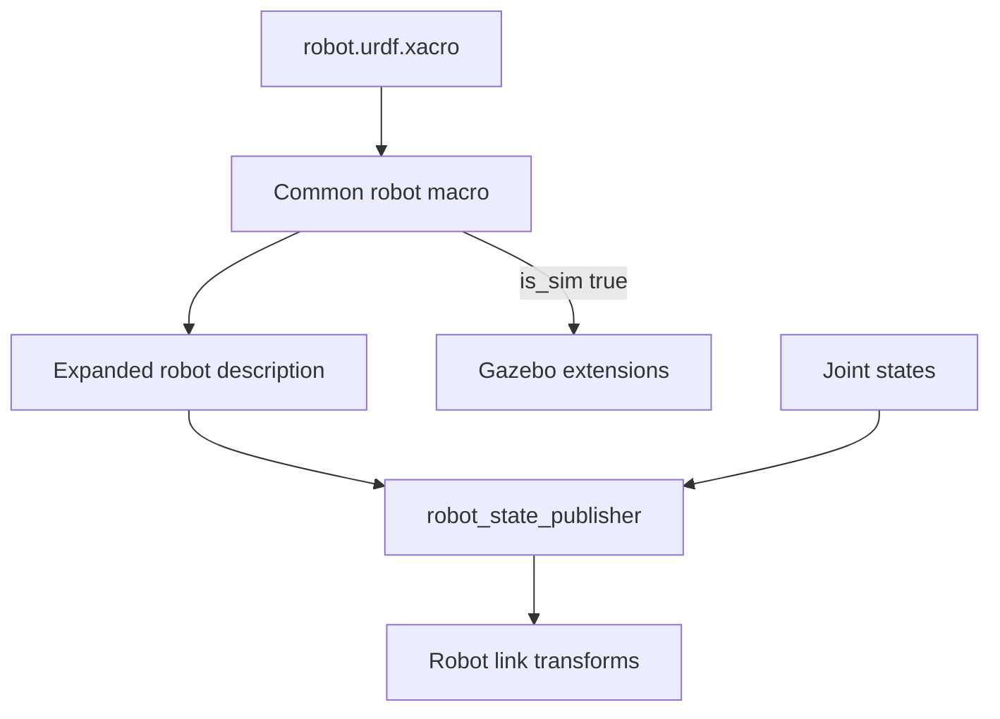

# pinky_description — the shared robot model

## 1. Package overview

**Learning goal:** explain where the robot's shape, sensor positions, wheel joints and local TF frames come from. This package supplies model data and launches external ROS nodes; it does not implement a motor driver or localization algorithm. The package installs `launch`, `meshes`, `rviz` and `urdf` directories. [Code-confirmed] [pinky_description/CMakeLists.txt:8-19](https://github.com/seljb/pinky_pro/blob/014a09f289e6988894fbffde2624fdb1e257815b/pinky_description/CMakeLists.txt#L8-L19)

A useful conceptual distinction is: **visual geometry** draws the robot, **collision geometry** gives simulation contact shapes, **inertia** describes mass distribution, and **joints** connect frames. In this repository the base has separate DAE visual and STL collision meshes plus a declared 0.8 kg inertial block. Wheels use sphere collisions of radius 0.028 m. These are source model values, not measured robot properties. [Code-confirmed] [pinky_description/urdf/pinky.urdf.xacro:6-59](https://github.com/seljb/pinky_pro/blob/014a09f289e6988894fbffde2624fdb1e257815b/pinky_description/urdf/pinky.urdf.xacro#L6-L59)

## 2. Package structure

| File / directory | Role |
|---|---|
| `urdf/robot.urdf.xacro` | Entry point: declares namespace, simulation and tilt arguments; instantiates the robot macro |
| `urdf/pinky.urdf.xacro` | Common links, masses, geometry and joints |
| `urdf/common/insert_inertia.urdf.xacro` | Inertia helper macros included by the common model |
| `urdf/pinky_gz.urdf.xacro` | Gazebo differential drive, joint publisher, lamp and sensors |
| `launch/upload_robot.launch.py` | Supplies expanded model to state publishers |
| `launch/view_robot.launch.py` | RViz + state publisher + joint slider GUI |
| `meshes/visual`, `meshes/collision` | Appearance and collision assets |

Entry-point and conditional inclusion evidence: [pinky_description/urdf/robot.urdf.xacro:1-14](https://github.com/seljb/pinky_pro/blob/014a09f289e6988894fbffde2624fdb1e257815b/pinky_description/urdf/robot.urdf.xacro#L1-L14), [pinky_description/urdf/pinky.urdf.xacro:1-4](https://github.com/seljb/pinky_pro/blob/014a09f289e6988894fbffde2624fdb1e257815b/pinky_description/urdf/pinky.urdf.xacro#L1-L4), [pinky_description/urdf/pinky.urdf.xacro:298-302](https://github.com/seljb/pinky_pro/blob/014a09f289e6988894fbffde2624fdb1e257815b/pinky_description/urdf/pinky.urdf.xacro#L298-L302).

## 3. Running nodes

These are launch declarations; no node was started for this analysis.

| Launch | Node / executable | Responsibility | Evidence |
|---|---|---|---|
| upload | `robot_state_publisher` | Receives expanded `robot_description`, `frame_prefix` and `use_sim_time` | [pinky_description/launch/upload_robot.launch.py:22-43](https://github.com/seljb/pinky_pro/blob/014a09f289e6988894fbffde2624fdb1e257815b/pinky_description/launch/upload_robot.launch.py#L22-L43) |
| upload | `joint_state_publisher` | Configured with `source_list: ['joint_states']`, rate 20.0 | [pinky_description/launch/upload_robot.launch.py:45-59](https://github.com/seljb/pinky_pro/blob/014a09f289e6988894fbffde2624fdb1e257815b/pinky_description/launch/upload_robot.launch.py#L45-L59) |
| view | `rviz2` | Displays supplied RViz config; shutdown action on exit | [pinky_description/launch/view_robot.launch.py:14-24](https://github.com/seljb/pinky_pro/blob/014a09f289e6988894fbffde2624fdb1e257815b/pinky_description/launch/view_robot.launch.py#L14-L24) |
| view | `robot_state_publisher` | Expands the default Xacro | [pinky_description/launch/view_robot.launch.py:26-42](https://github.com/seljb/pinky_pro/blob/014a09f289e6988894fbffde2624fdb1e257815b/pinky_description/launch/view_robot.launch.py#L26-L42) |
| view | `joint_state_publisher_gui` | Supplies manually adjustable joint state | [pinky_description/launch/view_robot.launch.py:44-49](https://github.com/seljb/pinky_pro/blob/014a09f289e6988894fbffde2624fdb1e257815b/pinky_description/launch/view_robot.launch.py#L44-L49) |

## 4. Communication interfaces

The common model defines the fixed chain `base_footprint → base_link → sensor frames` and continuous wheel/caster joints. The upload launch passes `robot_description` as a **node parameter**, while downstream Gazebo spawning asks for a `robot_description` **topic**. The topic availability is therefore an external state-publisher behavior to verify at runtime. The model and its static relationships are not an odometry estimate. [Code-confirmed / interpretation] [pinky_description/launch/upload_robot.launch.py:27-42](https://github.com/seljb/pinky_pro/blob/014a09f289e6988894fbffde2624fdb1e257815b/pinky_description/launch/upload_robot.launch.py#L27-L42), [pinky_gz_sim/launch/launch_sim.launch.xml:22-30](https://github.com/seljb/pinky_pro/blob/014a09f289e6988894fbffde2624fdb1e257815b/pinky_gz_sim/launch/launch_sim.launch.xml#L22-L30)

The code's `source_list` string is evidence of intended joint-state input; it does not prove a valid graph. In particular, the hardware driver publishes `left_wheel_joint` and `right_wheel_joint`, while this model names the joints `l_wheel_joint` and `r_wheel_joint` for the empty namespace. Those names differ literally. The effect on moving wheel TF remains untested. [Code-confirmed] [pinky_bringup/pinky_bringup/bringup.py:21-28](https://github.com/seljb/pinky_pro/blob/014a09f289e6988894fbffde2624fdb1e257815b/pinky_bringup/pinky_bringup/bringup.py#L21-L28), [pinky_description/urdf/pinky.urdf.xacro:54-63](https://github.com/seljb/pinky_pro/blob/014a09f289e6988894fbffde2624fdb1e257815b/pinky_description/urdf/pinky.urdf.xacro#L54-L63)

## 5. Dependencies

The manifest declares `xacro`, `robot_state_publisher`, `joint_state_publisher` and `joint_state_publisher_gui`. The view launch also uses `rviz2`, which is not directly listed in that manifest. Gazebo functionality is conditionally referenced from Xacro rather than declared as a manifest dependency on `pinky_gz_sim`. Distinguish dependency declarations from actual static references. [pinky_description/package.xml:10-21](https://github.com/seljb/pinky_pro/blob/014a09f289e6988894fbffde2624fdb1e257815b/pinky_description/package.xml#L10-L21), [pinky_description/launch/view_robot.launch.py:17-22](https://github.com/seljb/pinky_pro/blob/014a09f289e6988894fbffde2624fdb1e257815b/pinky_description/launch/view_robot.launch.py#L17-L22), [pinky_description/urdf/pinky_gz.urdf.xacro:32-34](https://github.com/seljb/pinky_pro/blob/014a09f289e6988894fbffde2624fdb1e257815b/pinky_description/urdf/pinky_gz.urdf.xacro#L32-L34)

## 6. Related pipelines

Read [Robot description and TF](../01_Architecture/robot-description-and-tf.md) for frame ownership and positions, then [Simulation pipeline](../01_Architecture/simulation-pipeline.md) for the two simulator paths. The existing [Bringup pipeline](../01_Architecture/pinky-bringup-pipeline.md) explains real hardware startup.

The diagram summarizes the source model and launch declarations above; live connections are unverified.

## 7. Related code and parameters

| Setting | Direct Xacro default | Upload launch default | Meaning |
|---|---|---|---|
| `namespace` | empty | empty | Joint-name prefix and state-publisher frame prefix |
| `is_sim` | `false` | `false` | Adds Gazebo extensions when true; upload also uses it for `use_sim_time` |
| `cam_tilt_deg` | `8` | `0` | Camera mount pitch in degrees |
| `screen_tilt_deg` | `-25` | not exposed | Screen mount pitch in degrees |

The defaults come from [pinky_description/urdf/robot.urdf.xacro:5-13](https://github.com/seljb/pinky_pro/blob/014a09f289e6988894fbffde2624fdb1e257815b/pinky_description/urdf/robot.urdf.xacro#L5-L13) and [pinky_description/launch/upload_robot.launch.py:14-41](https://github.com/seljb/pinky_pro/blob/014a09f289e6988894fbffde2624fdb1e257815b/pinky_description/launch/upload_robot.launch.py#L14-L41). Camera and screen angles become `pitch = degrees / 180 × π` in [pinky_description/urdf/pinky.urdf.xacro:224-260](https://github.com/seljb/pinky_pro/blob/014a09f289e6988894fbffde2624fdb1e257815b/pinky_description/urdf/pinky.urdf.xacro#L224-L260). Thus launching through upload is different from expanding the Xacro alone. MuJoCo's launch explicitly supplies 8° and −25° defaults; see [MuJoCo package](pinky_mujoco.md).

## 8. Verification and open questions

- **Code-confirmed [코드 확인]:** files, launch declarations, literal names and source configuration values above.
- **Inference [추론]:** inconsistent joint names may prevent expected wheel transforms; inspect actual node inputs before claiming the symptom.
- **Unverified [미검증]:** Xacro expansion, TF publication, namespace behavior, RViz display and physical sensor placement. No build, ROS node or simulation was run.
- The upload remapping spells `/robot_descrption` and `robot_descrpition`. These are literal misspellings in the file; the remapping's practical effect is unverified. [pinky_description/launch/upload_robot.launch.py:55-57](https://github.com/seljb/pinky_pro/blob/014a09f289e6988894fbffde2624fdb1e257815b/pinky_description/launch/upload_robot.launch.py#L55-L57)
- Namespace handling is split: joints incorporate `${namespace}`, link names remain plain, and upload sets `frame_prefix`. Nonempty namespaces require checking both model names and bridged topics. [pinky_description/urdf/pinky.urdf.xacro:33-59](https://github.com/seljb/pinky_pro/blob/014a09f289e6988894fbffde2624fdb1e257815b/pinky_description/urdf/pinky.urdf.xacro#L33-L59), [pinky_description/launch/upload_robot.launch.py:18-41](https://github.com/seljb/pinky_pro/blob/014a09f289e6988894fbffde2624fdb1e257815b/pinky_description/launch/upload_robot.launch.py#L18-L41)

**Check yourself:** Does a correct robot model tell Nav2 where the robot is in the map? **Answer:** no. It supplies relative link geometry; an odometry source supplies the moving `odom → base_footprint` relationship, and a localization or mapping system supplies the map relationship. See [Robot description and TF](../01_Architecture/robot-description-and-tf.md).

> 작업 메모: 기존 형상과 프레임 정의는 읽기 전용으로 분석했다. 카메라 기본값은 진입 경로마다 달라 단일 값으로 합치지 않았다.
