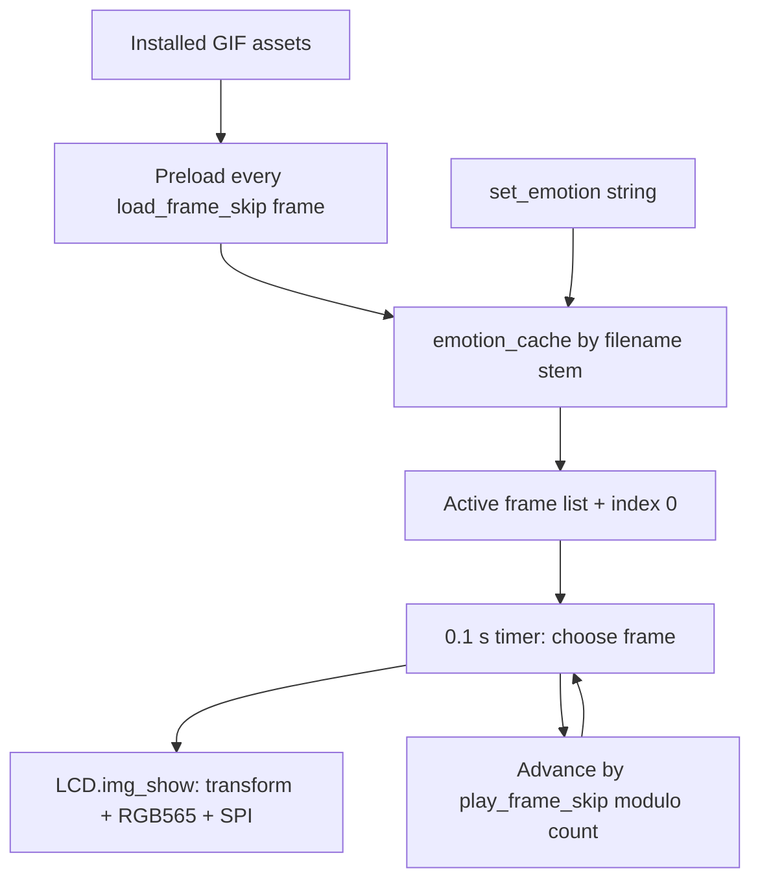

# pinky_emotion — cached GIFs become LCD frames

## 1. Package overview

The implemented `emotion_server` path selects an emotion by name, switches to its cached GIF frames and repeatedly displays them on an SPI LCD. It separates loading from playback: GIF decoding happens during preload, while the timer chooses the next cached frame. **[Code confirmed]** [pinky_emotion/pinky_emotion/emotion_server.py:10-39](https://github.com/seljb/pinky_pro/blob/014a09f289e6988894fbffde2624fdb1e257815b/pinky_emotion/pinky_emotion/emotion_server.py#L10-L39) [pinky_emotion/pinky_emotion/emotion_server.py:41-58](https://github.com/seljb/pinky_pro/blob/014a09f289e6988894fbffde2624fdb1e257815b/pinky_emotion/pinky_emotion/emotion_server.py#L41-L58) [pinky_emotion/pinky_emotion/emotion_server.py:75-83](https://github.com/seljb/pinky_pro/blob/014a09f289e6988894fbffde2624fdb1e257815b/pinky_emotion/pinky_emotion/emotion_server.py#L75-L83)

## 2. Package structure

| Path | Role |
|---|---|
| `pinky_emotion/emotion_server.py` | Cached, timer-driven `PinkyEmotion` node |
| `pinky_emotion/pinky_emotion.py` | Older synchronous path with a callback-name mismatch |
| `pinky_emotion/pinky_lcd.py` | Raspberry Pi GPIO/SPI display driver |
| `emotion/*.gif` | `angry`, `basic`, `bored`, `fun`, `happy`, `hello`, `interest`, `sad` assets |
| `setup.py` | Installs GIF assets and two console entrypoints |

The setup file copies `emotion/*.gif` to the package share directory; the server finds that installed directory through `get_package_share_directory`. [pinky_emotion/setup.py:8-16](https://github.com/seljb/pinky_pro/blob/014a09f289e6988894fbffde2624fdb1e257815b/pinky_emotion/setup.py#L8-L16) [pinky_emotion/pinky_emotion/emotion_server.py:10-39](https://github.com/seljb/pinky_pro/blob/014a09f289e6988894fbffde2624fdb1e257815b/pinky_emotion/pinky_emotion/emotion_server.py#L10-L39)

## 3. Executable nodes

| Console entrypoint | Node name | Source behavior |
|---|---|---|
| `emotion_server` | `pinky_emotion` | Defines `set_emotion_callback`, cache, lock and timer |
| `pinky_emotion` | `pinky_emotion` | Constructor refers to `self.set_emotion_callback`, but the class defines `lcd_callback` |

Entrypoint mapping: [pinky_emotion/setup.py:22-27](https://github.com/seljb/pinky_pro/blob/014a09f289e6988894fbffde2624fdb1e257815b/pinky_emotion/setup.py#L22-L27). Callback implementations: [pinky_emotion/pinky_emotion/emotion_server.py:60-73](https://github.com/seljb/pinky_pro/blob/014a09f289e6988894fbffde2624fdb1e257815b/pinky_emotion/pinky_emotion/emotion_server.py#L60-L73) [pinky_emotion/pinky_emotion/pinky_emotion.py:10-19](https://github.com/seljb/pinky_pro/blob/014a09f289e6988894fbffde2624fdb1e257815b/pinky_emotion/pinky_emotion/pinky_emotion.py#L10-L19)

**[Inference]** The older path's unresolved attribute should prevent normal construction when that line is reached; this was not executed to demonstrate an exception. Do not assume the two executables are interchangeable. The working callback in `emotion_server.py` does not repair the other Python module. [pinky_emotion/pinky_emotion/pinky_emotion.py:10-19](https://github.com/seljb/pinky_pro/blob/014a09f289e6988894fbffde2624fdb1e257815b/pinky_emotion/pinky_emotion/pinky_emotion.py#L10-L19)

## 4. Communication interfaces

| Relative name | Type | Request/response |
|---|---|---|
| `set_emotion` | `pinky_interfaces/srv/Emotion` | Emotion string → textual response |

The server checks the request string as a cache key. On success it replaces the active frame list and resets its index under a lock; otherwise it returns `Wrong command or emotion not cached`. There is no success boolean in the schema, and names are not lowercased. [pinky_interfaces/srv/Emotion.srv:1-3](https://github.com/seljb/pinky_pro/blob/014a09f289e6988894fbffde2624fdb1e257815b/pinky_interfaces/srv/Emotion.srv#L1-L3) [pinky_emotion/pinky_emotion/emotion_server.py:60-73](https://github.com/seljb/pinky_pro/blob/014a09f289e6988894fbffde2624fdb1e257815b/pinky_emotion/pinky_emotion/emotion_server.py#L60-L73)

After preload, the initial active emotion is `happy` if it exists in the cache. The timer does nothing when the active list is empty. Preloading catches an exception around the overall loop and logs it; a failure can leave a partially built cache. [pinky_emotion/pinky_emotion/emotion_server.py:10-39](https://github.com/seljb/pinky_pro/blob/014a09f289e6988894fbffde2624fdb1e257815b/pinky_emotion/pinky_emotion/emotion_server.py#L10-L39) [pinky_emotion/pinky_emotion/emotion_server.py:41-58](https://github.com/seljb/pinky_pro/blob/014a09f289e6988894fbffde2624fdb1e257815b/pinky_emotion/pinky_emotion/emotion_server.py#L41-L58) [pinky_emotion/pinky_emotion/emotion_server.py:75-83](https://github.com/seljb/pinky_pro/blob/014a09f289e6988894fbffde2624fdb1e257815b/pinky_emotion/pinky_emotion/emotion_server.py#L75-L83)

### How display bytes are produced

`LCD` sets a 240×320 target, BCM pins RST `27`, DC `25`, backlight `18`, PWM 1000 Hz at 100% initially, and SPI bus/device `(0,0)` with requested maximum 80 MHz and mode 0. `img_show` flips horizontally, rotates 270°, resizes, converts RGB pixels to two-byte RGB565 values, sets a full-screen window and writes the pixel array. These are configured operations, not verified panel specifications or measured bus rates. [pinky_emotion/pinky_emotion/pinky_lcd.py:1-35](https://github.com/seljb/pinky_pro/blob/014a09f289e6988894fbffde2624fdb1e257815b/pinky_emotion/pinky_emotion/pinky_lcd.py#L1-L35) [pinky_emotion/pinky_emotion/pinky_lcd.py:112-128](https://github.com/seljb/pinky_pro/blob/014a09f289e6988894fbffde2624fdb1e257815b/pinky_emotion/pinky_emotion/pinky_lcd.py#L112-L128)

## 5. Dependencies

The server imports `rclpy`, `ament_index_python`, Pillow and `pinky_interfaces`. The LCD module additionally imports `spidev`, `RPi.GPIO` and NumPy. The manifest lists test dependencies and `ament_python` but no direct runtime dependencies; `setup.py` requires only `setuptools`. Source imports and package declarations therefore have different coverage. [pinky_emotion/pinky_emotion/emotion_server.py:1-8](https://github.com/seljb/pinky_pro/blob/014a09f289e6988894fbffde2624fdb1e257815b/pinky_emotion/pinky_emotion/emotion_server.py#L1-L8) [pinky_emotion/pinky_emotion/pinky_lcd.py:1-35](https://github.com/seljb/pinky_pro/blob/014a09f289e6988894fbffde2624fdb1e257815b/pinky_emotion/pinky_emotion/pinky_lcd.py#L1-L35) [pinky_emotion/setup.py:8-16](https://github.com/seljb/pinky_pro/blob/014a09f289e6988894fbffde2624fdb1e257815b/pinky_emotion/setup.py#L8-L16) [pinky_emotion/package.xml:10-18](https://github.com/seljb/pinky_pro/blob/014a09f289e6988894fbffde2624fdb1e257815b/pinky_emotion/package.xml#L10-L18)

## 6. Related pipelines

- [Sensors and expression](../01_Architecture/sensors-and-expression.md)
- [Service contracts](pinky_interfaces.md)
- [Interface atlas](../04_Features/ros2-interface-atlas.md)

The tracked real-robot bringup does not start either emotion executable. There is no repository evidence that navigation automatically selects expressions. [pinky_bringup/launch/bringup_robot.launch.xml:3-29](https://github.com/seljb/pinky_pro/blob/014a09f289e6988894fbffde2624fdb1e257815b/pinky_bringup/launch/bringup_robot.launch.xml#L3-L29)

## 7. Related code and parameters

| Parameter | Default | Read/use point | Meaning |
|---|---|---|---|
| `load_frame_skip` | `2` | Constructor read; preload `i % skip == 0` | Keeps every second source GIF frame by default |
| `play_frame_skip` | `1` | Constructor read; `(index+skip)%len` | Advances one cached frame per timer callback |

Both are read once and cached as Python fields. The timer is fixed at 0.1 s, so it requests 10 callbacks/s; it does not use per-frame GIF duration metadata. For an ideal 100-source-frame GIF, the default keeps 50 frames and nominally loops in 5 s, assuming every timer callback is serviced promptly. This is an arithmetic teaching example, not observed playback. [pinky_emotion/pinky_emotion/emotion_server.py:10-39](https://github.com/seljb/pinky_pro/blob/014a09f289e6988894fbffde2624fdb1e257815b/pinky_emotion/pinky_emotion/emotion_server.py#L10-L39) [pinky_emotion/pinky_emotion/emotion_server.py:41-58](https://github.com/seljb/pinky_pro/blob/014a09f289e6988894fbffde2624fdb1e257815b/pinky_emotion/pinky_emotion/emotion_server.py#L41-L58) [pinky_emotion/pinky_emotion/emotion_server.py:75-83](https://github.com/seljb/pinky_pro/blob/014a09f289e6988894fbffde2624fdb1e257815b/pinky_emotion/pinky_emotion/emotion_server.py#L75-L83)

No input validation is shown for these parameters. A zero `load_frame_skip` raises during modulo inside preload and is caught by its broad exception handler. A zero `play_frame_skip` keeps the same index; larger strides can skip cached frames. **[Inference]** Frame skipping changes both memory use and the temporal appearance, rather than simply making an identical animation cheaper. [pinky_emotion/pinky_emotion/emotion_server.py:41-58](https://github.com/seljb/pinky_pro/blob/014a09f289e6988894fbffde2624fdb1e257815b/pinky_emotion/pinky_emotion/emotion_server.py#L41-L58) [pinky_emotion/pinky_emotion/emotion_server.py:75-83](https://github.com/seljb/pinky_pro/blob/014a09f289e6988894fbffde2624fdb1e257815b/pinky_emotion/pinky_emotion/emotion_server.py#L75-L83)

## 8. Verification and open questions

**[Code confirmed]** Entrypoints, schemas, cache selection, timer arithmetic and LCD conversions were inspected at the metadata SHA. **[Unverified]** GPIO/SPI access, display orientation, valid installed assets, memory use, actual frame rate and callback behavior on hardware were not tested.

On normal exit the server calls `lcd.clear()` but not `lcd.close()`; the LCD class has a separate close method for SPI/PWM/GPIO cleanup. This is a static difference, not a demonstrated resource leak. [pinky_emotion/pinky_emotion/emotion_server.py:86-97](https://github.com/seljb/pinky_pro/blob/014a09f289e6988894fbffde2624fdb1e257815b/pinky_emotion/pinky_emotion/emotion_server.py#L86-L97) [pinky_emotion/pinky_emotion/pinky_lcd.py:130-148](https://github.com/seljb/pinky_pro/blob/014a09f289e6988894fbffde2624fdb1e257815b/pinky_emotion/pinky_emotion/pinky_lcd.py#L130-L148)

**Check yourself.** Does `play_frame_skip=2` reduce preload memory? **Answer:** No; preload memory is controlled by `load_frame_skip`. Does `set_emotion("HAPPY")` necessarily find `happy.gif`? **Answer:** No; the server uses the string as-is.

> 작업 메모: 두 실행 진입점의 차이를 반드시 유지한다. GIF 원래 재생 시간과 현재 고정 타이머 재생 시간을 동일하게 설명하지 않는다.

[Wiki index](../index.md)
