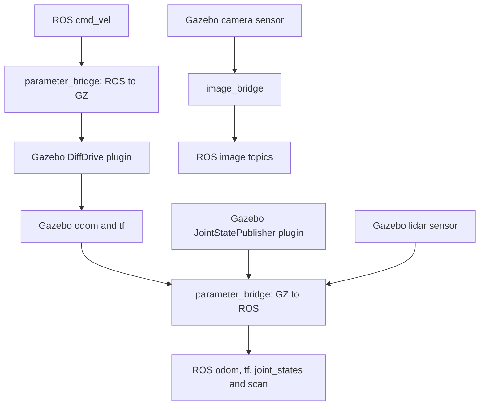

# pinky_gz_sim — Gazebo transport and assets

## 1. Package overview

**Learning goal:** separate physics in Gazebo from ROS communication. This package launches Gazebo, spawns the model, provides world/model assets, and starts bridges. The differential-drive and sensor declarations live in `pinky_description`; the bridge configuration lives here. [pinky_gz_sim/launch/launch_sim.launch.xml:13-35](https://github.com/seljb/pinky_pro/blob/014a09f289e6988894fbffde2624fdb1e257815b/pinky_gz_sim/launch/launch_sim.launch.xml#L13-L35), [pinky_description/urdf/pinky_gz.urdf.xacro:3-35](https://github.com/seljb/pinky_pro/blob/014a09f289e6988894fbffde2624fdb1e257815b/pinky_description/urdf/pinky_gz.urdf.xacro#L3-L35)

The common simulator entry point defaults to MuJoCo. Gazebo is selected only for `sim=gz` or `sim=gazebo`. This package can also be launched directly; its launch defaults are not identical to the wrapper's camera tilt. [pinky_bringup/launch/bringup_sim.launch.xml:14-46](https://github.com/seljb/pinky_pro/blob/014a09f289e6988894fbffde2624fdb1e257815b/pinky_bringup/launch/bringup_sim.launch.xml#L14-L46)

## 2. Package structure

| Area | What it contains | Evidence |
|---|---|---|
| `launch/launch_sim.launch.xml` | Server, GUI, description upload, spawn, transport bridges | [pinky_gz_sim/launch/launch_sim.launch.xml:3-35](https://github.com/seljb/pinky_pro/blob/014a09f289e6988894fbffde2624fdb1e257815b/pinky_gz_sim/launch/launch_sim.launch.xml#L3-L35) |
| `params/pinky_bridge.yaml` | Seven typed ROS/Gazebo mappings | [pinky_gz_sim/params/pinky_bridge.yaml:1-41](https://github.com/seljb/pinky_pro/blob/014a09f289e6988894fbffde2624fdb1e257815b/pinky_gz_sim/params/pinky_bridge.yaml#L1-L41) |
| `worlds/`, `models/` | Installed simulation assets, also read by MuJoCo | [pinky_gz_sim/CMakeLists.txt:38-45](https://github.com/seljb/pinky_pro/blob/014a09f289e6988894fbffde2624fdb1e257815b/pinky_gz_sim/CMakeLists.txt#L38-L45), [pinky_mujoco/pinky_mujoco/world.py:41-49](https://github.com/seljb/pinky_pro/blob/014a09f289e6988894fbffde2624fdb1e257815b/pinky_mujoco/pinky_mujoco/world.py#L41-L49) |
| `plugins/gz_lamp_control_plugin.cpp` | Simulated lamp's periodic green pulse | [pinky_gz_sim/plugins/gz_lamp_control_plugin.cpp:34-67](https://github.com/seljb/pinky_pro/blob/014a09f289e6988894fbffde2624fdb1e257815b/pinky_gz_sim/plugins/gz_lamp_control_plugin.cpp#L34-L67) |

## 3. Running nodes

| Launch declaration | Role | Source |
|---|---|---|
| `ros_gz_sim/gz_sim.launch.py`, server include | Run selected world with `-r -s` | [pinky_gz_sim/launch/launch_sim.launch.xml:13-16](https://github.com/seljb/pinky_pro/blob/014a09f289e6988894fbffde2624fdb1e257815b/pinky_gz_sim/launch/launch_sim.launch.xml#L13-L16) |
| second Gazebo include, `-g` | Open GUI client | [pinky_gz_sim/launch/launch_sim.launch.xml:18-20](https://github.com/seljb/pinky_pro/blob/014a09f289e6988894fbffde2624fdb1e257815b/pinky_gz_sim/launch/launch_sim.launch.xml#L18-L20) |
| description upload | Expand model with Gazebo plugins and simulation time | [pinky_gz_sim/launch/launch_sim.launch.xml:22-27](https://github.com/seljb/pinky_pro/blob/014a09f289e6988894fbffde2624fdb1e257815b/pinky_gz_sim/launch/launch_sim.launch.xml#L22-L27) |
| `ros_gz_sim/create` | Spawn model from robot-description topic at z = 0.1 m | [pinky_gz_sim/launch/launch_sim.launch.xml:29-31](https://github.com/seljb/pinky_pro/blob/014a09f289e6988894fbffde2624fdb1e257815b/pinky_gz_sim/launch/launch_sim.launch.xml#L29-L31) |
| `ros_gz_bridge/parameter_bridge` | Load YAML mapping | [pinky_gz_sim/launch/launch_sim.launch.xml:33-33](https://github.com/seljb/pinky_pro/blob/014a09f289e6988894fbffde2624fdb1e257815b/pinky_gz_sim/launch/launch_sim.launch.xml#L33-L33) |
| two `ros_gz_image/image_bridge` nodes | Bridge `/camera/image_raw` and `/camera` | [pinky_gz_sim/launch/launch_sim.launch.xml:34-35](https://github.com/seljb/pinky_pro/blob/014a09f289e6988894fbffde2624fdb1e257815b/pinky_gz_sim/launch/launch_sim.launch.xml#L34-L35) |

These actions coexist in the launch. Source order alone does not demonstrate that a world, topic or plugin is ready before another process needs it.

## 4. Communication interfaces

The YAML uses relative topic names. The rows below report literal configuration and direction; root-resolved names depend on launch context. [pinky_gz_sim/params/pinky_bridge.yaml:1-41](https://github.com/seljb/pinky_pro/blob/014a09f289e6988894fbffde2624fdb1e257815b/pinky_gz_sim/params/pinky_bridge.yaml#L1-L41)

| ROS topic | ROS message | Direction | Meaning |
|---|---|---|---|
| `clock` | `rosgraph_msgs/msg/Clock` | GZ → ROS | Simulation clock |
| `tf` | `tf2_msgs/msg/TFMessage` | GZ → ROS | Gazebo transform output |
| `scan` | `sensor_msgs/msg/LaserScan` | GZ → ROS | Lidar scan |
| `camera/camera_info` | `sensor_msgs/msg/CameraInfo` | GZ → ROS | Camera model information |
| `cmd_vel` | `geometry_msgs/msg/Twist` | ROS → GZ | Desired forward and yaw velocity |
| `joint_states` | `sensor_msgs/msg/JointState` | GZ → ROS | Wheel state |
| `odom` | `nav_msgs/msg/Odometry` | GZ → ROS | Differential-drive odometry |

The Xacro declares lidar at 640 horizontal samples over −π to π, 0.05–12.0 m range and Gaussian noise stddev 0.02. It declares camera 1280×720 at 30 Hz and an IMU at 100 Hz. The supplied bridge YAML has **no IMU mapping**, despite the IMU sensor declaration. Do not claim `/imu_raw` is available in ROS merely because it exists in Gazebo. [pinky_description/urdf/pinky_gz.urdf.xacro:68-132](https://github.com/seljb/pinky_pro/blob/014a09f289e6988894fbffde2624fdb1e257815b/pinky_description/urdf/pinky_gz.urdf.xacro#L68-L132)

The lamp plugin is autonomous: it increments/decrements green intensity in 0.1 steps on 0.1-second simulation intervals and publishes material color to the hard-coded `/world/pinky_factory/material_color`. It does not implement the hardware `SetLamp` ROS service. Effects in worlds with different names require runtime verification. [pinky_gz_sim/plugins/gz_lamp_control_plugin.cpp:34-67](https://github.com/seljb/pinky_pro/blob/014a09f289e6988894fbffde2624fdb1e257815b/pinky_gz_sim/plugins/gz_lamp_control_plugin.cpp#L34-L67)

### Paper walkthrough: follow a command across the transport boundary

Read the following as a source-based trace with the default empty namespace. It does not require launching Gazebo.

| Step | Declared connection | Evidence and boundary |
|---|---|---|
| 1. ROS command | A ROS `Twist` on `cmd_vel` is mapped to a Gazebo `gz.msgs.Twist` on `cmd_vel` | [Bridge YAML, lines 25–29](https://github.com/seljb/pinky_pro/blob/014a09f289e6988894fbffde2624fdb1e257815b/pinky_gz_sim/params/pinky_bridge.yaml#L25-L29); the bridge is started separately by launch |
| 2. Drive consumer | DiffDrive names `${namespace}cmd_vel` and the left/right wheel joints | [DiffDrive declaration, lines 5–23](https://github.com/seljb/pinky_pro/blob/014a09f289e6988894fbffde2624fdb1e257815b/pinky_description/urdf/pinky_gz.urdf.xacro#L5-L23); plugin implementation is external to this repository |
| 3. Motion feedback | DiffDrive declares `odom`, `odom → base_footprint`, and `/tf`; the YAML maps odometry and TF back to ROS | [Frame/topic declarations](https://github.com/seljb/pinky_pro/blob/014a09f289e6988894fbffde2624fdb1e257815b/pinky_description/urdf/pinky_gz.urdf.xacro#L18-L23), [TF mapping](https://github.com/seljb/pinky_pro/blob/014a09f289e6988894fbffde2624fdb1e257815b/pinky_gz_sim/params/pinky_bridge.yaml#L7-L11), [odom mapping](https://github.com/seljb/pinky_pro/blob/014a09f289e6988894fbffde2624fdb1e257815b/pinky_gz_sim/params/pinky_bridge.yaml#L37-L41) |
| 4. Joint feedback | A separate JointStatePublisher plugin declares only left/right wheel joint names | [Joint plugin declaration](https://github.com/seljb/pinky_pro/blob/014a09f289e6988894fbffde2624fdb1e257815b/pinky_description/urdf/pinky_gz.urdf.xacro#L26-L30); this is not the MuJoCo four-joint publication path |
| 5. Sensor feedback | The lidar declares its own `scan` output, independently of the drive plugin | [Lidar declaration](https://github.com/seljb/pinky_pro/blob/014a09f289e6988894fbffde2624fdb1e257815b/pinky_description/urdf/pinky_gz.urdf.xacro#L68-L100), [scan mapping](https://github.com/seljb/pinky_pro/blob/014a09f289e6988894fbffde2624fdb1e257815b/pinky_gz_sim/params/pinky_bridge.yaml#L13-L17) |

**[Code confirmed]** These names, types and directions match the checked source. **[Inference]** With matching names and functioning external components, they form the intended command/feedback loop. **[Unverified]** Actual bridge connectivity, plugin loading, odometry behavior and sensor delivery require runtime evidence.

Do not carry limits from another backend into this trace. The hardware bringup's RPM limit and MuJoCo's receipt timeout belong to their own implementations. Here the checked Xacro declares velocity/acceleration bounds, but it does not declare a command-timeout parameter. The external DiffDrive plugin's behavior after command publication stops is not established by these declarations. [Gazebo DiffDrive configuration](https://github.com/seljb/pinky_pro/blob/014a09f289e6988894fbffde2624fdb1e257815b/pinky_description/urdf/pinky_gz.urdf.xacro#L5-L24), [MuJoCo comparison](pinky_mujoco.md#4-communication-interfaces), [hardware comparison](../04_Features/motion-and-feedback.md)

**Check yourself:** Can the robot's ROS odometry work while ROS lidar is missing? **Answer:** The declarations allow those paths to fail independently: odometry and scan have different Gazebo producers and bridge entries. A working drive loop does not demonstrate lidar delivery. Does an empty `joint_states` path necessarily explain missing `odom → base_footprint`? **Answer:** No; DiffDrive declares that transform, while the separate joint-state path supplies wheel positions for the robot description chain. See [TF ownership](../01_Architecture/robot-description-and-tf.md).

## 5. Dependencies

Manifest dependencies are `ros_gz` and `gz_ros2_control`. Static launch references also include `pinky_description`, `ros_gz_sim`, `ros_gz_bridge` and `ros_gz_image`; do not confuse those with direct manifest declarations. CMake returns early on `aarch64`. The lamp library builds only when both `gz-sim8` and `gz-plugin2` are found. [pinky_gz_sim/package.xml:10-13](https://github.com/seljb/pinky_pro/blob/014a09f289e6988894fbffde2624fdb1e257815b/pinky_gz_sim/package.xml#L10-L13), [pinky_gz_sim/CMakeLists.txt:8-36](https://github.com/seljb/pinky_pro/blob/014a09f289e6988894fbffde2624fdb1e257815b/pinky_gz_sim/CMakeLists.txt#L8-L36)

## 6. Related pipelines

Read [Simulation pipeline](../01_Architecture/simulation-pipeline.md) and [Robot description and TF](../01_Architecture/robot-description-and-tf.md). The diagram summarizes the launch, YAML and Xacro above; no live topic flow was observed.

## 7. Related code and parameters

The launch declares `namespace=''`, `robot_name=namespace+pinky`, `cam_tilt_deg=0`, `world_name=pinky_factory.world`, explicit `world` path and `bridge_params` path. Through the common bringup wrapper, camera tilt instead defaults to 8°. [pinky_gz_sim/launch/launch_sim.launch.xml:4-9](https://github.com/seljb/pinky_pro/blob/014a09f289e6988894fbffde2624fdb1e257815b/pinky_gz_sim/launch/launch_sim.launch.xml#L4-L9), [pinky_bringup/launch/bringup_sim.launch.xml:17-18](https://github.com/seljb/pinky_pro/blob/014a09f289e6988894fbffde2624fdb1e257815b/pinky_bringup/launch/bringup_sim.launch.xml#L17-L18)

Gazebo DiffDrive declares wheel radius 0.028 m, separation 0.0961 m, velocity bounds −1 to +1, acceleration bounds −2 to +2 and odometry publisher frequency 30. These are plugin configuration values; this repository does not implement the external plugin's validation or prove effective runtime values. [pinky_description/urdf/pinky_gz.urdf.xacro:5-23](https://github.com/seljb/pinky_pro/blob/014a09f289e6988894fbffde2624fdb1e257815b/pinky_description/urdf/pinky_gz.urdf.xacro#L5-L23)

For comparison, MuJoCo derives its track from wheel collision centers rather than reading that Gazebo separation. See [MuJoCo package](pinky_mujoco.md#7-related-code-and-parameters).

## 8. Verification and open questions

**Code-confirmed [코드 확인]:** launch actions, bridge directions/types, declared settings, conditional library build and hard-coded lamp world path. **Inference [추론]:** a custom namespace likely needs matching bridge-topic changes: the YAML remains unprefixed while Xacro prefixes some Gazebo topics. **Unverified [미검증]:** Gazebo installation, world assets, library loading, sensor messages, image topics and timing. Nothing was launched or built.

**Check yourself:** ROS publishes `cmd_vel`, but Gazebo does not move. What chain must be present? **Answer:** the ROS→Gazebo bridge mapping, a matching Gazebo command topic, the DiffDrive plugin and valid wheel-joint names. The Wiki gives their source declarations; a future runtime diagnosis would verify each link.

> 작업 메모: Gazebo의 센서 선언과 ROS bridge 항목을 분리했다. IMU 선언만 보고 ROS 토픽이 제공된다고 기록하지 않았다. 2026-11-19에는 명령의 ROS↔Gazebo 경계 추적과 서로 독립적인 odom·joint_states·scan 경로를 보완했다. 외부 플러그인의 timeout 동작은 확인한 것으로 쓰지 않았다.
