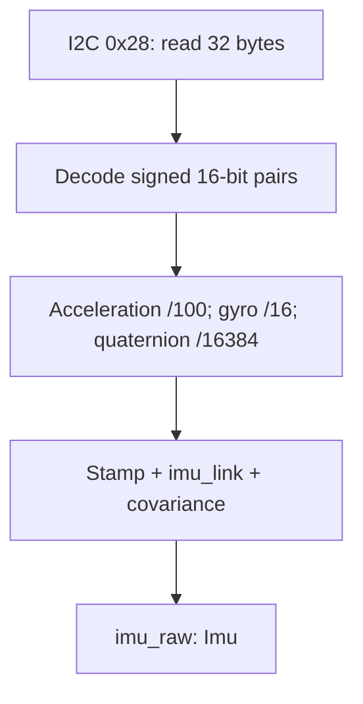

# pinky_imu_bno055 — from I2C registers to an IMU message

## 1. Package overview

This hardware driver reads a BNO055 through I2C and publishes orientation, angular velocity and linear acceleration together. Learn it as a conversion pipeline: bytes → signed numbers → scaled fields → a timestamped ROS message. The node does not fuse wheel odometry, publish TF, or connect itself to Nav2. **[Code confirmed]** [pinky_imu_bno055/src/main_node.cpp:13-63](https://github.com/seljb/pinky_pro/blob/014a09f289e6988894fbffde2624fdb1e257815b/pinky_imu_bno055/src/main_node.cpp#L13-L63) [pinky_imu_bno055/src/main_node.cpp:93-117](https://github.com/seljb/pinky_pro/blob/014a09f289e6988894fbffde2624fdb1e257815b/pinky_imu_bno055/src/main_node.cpp#L93-L117)

## 2. Package structure

| File | Role |
|---|---|
| `src/main_node.cpp` | `PinkyIMUBNO055`, device initialization and periodic reads |
| `CMakeLists.txt` | `main_node` executable, created only for `aarch64` |
| `package.xml` | `ament_cmake` package and declared ROS dependencies |

The build searches ROS dependencies before the architecture check. A non-ARM machine skips the executable; that is different from proving all dependency checks succeed. [pinky_imu_bno055/CMakeLists.txt:9-29](https://github.com/seljb/pinky_pro/blob/014a09f289e6988894fbffde2624fdb1e257815b/pinky_imu_bno055/CMakeLists.txt#L9-L29)

## 3. Executable nodes

| Node name | Executable | Role | Evidence |
|---|---|---|---|
| `pinky_imu_bno055` | `main_node` | I2C setup followed by a wall-timer publisher | [pinky_imu_bno055/src/main_node.cpp:13-63](https://github.com/seljb/pinky_pro/blob/014a09f289e6988894fbffde2624fdb1e257815b/pinky_imu_bno055/src/main_node.cpp#L13-L63) [pinky_imu_bno055/src/main_node.cpp:128-134](https://github.com/seljb/pinky_pro/blob/014a09f289e6988894fbffde2624fdb1e257815b/pinky_imu_bno055/src/main_node.cpp#L128-L134) |

Initialization opens the configured interface at address `0x28`, resets the device, waits for register `0x3A` to become zero, writes power mode `0x00` and operation mode `0x08`, then waits for register `0x39` to become `0x05`. The two wait loops have no elapsed-time timeout; they continue while ROS is running. A failed open logs fatal and calls `assert(false)`. [pinky_imu_bno055/src/main_node.cpp:13-63](https://github.com/seljb/pinky_pro/blob/014a09f289e6988894fbffde2624fdb1e257815b/pinky_imu_bno055/src/main_node.cpp#L13-L63)

## 4. Communication interfaces

| Direction | Relative name | Type | Details |
|---|---|---|---|
| Publish | `imu_raw` | `sensor_msgs/msg/Imu` | `SystemDefaultsQoS`; timestamp from `now()`, configurable frame |

Names here are source literals; namespace and remapping can change their resolved runtime names. No subscribers, services or action servers are created in this file. [pinky_imu_bno055/src/main_node.cpp:13-63](https://github.com/seljb/pinky_pro/blob/014a09f289e6988894fbffde2624fdb1e257815b/pinky_imu_bno055/src/main_node.cpp#L13-L63) [pinky_imu_bno055/src/main_node.cpp:93-117](https://github.com/seljb/pinky_pro/blob/014a09f289e6988894fbffde2624fdb1e257815b/pinky_imu_bno055/src/main_node.cpp#L93-L117)

In `timer_callback`, the 32-byte block starts at register `0x08`. Acceleration uses byte offsets 0–5, gyro 12–17, and quaternion 24–31. The quaternion is read in **w, x, y, z** order and assigned to the corresponding named message fields. [pinky_imu_bno055/src/main_node.cpp:68-88](https://github.com/seljb/pinky_pro/blob/014a09f289e6988894fbffde2624fdb1e257815b/pinky_imu_bno055/src/main_node.cpp#L68-L88)

| Message field | Numeric operation in this implementation | Interpretation boundary |
|---|---|---|
| `linear_acceleration` | signed raw / `100.0` | Published acceleration values; physical scale and calibration unverified |
| `angular_velocity` | signed raw / `16.0` | No explicit degree-to-radian conversion appears in the assignment path |
| `orientation` | signed raw / `16384.0` | Dimensionless quaternion components; no normalization step shown |
| All three covariance arrays | diagonal `0.01`, off-diagonal `0` | Fixed declarations, not measured noise estimates |

For example, a signed acceleration sample `981` becomes `9.81`; a quaternion component `16384` becomes `1.0`. These are arithmetic examples, not sensor measurements. Do not assume the word `raw` means orientation is absent: this publisher fills orientation. [pinky_imu_bno055/src/main_node.cpp:68-88](https://github.com/seljb/pinky_pro/blob/014a09f289e6988894fbffde2624fdb1e257815b/pinky_imu_bno055/src/main_node.cpp#L68-L88) [pinky_imu_bno055/src/main_node.cpp:93-117](https://github.com/seljb/pinky_pro/blob/014a09f289e6988894fbffde2624fdb1e257815b/pinky_imu_bno055/src/main_node.cpp#L93-L117)

## 5. Dependencies

The manifest declares `rclcpp`, `sensor_msgs` and `std_msgs`. CMake additionally searches `angles` and `realtime_tools` and links `wiringPi`; those extra requirements are not directly listed as manifest dependencies. This is a source declaration comparison, not an installation diagnosis. [pinky_imu_bno055/package.xml:10-20](https://github.com/seljb/pinky_pro/blob/014a09f289e6988894fbffde2624fdb1e257815b/pinky_imu_bno055/package.xml#L10-L20) [pinky_imu_bno055/CMakeLists.txt:9-29](https://github.com/seljb/pinky_pro/blob/014a09f289e6988894fbffde2624fdb1e257815b/pinky_imu_bno055/CMakeLists.txt#L9-L29)

## 6. Related pipelines

- [Sensors and expression](../01_Architecture/sensors-and-expression.md)
- [Interface atlas](../04_Features/ros2-interface-atlas.md)
- [Robot description and TF](../01_Architecture/robot-description-and-tf.md)

The tracked real-robot bringup launch starts description, external LiDAR, wheel bringup and a battery publisher. It does **not** start this IMU node. A frame name in a message does not itself create the corresponding TF transform. [pinky_bringup/launch/bringup_robot.launch.xml:3-29](https://github.com/seljb/pinky_pro/blob/014a09f289e6988894fbffde2624fdb1e257815b/pinky_bringup/launch/bringup_robot.launch.xml#L3-L29)

## 7. Related code and parameters

| Parameter | Declared default | Read/use point | Effect |
|---|---|---|---|
| `interface` | `/dev/i2c-0` | Constructor → `wiringPiI2CSetupInterface` | Selects I2C device path |
| `frame_id` | `imu_link` | Constructor → message header | Labels measurement frame |
| `rate` | `100.0` | Constructor → period `1/rate` | Requested timer frequency in Hz |

These are constructor-time reads. There is no parameter-change callback to rebuild the timer or reopen the device. Source defaults are not observations of a running node. [pinky_imu_bno055/src/main_node.cpp:13-63](https://github.com/seljb/pinky_pro/blob/014a09f289e6988894fbffde2624fdb1e257815b/pinky_imu_bno055/src/main_node.cpp#L13-L63)

## 8. Verification and open questions

**[Code confirmed]** Source and build wiring were inspected at the metadata SHA. **[Unverified]** Device connectivity, actual sample rate, BNO055 unit configuration, calibration, axis alignment and downstream fusion were not tested.

The block-read result is not checked, and `trylock()` is called without branching on its return value before writing the realtime publisher's message. **[Inference]** Error handling and failed-lock behavior deserve review before treating every published sample as valid. No source changes were made. [pinky_imu_bno055/src/main_node.cpp:68-88](https://github.com/seljb/pinky_pro/blob/014a09f289e6988894fbffde2624fdb1e257815b/pinky_imu_bno055/src/main_node.cpp#L68-L88) [pinky_imu_bno055/src/main_node.cpp:93-117](https://github.com/seljb/pinky_pro/blob/014a09f289e6988894fbffde2624fdb1e257815b/pinky_imu_bno055/src/main_node.cpp#L93-L117)

**Check yourself.** Does changing `frame_id` rotate the data? **Answer:** No rotation calculation is present; the string is copied into the header. Does 100 Hz prove a measured 100 Hz stream? **Answer:** It configures a requested wall-timer period; scheduling and hardware behavior remain unverified.

> 작업 메모: 단위 설정 레지스터와 실제 센서 축 방향은 아직 확인하지 않았다. 코드의 나눗셈을 물리 단위 검증 결과로 표현하지 않는다.

[Wiki index](../index.md)
