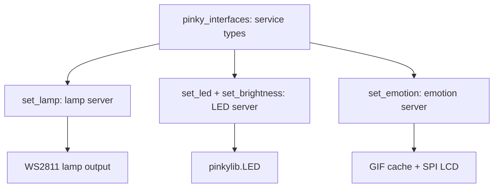

# pinky_interfaces — the contracts shared by expression devices

## 1. Package overview

This package generates **four custom service types**. A service type defines the request and response data; it does not start a server or drive hardware. The actual servers live in `pinky_lamp_control`, `pinky_led` and `pinky_emotion`. **[Code confirmed]** [pinky_interfaces/CMakeLists.txt:9-37](https://github.com/seljb/pinky_pro/blob/014a09f289e6988894fbffde2624fdb1e257815b/pinky_interfaces/CMakeLists.txt#L9-L37) [pinky_lamp_control/src/main_node.cpp:62-67](https://github.com/seljb/pinky_pro/blob/014a09f289e6988894fbffde2624fdb1e257815b/pinky_lamp_control/src/main_node.cpp#L62-L67) [pinky_led/pinky_led/led_server.py:8-16](https://github.com/seljb/pinky_pro/blob/014a09f289e6988894fbffde2624fdb1e257815b/pinky_led/pinky_led/led_server.py#L8-L16) [pinky_emotion/pinky_emotion/emotion_server.py:10-34](https://github.com/seljb/pinky_pro/blob/014a09f289e6988894fbffde2624fdb1e257815b/pinky_emotion/pinky_emotion/emotion_server.py#L10-L34)

## 2. Package structure

| File | Purpose |
|---|---|
| `srv/SetLamp.srv` | Color, mode and timing for lamp animation |
| `srv/SetLed.srv` | Pixel/all-LED command with integer color fields |
| `srv/SetBrightness.srv` | Integer brightness request |
| `srv/Emotion.srv` | Emotion-name request and textual response |
| `CMakeLists.txt` | Registers all four service definitions with ROSIDL |
| `package.xml` | Generator/runtime and message dependencies |

`MSG_FILES` and `ACTION_FILES` are empty. Thus this baseline defines no custom `.msg` or `.action` types here; using standard ROS messages or a Nav2 action elsewhere is a separate matter. [pinky_interfaces/CMakeLists.txt:9-37](https://github.com/seljb/pinky_pro/blob/014a09f289e6988894fbffde2624fdb1e257815b/pinky_interfaces/CMakeLists.txt#L9-L37)

## 3. Executable nodes

None. The CMake file generates interfaces but declares no executable or ROS node. It is useful to distinguish a generated type such as `pinky_interfaces/srv/SetLamp` from a service instance named `set_lamp`. [pinky_interfaces/CMakeLists.txt:9-37](https://github.com/seljb/pinky_pro/blob/014a09f289e6988894fbffde2624fdb1e257815b/pinky_interfaces/CMakeLists.txt#L9-L37)

## 4. Communication interfaces

| Type | Request | Response | Server source |
|---|---|---|---|
| `SetLamp` | `std_msgs/ColorRGBA color`, `uint8 mode`, `uint16 time` | `bool result` | `PinkyLampControl.callback_set_lamp` |
| `SetLed` | `string command`, `int32[] pixels`, `int32 r,g,b` | `bool success`, `string message` | `LedServiceServer.set_led_callback` |
| `SetBrightness` | `int32 brightness` | `bool success`, `string message` | `LedServiceServer.set_brightness_callback` |
| `Emotion` | `string emotion` | `string response` | `PinkyEmotion.set_emotion_callback` in `emotion_server.py` |

Exact schemas: [pinky_interfaces/srv/SetLamp.srv:1-5](https://github.com/seljb/pinky_pro/blob/014a09f289e6988894fbffde2624fdb1e257815b/pinky_interfaces/srv/SetLamp.srv#L1-L5) [pinky_interfaces/srv/SetLed.srv:1-11](https://github.com/seljb/pinky_pro/blob/014a09f289e6988894fbffde2624fdb1e257815b/pinky_interfaces/srv/SetLed.srv#L1-L11) [pinky_interfaces/srv/SetBrightness.srv:1-4](https://github.com/seljb/pinky_pro/blob/014a09f289e6988894fbffde2624fdb1e257815b/pinky_interfaces/srv/SetBrightness.srv#L1-L4) [pinky_interfaces/srv/Emotion.srv:1-3](https://github.com/seljb/pinky_pro/blob/014a09f289e6988894fbffde2624fdb1e257815b/pinky_interfaces/srv/Emotion.srv#L1-L3)

### Schema versus behavior

`SetLamp` carries floating-point color components inside `ColorRGBA`; the lamp server multiplies RGB by 255, casts to bytes and ignores alpha. `SetLed` carries integer RGB directly to `pinkylib.LED`. They are different contracts, even when both requests mean “make it red.” The schema alone does not encode accepted color ranges, pixel bounds, time units or supported mode values. [pinky_lamp_control/src/main_node.cpp:79-104](https://github.com/seljb/pinky_pro/blob/014a09f289e6988894fbffde2624fdb1e257815b/pinky_lamp_control/src/main_node.cpp#L79-L104) [pinky_led/pinky_led/led_server.py:18-79](https://github.com/seljb/pinky_pro/blob/014a09f289e6988894fbffde2624fdb1e257815b/pinky_led/pinky_led/led_server.py#L18-L79)

A `true` response means what its server implements. The lamp callback always sets `result=true` after storing values, without a range/mode check or render confirmation. LED responses follow the selected branch and caught exceptions. Emotion responds with a string rather than a success boolean. [pinky_lamp_control/src/main_node.cpp:79-104](https://github.com/seljb/pinky_pro/blob/014a09f289e6988894fbffde2624fdb1e257815b/pinky_lamp_control/src/main_node.cpp#L79-L104) [pinky_led/pinky_led/led_server.py:18-79](https://github.com/seljb/pinky_pro/blob/014a09f289e6988894fbffde2624fdb1e257815b/pinky_led/pinky_led/led_server.py#L18-L79) [pinky_emotion/pinky_emotion/emotion_server.py:60-73](https://github.com/seljb/pinky_pro/blob/014a09f289e6988894fbffde2624fdb1e257815b/pinky_emotion/pinky_emotion/emotion_server.py#L60-L73)

## 5. Dependencies

The manifest lists `ament_cmake`, `rosidl_default_generators`, `std_msgs`, `action_msgs`, `builtin_interfaces` and `rosidl_default_runtime`, and joins `rosidl_interface_packages`. CMake passes the three message packages to interface generation. Declaring `action_msgs` does not mean this package defines an action. [pinky_interfaces/package.xml:10-25](https://github.com/seljb/pinky_pro/blob/014a09f289e6988894fbffde2624fdb1e257815b/pinky_interfaces/package.xml#L10-L25) [pinky_interfaces/CMakeLists.txt:9-37](https://github.com/seljb/pinky_pro/blob/014a09f289e6988894fbffde2624fdb1e257815b/pinky_interfaces/CMakeLists.txt#L9-L37)

## 6. Related pipelines

- [Sensors and expression](../01_Architecture/sensors-and-expression.md)
- [Interface atlas](../04_Features/ros2-interface-atlas.md)
- [Lamp server](pinky_lamp_control.md)
- [LED server](pinky_led.md)
- [Emotion server](pinky_emotion.md)

## 7. Related code and parameters

There are no runtime node parameters in these `.srv` definitions. Request fields are per-call data, while parameters such as emotion frame skipping configure a node. Study the server page to learn validation, defaults and side effects rather than inferring them from integer types. [pinky_interfaces/srv/SetLamp.srv:1-5](https://github.com/seljb/pinky_pro/blob/014a09f289e6988894fbffde2624fdb1e257815b/pinky_interfaces/srv/SetLamp.srv#L1-L5) [pinky_interfaces/srv/SetLed.srv:1-11](https://github.com/seljb/pinky_pro/blob/014a09f289e6988894fbffde2624fdb1e257815b/pinky_interfaces/srv/SetLed.srv#L1-L11) [pinky_interfaces/srv/SetBrightness.srv:1-4](https://github.com/seljb/pinky_pro/blob/014a09f289e6988894fbffde2624fdb1e257815b/pinky_interfaces/srv/SetBrightness.srv#L1-L4) [pinky_interfaces/srv/Emotion.srv:1-3](https://github.com/seljb/pinky_pro/blob/014a09f289e6988894fbffde2624fdb1e257815b/pinky_interfaces/srv/Emotion.srv#L1-L3)

## 8. Verification and open questions

**[Code confirmed]** Four schemas, their registration and the corresponding server declarations were inspected. **[Unverified]** Generated bindings, installed type support, server availability and hardware effects were not tested.

**Check yourself.** Is `mode` a ROS parameter? **Answer:** Here it is a `SetLamp` request field. Does compiling the interface package create `set_lamp` in the ROS graph? **Answer:** No; the server node must also run.

> 작업 메모: 타입 정의와 서비스 인스턴스 이름을 구분한다. 범위와 단위는 서비스 스키마만 보고 확정하지 않는다.

[Wiki index](../index.md)
