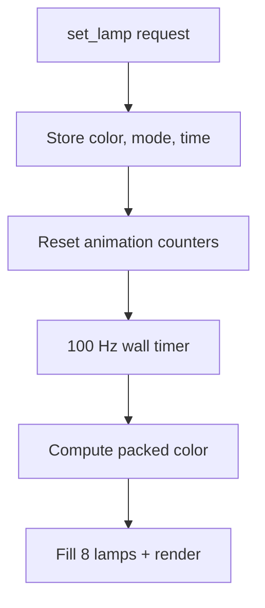

# pinky_lamp_control — service requests become a timed light pattern

## 1. Package overview

This C++ hardware server stores a requested RGB color, mode and time, then a 100 Hz timer renders the pattern on an eight-element lamp strip. A service call updates the target; it does not wait for a complete animation cycle. **[Code confirmed]** [pinky_lamp_control/src/main_node.cpp:32-68](https://github.com/seljb/pinky_pro/blob/014a09f289e6988894fbffde2624fdb1e257815b/pinky_lamp_control/src/main_node.cpp#L32-L68) [pinky_lamp_control/src/main_node.cpp:79-104](https://github.com/seljb/pinky_pro/blob/014a09f289e6988894fbffde2624fdb1e257815b/pinky_lamp_control/src/main_node.cpp#L79-L104) [pinky_lamp_control/src/main_node.cpp:106-159](https://github.com/seljb/pinky_pro/blob/014a09f289e6988894fbffde2624fdb1e257815b/pinky_lamp_control/src/main_node.cpp#L106-L159)

## 2. Package structure

| File | Role |
|---|---|
| `src/main_node.cpp` | `PinkyLampControl`, animation state and WS2811 calls |
| `CMakeLists.txt` | C++20, ARM64 executable and external `ws2811` link |
| `package.xml` | `rclcpp`, `std_msgs`, `pinky_interfaces` declarations |
| `README.md` | Device-specific boot/module setup notes; not automatically applied by the node |

The static hardware configuration selects GPIO `19`, DMA channel `10`, eight lamps, `WS2811_STRIP_GBR` and brightness `255`. Those are hardcoded fields, not declared ROS parameters. [pinky_lamp_control/src/main_node.cpp:12-27](https://github.com/seljb/pinky_pro/blob/014a09f289e6988894fbffde2624fdb1e257815b/pinky_lamp_control/src/main_node.cpp#L12-L27)

## 3. Executable nodes

| Node | Executable | Role | Evidence |
|---|---|---|---|
| `pinky_lamp_control` | `main_node` | Service server plus lamp-render timer | [pinky_lamp_control/src/main_node.cpp:32-68](https://github.com/seljb/pinky_pro/blob/014a09f289e6988894fbffde2624fdb1e257815b/pinky_lamp_control/src/main_node.cpp#L32-L68) [pinky_lamp_control/CMakeLists.txt:4-35](https://github.com/seljb/pinky_pro/blob/014a09f289e6988894fbffde2624fdb1e257815b/pinky_lamp_control/CMakeLists.txt#L4-L35) |

CMake creates/installs the executable only when `CMAKE_SYSTEM_PROCESSOR` is `aarch64`. It uses `/usr/local/include` and links `ws2811`; the manifest does not declare that external library directly. No build or device setup was run. [pinky_lamp_control/CMakeLists.txt:4-35](https://github.com/seljb/pinky_pro/blob/014a09f289e6988894fbffde2624fdb1e257815b/pinky_lamp_control/CMakeLists.txt#L4-L35) [pinky_lamp_control/package.xml:10-20](https://github.com/seljb/pinky_pro/blob/014a09f289e6988894fbffde2624fdb1e257815b/pinky_lamp_control/package.xml#L10-L20)

## 4. Communication interfaces

| Interface | Type | Behavior |
|---|---|---|
| `set_lamp` service | `pinky_interfaces/srv/SetLamp` | Stores RGB, mode and time, resets animation indices, responds `result=true` |

Source names are relative and may be namespaced/remapped. The server creates no topic publisher/subscriber. RGB floats are multiplied by `255` and cast to `uint8_t`; `color.a` is not used. No explicit input clamping or mode validation is present. [pinky_lamp_control/src/main_node.cpp:79-104](https://github.com/seljb/pinky_pro/blob/014a09f289e6988894fbffde2624fdb1e257815b/pinky_lamp_control/src/main_node.cpp#L79-L104) [pinky_interfaces/srv/SetLamp.srv:1-5](https://github.com/seljb/pinky_pro/blob/014a09f289e6988894fbffde2624fdb1e257815b/pinky_interfaces/srv/SetLamp.srv#L1-L5)

| `mode` | Timer branch | Timing interpretation |
|---|---|---|
| `0` | Sets packed color `0xff000000` | Off intent in source |
| `1` | Combines requested RGB into packed color | Constant requested color |
| `2` | Alternates on/off when `time_index * 10 > current_time` | Time is compared against 10 ms timer ticks; **[Inference]** millisecond half-cycle intent |
| `3` | Moves HSV value up/down, converts back to RGB | Step uses `(goal_v*100)/(current_time/10.0)` |
| Other values | No matching update branch | Previous `target_color` remains and is still rendered |

The comparisons use `>` rather than `>=`, so `time=1000` is not a promise of an exact one-second measured half-cycle. The timer frequency, scheduling and integer counter assignment all matter. [pinky_lamp_control/src/main_node.cpp:106-159](https://github.com/seljb/pinky_pro/blob/014a09f289e6988894fbffde2624fdb1e257815b/pinky_lamp_control/src/main_node.cpp#L106-L159)

The constructor chooses white RGB, mode `3`, time `1000`, direction/index zero and a black target before the first timer callback. All eight elements receive the same computed color; this is not per-pixel addressable behavior through the ROS service. [pinky_lamp_control/src/main_node.cpp:32-68](https://github.com/seljb/pinky_pro/blob/014a09f289e6988894fbffde2624fdb1e257815b/pinky_lamp_control/src/main_node.cpp#L32-L68) [pinky_lamp_control/src/main_node.cpp:161-177](https://github.com/seljb/pinky_pro/blob/014a09f289e6988894fbffde2624fdb1e257815b/pinky_lamp_control/src/main_node.cpp#L161-L177)

## 5. Dependencies

`pinky_interfaces` supplies the schema, `rclcpp` supplies ROS execution, and `ws2811` drives the hardware. This package differs from [pinky_led](pinky_led.md), which delegates to `pinkylib.LED` and exposes different service types. The Gazebo lamp plugin changes a simulated visual's green material; its code is not a ROS `SetLamp` server. [pinky_lamp_control/CMakeLists.txt:4-35](https://github.com/seljb/pinky_pro/blob/014a09f289e6988894fbffde2624fdb1e257815b/pinky_lamp_control/CMakeLists.txt#L4-L35) [pinky_gz_sim/plugins/gz_lamp_control_plugin.cpp:34-67](https://github.com/seljb/pinky_pro/blob/014a09f289e6988894fbffde2624fdb1e257815b/pinky_gz_sim/plugins/gz_lamp_control_plugin.cpp#L34-L67)

## 6. Related pipelines

- [Sensors and expression](../01_Architecture/sensors-and-expression.md)
- [Service contracts](pinky_interfaces.md)
- [Simulation pipeline](../01_Architecture/simulation-pipeline.md)

Real-robot bringup does not launch this node in the tracked file. Its separate README describes platform setup, but those system settings were not inspected or changed on this PC. [pinky_bringup/launch/bringup_robot.launch.xml:3-29](https://github.com/seljb/pinky_pro/blob/014a09f289e6988894fbffde2624fdb1e257815b/pinky_bringup/launch/bringup_robot.launch.xml#L3-L29) [pinky_lamp_control/README.md:3-49](https://github.com/seljb/pinky_pro/blob/014a09f289e6988894fbffde2624fdb1e257815b/pinky_lamp_control/README.md#L3-L49)

## 7. Related code and parameters

`color`, `mode` and `time` are **request fields**, not ROS parameters. Their effects are implemented by `callback_set_lamp` and `timer_callback`. Hardware configuration and the 100 Hz period are constants. [pinky_interfaces/srv/SetLamp.srv:1-5](https://github.com/seljb/pinky_pro/blob/014a09f289e6988894fbffde2624fdb1e257815b/pinky_interfaces/srv/SetLamp.srv#L1-L5) [pinky_lamp_control/src/main_node.cpp:12-27](https://github.com/seljb/pinky_pro/blob/014a09f289e6988894fbffde2624fdb1e257815b/pinky_lamp_control/src/main_node.cpp#L12-L27) [pinky_lamp_control/src/main_node.cpp:32-68](https://github.com/seljb/pinky_pro/blob/014a09f289e6988894fbffde2624fdb1e257815b/pinky_lamp_control/src/main_node.cpp#L32-L68) [pinky_lamp_control/src/main_node.cpp:79-104](https://github.com/seljb/pinky_pro/blob/014a09f289e6988894fbffde2624fdb1e257815b/pinky_lamp_control/src/main_node.cpp#L79-L104)

A dimming request with `time=0` reaches a division by `current_time/10.0`; no guard is shown. Dimming stores progress in an `int16_t`; a fractional increment can truncate to zero for some color/time combinations. **[Inference]** These paths need focused validation before relying on every representable request value. The callback's `true` result does not validate either condition or confirm hardware output. [pinky_lamp_control/src/main_node.cpp:79-104](https://github.com/seljb/pinky_pro/blob/014a09f289e6988894fbffde2624fdb1e257815b/pinky_lamp_control/src/main_node.cpp#L79-L104) [pinky_lamp_control/src/main_node.cpp:106-159](https://github.com/seljb/pinky_pro/blob/014a09f289e6988894fbffde2624fdb1e257815b/pinky_lamp_control/src/main_node.cpp#L106-L159) [pinky_lamp_control/src/main_node.cpp:237-249](https://github.com/seljb/pinky_pro/blob/014a09f289e6988894fbffde2624fdb1e257815b/pinky_lamp_control/src/main_node.cpp#L237-L249)

## 8. Verification and open questions

**[Code confirmed]** Schema mapping, mode branches, defaults and platform condition were checked at the metadata SHA. **[Unverified]** Pin wiring, kernel/module setup, color order, actual animation timing and render success were not tested. The destructor renders off, but it does not show a `free(matrix_)` or `ws2811_fini` call. [pinky_lamp_control/src/main_node.cpp:70-76](https://github.com/seljb/pinky_pro/blob/014a09f289e6988894fbffde2624fdb1e257815b/pinky_lamp_control/src/main_node.cpp#L70-L76)

**Check yourself.** Does `result=true` prove the lamp became red? **Answer:** It confirms the callback stored values and returned its constant result; rendering occurs later. Can `set_lamp` set element 4 alone? **Answer:** The implementation fills all eight elements with the same color.

> 작업 메모: 시간의 ms 해석은 10 ms 주기와 비교식에 근거한 추론이다. 실제 주기나 하드웨어 성공으로 기록하지 않는다.

[Wiki index](../index.md)
