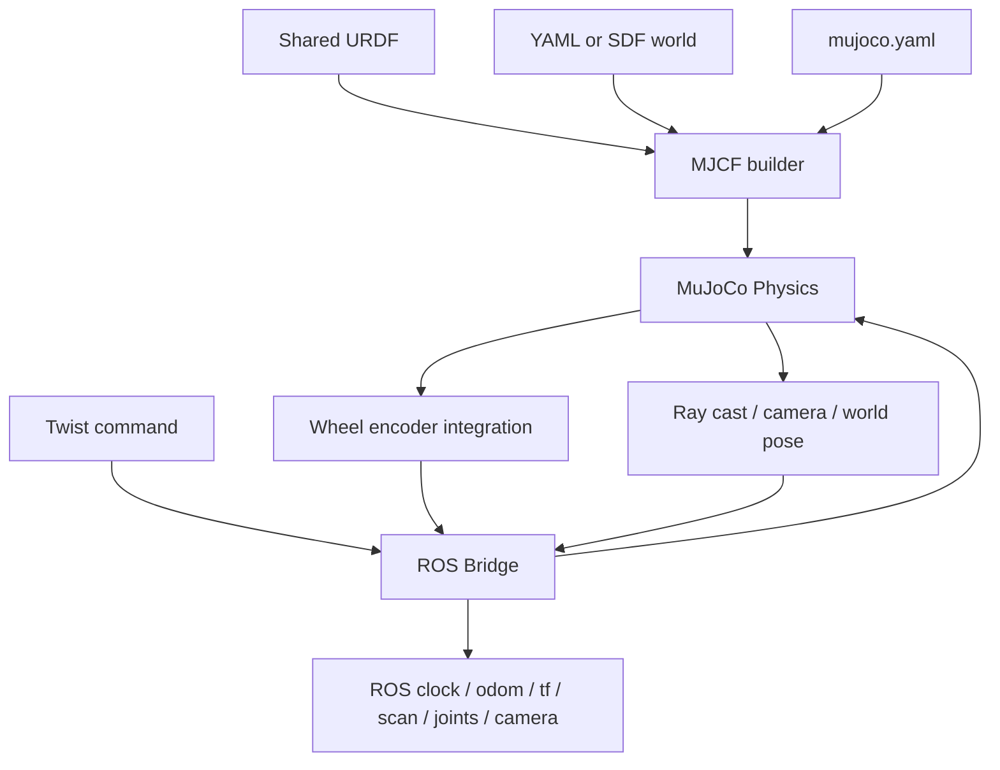

# pinky_mujoco — model conversion, physics and ROS bridge

## 1. Package overview

**Learning goal:** explain how a shared URDF becomes a MuJoCo scene, how a velocity request reaches wheel motors, and why odometry differs from ground truth. This is the default simulator selected by `bringup_sim.launch.xml`. Its Python bridge performs ROS communication while `Physics` handles model state, wheel integration and ray-cast lidar. [pinky_bringup/launch/bringup_sim.launch.xml:14-40](https://github.com/seljb/pinky_pro/blob/014a09f289e6988894fbffde2624fdb1e257815b/pinky_bringup/launch/bringup_sim.launch.xml#L14-L40), [pinky_mujoco/pinky_mujoco/model.py:189-252](https://github.com/seljb/pinky_pro/blob/014a09f289e6988894fbffde2624fdb1e257815b/pinky_mujoco/pinky_mujoco/model.py#L189-L252)

The description helper forces `is_sim=false`: that suppresses **Gazebo-specific plugins**. It does not disable MuJoCo simulation. The launch separately gives both ROS nodes `use_sim_time=true`. [pinky_mujoco/pinky_mujoco/description.py:6-12](https://github.com/seljb/pinky_pro/blob/014a09f289e6988894fbffde2624fdb1e257815b/pinky_mujoco/pinky_mujoco/description.py#L6-L12), [pinky_mujoco/launch/launch_sim.launch.py:72-79](https://github.com/seljb/pinky_pro/blob/014a09f289e6988894fbffde2624fdb1e257815b/pinky_mujoco/launch/launch_sim.launch.py#L72-L79)

## 2. Package structure

| File | Responsibility | Main function/class |
|---|---|---|
| `launch/launch_sim.launch.py` | Resolve world, expand/write URDF, configure bridge and state publisher | `resolve_world`, `setup` |
| `description.py` | Expand common Xacro and resolve mesh URIs | `expand_urdf`, `resolve_mesh` |
| `model.py` | Create MJCF scene, validate rates, advance physics, integrate odom, cast lidar | `build_model`, `Physics` |
| `world.py` | Convert YAML box lists or supported SDF geometry | `WorldBuilder` |
| `meshes.py` | Split visual meshes by material, cache converted parts, register assets | `convert_visual_mesh`, `AssetRegistry` |
| `bridge.py` | ROS messages, command timeout, clock, camera, realtime loop | `Bridge`, `FrontCamera`, `main` |
| `config/mujoco.yaml` | Physics, contact, motors, rates, lidar, control and camera settings | loaded by `load_settings` |

Evidence: [pinky_mujoco/launch/launch_sim.launch.py:31-79](https://github.com/seljb/pinky_pro/blob/014a09f289e6988894fbffde2624fdb1e257815b/pinky_mujoco/launch/launch_sim.launch.py#L31-L79), [pinky_mujoco/pinky_mujoco/model.py:28-55](https://github.com/seljb/pinky_pro/blob/014a09f289e6988894fbffde2624fdb1e257815b/pinky_mujoco/pinky_mujoco/model.py#L28-L55), [pinky_mujoco/pinky_mujoco/world.py:86-113](https://github.com/seljb/pinky_pro/blob/014a09f289e6988894fbffde2624fdb1e257815b/pinky_mujoco/pinky_mujoco/world.py#L86-L113), [pinky_mujoco/pinky_mujoco/meshes.py:55-86](https://github.com/seljb/pinky_pro/blob/014a09f289e6988894fbffde2624fdb1e257815b/pinky_mujoco/pinky_mujoco/meshes.py#L55-L86), [pinky_mujoco/pinky_mujoco/bridge.py:127-186](https://github.com/seljb/pinky_pro/blob/014a09f289e6988894fbffde2624fdb1e257815b/pinky_mujoco/pinky_mujoco/bridge.py#L127-L186).

### Model construction in plain language

1. Expand the common Xacro and parse links and joints.
2. Add simulator physics/contact defaults, a floor and selected world geometry.
3. Start the physical robot at `base_link` with a free joint. Recreate its descendants, continuous hinge joints, explicit inertias and visual/collision geometries.
4. Add lidar site, front camera and left/right velocity actuators.
5. Save `scene.xml`; load it into `Physics`.

These steps follow [pinky_mujoco/pinky_mujoco/model.py:48-90](https://github.com/seljb/pinky_pro/blob/014a09f289e6988894fbffde2624fdb1e257815b/pinky_mujoco/pinky_mujoco/model.py#L48-L90), [pinky_mujoco/pinky_mujoco/model.py:131-181](https://github.com/seljb/pinky_pro/blob/014a09f289e6988894fbffde2624fdb1e257815b/pinky_mujoco/pinky_mujoco/model.py#L131-L181), [pinky_mujoco/pinky_mujoco/model.py:189-212](https://github.com/seljb/pinky_pro/blob/014a09f289e6988894fbffde2624fdb1e257815b/pinky_mujoco/pinky_mujoco/model.py#L189-L212). Unsupported joint types and rotated inertias raise errors; the converter is tailored to the current robot, not a general arbitrary-URDF converter. [pinky_mujoco/pinky_mujoco/model.py:138-155](https://github.com/seljb/pinky_pro/blob/014a09f289e6988894fbffde2624fdb1e257815b/pinky_mujoco/pinky_mujoco/model.py#L138-L155)

SDF worlds are converted into static geometry. The traversal handles nested models, links and includes; it does not instantiate the SDF plugins, lights or sensors. Planes are skipped or converted to textured visual quads, and the MuJoCo scene has its own floor. Thus opening the same world filename in both simulators does not imply identical dynamics. [pinky_mujoco/pinky_mujoco/world.py:1-5](https://github.com/seljb/pinky_pro/blob/014a09f289e6988894fbffde2624fdb1e257815b/pinky_mujoco/pinky_mujoco/world.py#L1-L5), [pinky_mujoco/pinky_mujoco/world.py:116-148](https://github.com/seljb/pinky_pro/blob/014a09f289e6988894fbffde2624fdb1e257815b/pinky_mujoco/pinky_mujoco/world.py#L116-L148), [pinky_mujoco/pinky_mujoco/world.py:202-215](https://github.com/seljb/pinky_pro/blob/014a09f289e6988894fbffde2624fdb1e257815b/pinky_mujoco/pinky_mujoco/world.py#L202-L215)

## 3. Running nodes

| Node | Executable | Responsibility | Evidence |
|---|---|---|---|
| `pinky_mujoco` | `pinky_mujoco/bridge` | Simulation and ROS bridge | [pinky_mujoco/setup.py:33-36](https://github.com/seljb/pinky_pro/blob/014a09f289e6988894fbffde2624fdb1e257815b/pinky_mujoco/setup.py#L33-L36), [pinky_mujoco/launch/launch_sim.launch.py:72-75](https://github.com/seljb/pinky_pro/blob/014a09f289e6988894fbffde2624fdb1e257815b/pinky_mujoco/launch/launch_sim.launch.py#L72-L75) |
| `robot_state_publisher` | external package executable | Publishes robot transforms using the same expanded URDF | [pinky_mujoco/launch/launch_sim.launch.py:76-78](https://github.com/seljb/pinky_pro/blob/014a09f289e6988894fbffde2624fdb1e257815b/pinky_mujoco/launch/launch_sim.launch.py#L76-L78) |

The launch writes `robot.urdf` under `PINKY_MODEL_DIR` or `~/.cache/pinky_mujoco`. Model construction also writes generated URDF/MJCF and world records to its output directory. This analysis only read those statements; it did not execute them. [pinky_mujoco/launch/launch_sim.launch.py:44-50](https://github.com/seljb/pinky_pro/blob/014a09f289e6988894fbffde2624fdb1e257815b/pinky_mujoco/launch/launch_sim.launch.py#L44-L50), [pinky_mujoco/pinky_mujoco/model.py:51-56](https://github.com/seljb/pinky_pro/blob/014a09f289e6988894fbffde2624fdb1e257815b/pinky_mujoco/pinky_mujoco/model.py#L51-L56), [pinky_mujoco/pinky_mujoco/model.py:89-91](https://github.com/seljb/pinky_pro/blob/014a09f289e6988894fbffde2624fdb1e257815b/pinky_mujoco/pinky_mujoco/model.py#L89-L91), [pinky_mujoco/pinky_mujoco/model.py:178-181](https://github.com/seljb/pinky_pro/blob/014a09f289e6988894fbffde2624fdb1e257815b/pinky_mujoco/pinky_mujoco/model.py#L178-L181)

## 4. Communication interfaces

| Interface | Type | Direction | Meaning |
|---|---|---|---|
| `/cmd_vel` | `geometry_msgs/msg/Twist` | subscribe | Desired linear.x and angular.z |
| `/cmd_vel_stamped` | `geometry_msgs/msg/TwistStamped` | subscribe | Uses the enclosed twist; incoming header is not checked |
| `/clock` | `rosgraph_msgs/msg/Clock` | publish | MuJoCo simulation time |
| `/odom` | `nav_msgs/msg/Odometry` | publish | Integrated wheel encoder motion in `odom` |
| `/ground_truth` | `geometry_msgs/msg/PoseStamped` | publish | Simulated planar base pose in `world` |
| `/scan` | `sensor_msgs/msg/LaserScan` | publish | Rays from `rplidar_link`, sensor-data QoS |
| `/joint_states` | `sensor_msgs/msg/JointState` | publish | Four wheel/caster joint angles and velocities |
| `/tf` | TransformBroadcaster output | publish | Matching `odom → base_footprint` transform |
| `camera/image_raw` | `sensor_msgs/msg/Image` | publish if enabled | RGB8 rendered front camera |
| `camera/camera_info` | `sensor_msgs/msg/CameraInfo` | publish if enabled | Intrinsic camera data |

Evidence: [pinky_mujoco/pinky_mujoco/bridge.py:137-151](https://github.com/seljb/pinky_pro/blob/014a09f289e6988894fbffde2624fdb1e257815b/pinky_mujoco/pinky_mujoco/bridge.py#L137-L151), [pinky_mujoco/pinky_mujoco/bridge.py:174-215](https://github.com/seljb/pinky_pro/blob/014a09f289e6988894fbffde2624fdb1e257815b/pinky_mujoco/pinky_mujoco/bridge.py#L174-L215), [pinky_mujoco/pinky_mujoco/bridge.py:46-58](https://github.com/seljb/pinky_pro/blob/014a09f289e6988894fbffde2624fdb1e257815b/pinky_mujoco/pinky_mujoco/bridge.py#L46-L58), [pinky_mujoco/pinky_mujoco/bridge.py:112-124](https://github.com/seljb/pinky_pro/blob/014a09f289e6988894fbffde2624fdb1e257815b/pinky_mujoco/pinky_mujoco/bridge.py#L112-L124), [pinky_mujoco/config/mujoco.yaml:53-55](https://github.com/seljb/pinky_pro/blob/014a09f289e6988894fbffde2624fdb1e257815b/pinky_mujoco/config/mujoco.yaml#L53-L55). This bridge does not create an IMU publisher or lamp service.

### From command to odometry

`receive_command` discards non-finite x/z values, clamps the accepted command, and records **wall-clock monotonic receipt time**. `advance` substitutes `(0,0)` once the receipt age reaches `command_timeout`, calls `Physics.step`, publishes clock and schedules state/scan outputs. The stamped-command callback passes only `msg.twist`; its header does not define command age here. [pinky_mujoco/pinky_mujoco/bridge.py:137-139](https://github.com/seljb/pinky_pro/blob/014a09f289e6988894fbffde2624fdb1e257815b/pinky_mujoco/pinky_mujoco/bridge.py#L137-L139), [pinky_mujoco/pinky_mujoco/bridge.py:158-184](https://github.com/seljb/pinky_pro/blob/014a09f289e6988894fbffde2624fdb1e257815b/pinky_mujoco/pinky_mujoco/bridge.py#L158-L184)

For requested linear velocity `v` and angular velocity `ω`:

```text
left wheel rate  = (v - ω × track / 2) / radius
right wheel rate = (v + ω × track / 2) / radius
```

The motor target is clipped to ±`max_speed`, optionally ramped each physics step, and applied to velocity actuators. Odometry uses the **resulting wheel angle differences**, not the original velocity request. With distances `dl`, `dr`, it uses `distance=(dl+dr)/2`, `angle=(dr-dl)/track` and midpoint heading. Slipping wheels can therefore make encoder odometry differ from simulated world pose. The formulas are code-confirmed; the slip explanation is inference, not an observed test result. [pinky_mujoco/pinky_mujoco/model.py:214-236](https://github.com/seljb/pinky_pro/blob/014a09f289e6988894fbffde2624fdb1e257815b/pinky_mujoco/pinky_mujoco/model.py#L214-L236)

**Worked example:** deriving `radius=0.028 m` and `track=0.0971 m` from the source, `v=0.10 m/s`, `ω=1 rad/s` requests approximately 1.8375 rad/s left and 5.3054 rad/s right before ramping/contact. A straight `v=0.10, ω=0` request gives both 3.5714 rad/s. These are arithmetic predictions, not measured speeds. [pinky_mujoco/pinky_mujoco/model.py:198-202](https://github.com/seljb/pinky_pro/blob/014a09f289e6988894fbffde2624fdb1e257815b/pinky_mujoco/pinky_mujoco/model.py#L198-L202), [pinky_description/urdf/pinky.urdf.xacro:42-58](https://github.com/seljb/pinky_pro/blob/014a09f289e6988894fbffde2624fdb1e257815b/pinky_description/urdf/pinky.urdf.xacro#L42-L58)

### Paper walkthrough: one received command, three different quantities

Use this example without running the robot or simulator. Suppose a message arrives with `linear.x=0.50 m/s` and `angular.z=2.0 rad/s`, with the checked configuration unchanged.

| Stage | Predicted value or operation | What this teaches |
|---|---|---|
| Receipt in `Bridge.receive_command` | Clamp to `v=0.25 m/s`, `ω=1.5 rad/s`; save monotonic receipt time | A requested command is not the accepted command |
| Kinematics in `Physics.step` | Left target ≈ `6.3277 rad/s`; right target ≈ `11.5295 rad/s` with radius `0.028 m`, track `0.0971 m` | Body velocity becomes two wheel targets; both are below the configured `14 rad/s` motor cap |
| Actuation | Move the actuator control toward those targets, with the configured ramp applied on each physics step | The target does not assert an instantaneous wheel velocity |
| State calculation | Read actual wheel-angle changes after stepping; integrate them into `physics.odom` | Odometry is feedback from simulated joint motion, not a copy of the input command |
| Publication | Publish odometry and matching TF on state ticks; sample lidar on scan ticks | State and scan messages have separate scheduling |

**[Code confirmed]** The clamp, finite-value check, target clipping, ramp, wheel-angle integration and publication schedule are in [Bridge receipt/advance](https://github.com/seljb/pinky_pro/blob/014a09f289e6988894fbffde2624fdb1e257815b/pinky_mujoco/pinky_mujoco/bridge.py#L158-L184), [Physics.step](https://github.com/seljb/pinky_pro/blob/014a09f289e6988894fbffde2624fdb1e257815b/pinky_mujoco/pinky_mujoco/model.py#L214-L236), and [source control/motor settings](https://github.com/seljb/pinky_pro/blob/014a09f289e6988894fbffde2624fdb1e257815b/pinky_mujoco/config/mujoco.yaml#L15-L42). **[Inference]** The numbers above are arithmetic predictions using the source-derived geometry; no speed or displacement was measured.

At receipt age **0.5 seconds or greater**, the default timeout makes `advance` send `(0,0)` to `Physics.step`. The same motor ramp and physics still apply. **[Inference]** This sets a zero target; it does not prove immediate standstill or a measured stopping distance. A message containing NaN or infinity is rejected before the receipt timestamp is refreshed. A finite message received on either command subscription replaces the shared command, and a stamped message's old header is not checked here. [Bridge command handling](https://github.com/seljb/pinky_pro/blob/014a09f289e6988894fbffde2624fdb1e257815b/pinky_mujoco/pinky_mujoco/bridge.py#L135-L139), [timeout comparison](https://github.com/seljb/pinky_pro/blob/014a09f289e6988894fbffde2624fdb1e257815b/pinky_mujoco/pinky_mujoco/bridge.py#L158-L167)

**Check yourself:** Does a new invalid command keep the previous finite command alive? **Answer:** No. The early return does not refresh `command_time`; the previous finite command ages toward the timeout. Does a fresh receipt of an old stamped message get rejected because of its header? **Answer:** No; the callback forwards only its `.twist`. These are implementation observations, not a recommendation to send such messages.

## 5. Dependencies

The manifest declares ROS/Python dependencies and the internal `pinky_description` and `pinky_gz_sim` packages. Its `mujoco==3.6.0`, `trimesh` and `pycollada` requirements appear in an XML comment, not executable dependency declarations; `setup.py` lists only `setuptools` under `install_requires`. On `aarch64`, setup emits an empty package and exits. Installation success and dependency availability are unverified. [pinky_mujoco/package.xml:10-31](https://github.com/seljb/pinky_pro/blob/014a09f289e6988894fbffde2624fdb1e257815b/pinky_mujoco/package.xml#L10-L31), [pinky_mujoco/setup.py:8-12](https://github.com/seljb/pinky_pro/blob/014a09f289e6988894fbffde2624fdb1e257815b/pinky_mujoco/setup.py#L8-L12), [pinky_mujoco/setup.py:26-26](https://github.com/seljb/pinky_pro/blob/014a09f289e6988894fbffde2624fdb1e257815b/pinky_mujoco/setup.py#L26-L26)

## 6. Related pipelines

See [Simulation pipeline](../01_Architecture/simulation-pipeline.md) for the launch-to-bridge overview, [Robot description and TF](../01_Architecture/robot-description-and-tf.md) for coordinate ownership, and [Gazebo package](pinky_gz_sim.md) for the comparison path.



## 7. Related code and parameters

These are file settings or launch defaults, not measured effective runtime values.

| Group | Source setting | Effect in implementation |
|---|---|---|
| physics | timestep 0.002 s; `implicitfast`; iterations 80; gravity `[0,0,-9.81]` | MJCF physics options |
| rates | bridge 100 Hz, state 50 Hz, scan 10 Hz | Five 0.002 s physics steps per bridge tick; state every 2 ticks, scan every 10 |
| motors | gain 0.08; max speed 14 rad/s; max torque 0.15; ramp 74.9 rad/s² | Actuator configuration, target clipping and ramp |
| control | max linear 0.25; max angular 1.5; timeout 0.5 s | Receipt-time command clamp and timeout |
| lidar | 360 samples; range 0.05–12.0 m | Equally spaced rays, endpoint π excluded; out-of-range → infinity |
| camera | enabled; 640×360; 15 fps; render share 0.25 | Render resolution and requested rate, potentially reduced |
| launch | GPU false; viewer true; camera true; camera pitch 8°; screen pitch −25° | Software GL defaults; image and viewer controls |

Sources: [pinky_mujoco/config/mujoco.yaml:2-55](https://github.com/seljb/pinky_pro/blob/014a09f289e6988894fbffde2624fdb1e257815b/pinky_mujoco/config/mujoco.yaml#L2-L55), [pinky_mujoco/pinky_mujoco/model.py:28-40](https://github.com/seljb/pinky_pro/blob/014a09f289e6988894fbffde2624fdb1e257815b/pinky_mujoco/pinky_mujoco/model.py#L28-L40), [pinky_mujoco/pinky_mujoco/model.py:195-209](https://github.com/seljb/pinky_pro/blob/014a09f289e6988894fbffde2624fdb1e257815b/pinky_mujoco/pinky_mujoco/model.py#L195-L209), [pinky_mujoco/pinky_mujoco/model.py:214-248](https://github.com/seljb/pinky_pro/blob/014a09f289e6988894fbffde2624fdb1e257815b/pinky_mujoco/pinky_mujoco/model.py#L214-L248), [pinky_mujoco/launch/launch_sim.launch.py:82-94](https://github.com/seljb/pinky_pro/blob/014a09f289e6988894fbffde2624fdb1e257815b/pinky_mujoco/launch/launch_sim.launch.py#L82-L94).

`load_settings(config_file)` reads either that file **or** the default file. Despite the CLI help calling it an override, this function does not merge a partial YAML over defaults. A supplied file must contain the groups its consumers require. [pinky_mujoco/pinky_mujoco/model.py:28-41](https://github.com/seljb/pinky_pro/blob/014a09f289e6988894fbffde2624fdb1e257815b/pinky_mujoco/pinky_mujoco/model.py#L28-L41), [pinky_mujoco/pinky_mujoco/bridge.py:225-233](https://github.com/seljb/pinky_pro/blob/014a09f289e6988894fbffde2624fdb1e257815b/pinky_mujoco/pinky_mujoco/bridge.py#L225-L233)

The track is computed from wheel-joint origins **plus collision-center offsets**: `2 × (0.04055 + 0.008) = 0.0971 m`. It is not the Gazebo DiffDrive's 0.0961 m declaration or merely the joint-origin spacing 0.0811 m. [pinky_description/urdf/pinky.urdf.xacro:42-58](https://github.com/seljb/pinky_pro/blob/014a09f289e6988894fbffde2624fdb1e257815b/pinky_description/urdf/pinky.urdf.xacro#L42-L58), [pinky_mujoco/pinky_mujoco/model.py:198-202](https://github.com/seljb/pinky_pro/blob/014a09f289e6988894fbffde2624fdb1e257815b/pinky_mujoco/pinky_mujoco/model.py#L198-L202), [pinky_description/urdf/pinky_gz.urdf.xacro:8-9](https://github.com/seljb/pinky_pro/blob/014a09f289e6988894fbffde2624fdb1e257815b/pinky_description/urdf/pinky_gz.urdf.xacro#L8-L9)

Camera setup can fail independently of physics. Renderer creation failure disables the camera, and slow rendering can increase its period based on measured render time and the configured share. A running physics loop does not establish camera health or a 15 Hz output. [pinky_mujoco/pinky_mujoco/bridge.py:63-104](https://github.com/seljb/pinky_pro/blob/014a09f289e6988894fbffde2624fdb1e257815b/pinky_mujoco/pinky_mujoco/bridge.py#L63-L104)

## 8. Verification and open questions

- **Code-confirmed [코드 확인]:** conversion steps, ROS contracts, formulas, source values and timeout logic.
- **Inference [추론]:** calculated wheel rates, derived track and odometry/ground-truth divergence under slip.
- **Unverified [미검증]:** model generation, external MuJoCo API behavior, physical realism, rates, camera output, navigation compatibility and all runtime tests. Existing source test files were not executed.
- `world` overrides `world_name`; names ending `.yaml` resolve under `pinky_mujoco/worlds`, other names under `pinky_gz_sim/worlds`. The CLI's default world is `room.yaml`, while the launch's default is `pinky_factory.world`. [pinky_mujoco/launch/launch_sim.launch.py:31-38](https://github.com/seljb/pinky_pro/blob/014a09f289e6988894fbffde2624fdb1e257815b/pinky_mujoco/launch/launch_sim.launch.py#L31-L38), [pinky_mujoco/launch/launch_sim.launch.py:88-90](https://github.com/seljb/pinky_pro/blob/014a09f289e6988894fbffde2624fdb1e257815b/pinky_mujoco/launch/launch_sim.launch.py#L88-L90), [pinky_mujoco/pinky_mujoco/model.py:44-45](https://github.com/seljb/pinky_pro/blob/014a09f289e6988894fbffde2624fdb1e257815b/pinky_mujoco/pinky_mujoco/model.py#L44-L45)
- Scan timestamps describe one simulation instant; `time_increment=0`, and no rolling scan is modeled. [pinky_mujoco/pinky_mujoco/bridge.py:174-183](https://github.com/seljb/pinky_pro/blob/014a09f289e6988894fbffde2624fdb1e257815b/pinky_mujoco/pinky_mujoco/bridge.py#L174-L183)

**Check yourself:** Why is `/ground_truth` not interchangeable with `/odom`? **Answer:** ground truth reads the simulated world pose, while odometry integrates wheel motion. They also use different frame IDs (`world` and `odom`). A controller or estimator must know which quantity it consumes.

> 작업 메모: MuJoCo를 실행하지 않고 변환·제어·발행 경로를 추적했다. 설정 파일 인수가 부분 병합되는 것으로 오해하지 않도록 실제 로딩 동작을 명시했다. 2026-11-19에는 명령 제한·수신 시각·timeout·실제 바퀴 피드백을 구분하는 종이 위 예제를 추가했다.
