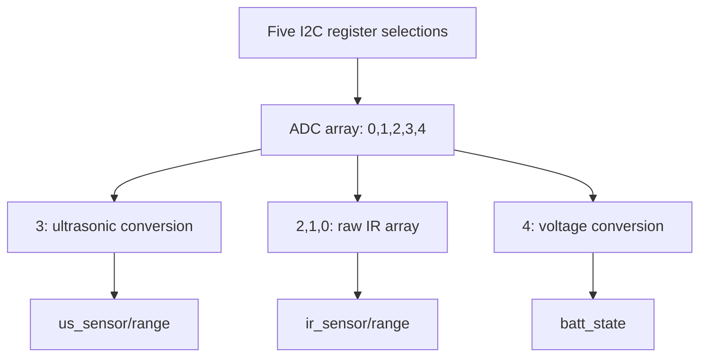

# pinky_sensor_adc — three messages from five ADC channels

## 1. Package overview

`PinkySensorADC` reads five 12-bit values through an I2C ADC and turns them into ultrasonic range, an IR array and battery voltage. The three outputs have different meanings: one converted distance, three unconverted sensor values, and a battery message. Treating them all as distances would lose that distinction. **[Code confirmed]** [pinky_sensor_adc/src/main_node.cpp:40-54](https://github.com/seljb/pinky_pro/blob/014a09f289e6988894fbffde2624fdb1e257815b/pinky_sensor_adc/src/main_node.cpp#L40-L54) [pinky_sensor_adc/src/main_node.cpp:56-92](https://github.com/seljb/pinky_pro/blob/014a09f289e6988894fbffde2624fdb1e257815b/pinky_sensor_adc/src/main_node.cpp#L56-L92)

## 2. Package structure

| File | Role |
|---|---|
| `src/main_node.cpp` | `PinkySensorADC`, five-channel acquisition and messages |
| `CMakeLists.txt` | Creates `main_node` only on `aarch64`; links `wiringPi` |
| `package.xml` | Declares `rclcpp` and `sensor_msgs` dependencies |

CMake also requires `std_msgs` and `realtime_tools`, which are not directly declared in the manifest. Dependency searches occur before the ARM64 condition. [pinky_sensor_adc/CMakeLists.txt:9-28](https://github.com/seljb/pinky_pro/blob/014a09f289e6988894fbffde2624fdb1e257815b/pinky_sensor_adc/CMakeLists.txt#L9-L28) [pinky_sensor_adc/package.xml:10-20](https://github.com/seljb/pinky_pro/blob/014a09f289e6988894fbffde2624fdb1e257815b/pinky_sensor_adc/package.xml#L10-L20)

## 3. Executable nodes

| Node | Executable | Role | Evidence |
|---|---|---|---|
| `pinky_sensor_adc` | `main_node` | I2C address `0x08`; periodic sensor sampling | [pinky_sensor_adc/src/main_node.cpp:14-35](https://github.com/seljb/pinky_pro/blob/014a09f289e6988894fbffde2624fdb1e257815b/pinky_sensor_adc/src/main_node.cpp#L14-L35) [pinky_sensor_adc/src/main_node.cpp:104-110](https://github.com/seljb/pinky_pro/blob/014a09f289e6988894fbffde2624fdb1e257815b/pinky_sensor_adc/src/main_node.cpp#L104-L110) |

Declared parameters are `interface=/dev/i2c-1` and `rate=20.0`. The wall-timer period is `1/rate`; the nearby `100Hz` comment does not match the default value. Both parameters are read during construction. [pinky_sensor_adc/src/main_node.cpp:14-35](https://github.com/seljb/pinky_pro/blob/014a09f289e6988894fbffde2624fdb1e257815b/pinky_sensor_adc/src/main_node.cpp#L14-L35)

## 4. Communication interfaces

| Publish name | Type | Content |
|---|---|---|
| `us_sensor/range` | `sensor_msgs/msg/Range` | Timestamp, `ultrasonic_link`, converted ADC channel 3 |
| `ir_sensor/range` | `std_msgs/msg/UInt16MultiArray` | Raw values in channel order **2, 1, 0** |
| `batt_state` | `sensor_msgs/msg/BatteryState` | Timestamp, calculated voltage and fixed/unknown metadata |

All publishers use depth 10. These are relative source names; actual namespaces/remaps remain unobserved. There are no subscribers or services in this driver. [pinky_sensor_adc/src/main_node.cpp:14-35](https://github.com/seljb/pinky_pro/blob/014a09f289e6988894fbffde2624fdb1e257815b/pinky_sensor_adc/src/main_node.cpp#L14-L35) [pinky_sensor_adc/src/main_node.cpp:56-92](https://github.com/seljb/pinky_pro/blob/014a09f289e6988894fbffde2624fdb1e257815b/pinky_sensor_adc/src/main_node.cpp#L56-L92)

Each callback selects registers `[0x88, 0xC8, 0x98, 0xD8, 0xF8]`, waits 6 ms per selection, reads two bytes and combines them as `(byte0 << 4) + (byte1 >> 4)`. Five explicit waits total **30 ms per callback**, before I/O and message overhead. At the default 20 Hz, the nominal period is 50 ms. **[Inference]** Raising `rate` cannot remove the sampling time inside the callback. [pinky_sensor_adc/src/main_node.cpp:40-54](https://github.com/seljb/pinky_pro/blob/014a09f289e6988894fbffde2624fdb1e257815b/pinky_sensor_adc/src/main_node.cpp#L40-L54)

### What each value means

| Output | Implemented expression or assignment | Worked example / boundary |
|---|---|---|
| Ultrasonic `range` | `adc[3]/4096.0 - 0.03` | Raw 2048 → `0.47`; interpreted as distance by the Range message |
| Ultrasonic metadata | ultrasound, FOV `0.26`, minimum `0.02`, maximum `3.0`, variance `0` | Fixed metadata; not a calibration test |
| IR data | `[adc[2], adc[1], adc[0]]` | Values remain integer counts, despite the topic's `range` suffix |
| Battery voltage | `(adc[4]/4096.0)*4.096/(13.0/28.0)` | Raw 2048 → approximately `4.4111` V by this formula |
| Battery capacity/status | design capacity `5.0`; status unknown; health good; Li-ion technology | Fixed assignments, not measurements of those properties |
| Battery unknown values | temperature/current/charge/capacity/percentage = NaN | The driver does not calculate a battery percentage |

The range formula is not clamped to `min_range`/`max_range`. For a 12-bit input 0–4095, its algebraic output spans `-0.03` to about `0.96976`, although the message advertises `max_range=3.0`. This is a code/formula comparison, not proof of a faulty sensor or a proposed correction. I2C read/write return values are not checked. [pinky_sensor_adc/src/main_node.cpp:56-92](https://github.com/seljb/pinky_pro/blob/014a09f289e6988894fbffde2624fdb1e257815b/pinky_sensor_adc/src/main_node.cpp#L56-L92) [pinky_sensor_adc/src/main_node.cpp:40-54](https://github.com/seljb/pinky_pro/blob/014a09f289e6988894fbffde2624fdb1e257815b/pinky_sensor_adc/src/main_node.cpp#L40-L54)

## 5. Dependencies

The hardware access comes from `wiringPiI2C.h`; it is not the same path as `pinkylib.Battery` used by the wheel-bringup battery publisher. The latter publishes `Float32` on `battery/voltage` and `battery/percent`, with 5-second timers. `batt_state` is not automatically a substitute for either topic. [pinky_sensor_adc/src/main_node.cpp:1-9](https://github.com/seljb/pinky_pro/blob/014a09f289e6988894fbffde2624fdb1e257815b/pinky_sensor_adc/src/main_node.cpp#L1-L9) [pinky_bringup/pinky_bringup/battery_publisher.py:1-36](https://github.com/seljb/pinky_pro/blob/014a09f289e6988894fbffde2624fdb1e257815b/pinky_bringup/pinky_bringup/battery_publisher.py#L1-L36)

## 6. Related pipelines

- [Sensors and expression](../01_Architecture/sensors-and-expression.md)
- [Interface atlas](../04_Features/ros2-interface-atlas.md)
- [Bringup state publishing](../05_Code_Analysis/pinky_bringup--state-publishing.md)

The tracked real-robot launch does not start this driver. The supplied navigation wiring is not evidence that its ultrasonic or IR outputs are already configured as costmap inputs. [pinky_bringup/launch/bringup_robot.launch.xml:3-29](https://github.com/seljb/pinky_pro/blob/014a09f289e6988894fbffde2624fdb1e257815b/pinky_bringup/launch/bringup_robot.launch.xml#L3-L29)

## 7. Related code and parameters

`interface` selects the I2C bus path and `rate` controls the requested wall-timer frequency; address `0x08`, register order, conversion constants, output topics and sensor metadata are hardcoded. There is no dynamic-parameter callback or external ADC YAML in this package. [pinky_sensor_adc/src/main_node.cpp:14-35](https://github.com/seljb/pinky_pro/blob/014a09f289e6988894fbffde2624fdb1e257815b/pinky_sensor_adc/src/main_node.cpp#L14-L35) [pinky_sensor_adc/src/main_node.cpp:40-54](https://github.com/seljb/pinky_pro/blob/014a09f289e6988894fbffde2624fdb1e257815b/pinky_sensor_adc/src/main_node.cpp#L40-L54) [pinky_sensor_adc/src/main_node.cpp:56-92](https://github.com/seljb/pinky_pro/blob/014a09f289e6988894fbffde2624fdb1e257815b/pinky_sensor_adc/src/main_node.cpp#L56-L92)

## 8. Verification and open questions

**[Code confirmed]** Decoding, ordering, formulas and publisher declarations were statically checked at the metadata SHA. **[Unverified]** Hardware calibration, electrical scaling, actual sensor ranges, device presence, publish rate and consumption by navigation were not tested.

**Check yourself.** If `ir_sensor/range` reports `[120, 300, 450]`, can you infer meters? **Answer:** No; this driver copies raw ADC counts and gives no IR distance conversion. Does `health=GOOD` establish a healthy battery? **Answer:** No; the code assigns that constant without a health test.

> 작업 메모: ADC 변환식은 원문 그대로 기록했다. 실제 거리 보정, 분압 회로 값, 배터리 상태 판정은 계측으로 확인해야 한다.

[Wiki index](../index.md)
