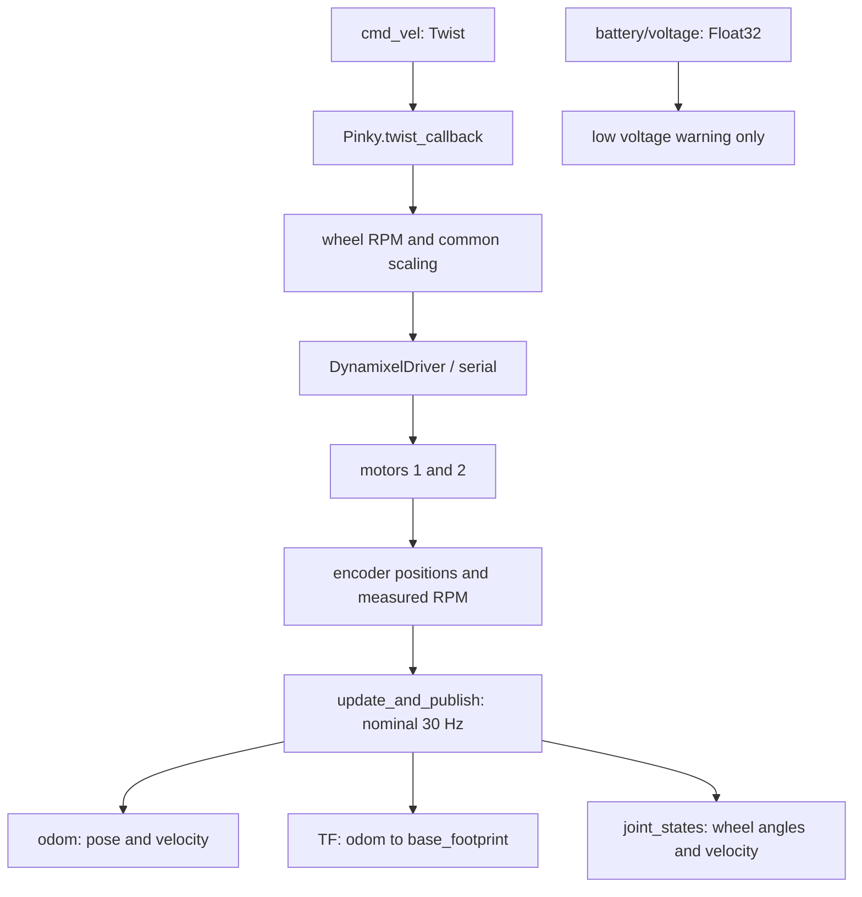

# From velocity command to measured motion

## 1. Learning target

Explain how a requested body velocity becomes motor commands, and how encoder feedback becomes an estimated pose. This is the English learning entry for `pinky_bringup`; the existing [package analysis](../02_Packages/pinky_bringup.md), [motor analysis](../05_Code_Analysis/pinky_bringup--motor-control.md), [state analysis](../05_Code_Analysis/pinky_bringup--state-publishing.md), [pipeline](../01_Architecture/pinky-bringup-pipeline.md) and [parameter catalog](../03_Parameters/pinky_bringup-parameters.md) retain the earlier Korean analysis.

**Code-confirmed / [코드 확인]** means that source definitions were inspected. **Inference / [추론]** marks a deduction. **Unverified / [미검증]** means no runtime evidence. Nothing here is a robot test.

## 2. Pipeline and mental model

A command describes what you want; feedback describes what the encoders report. The node does not copy commanded velocity into its measured pose. It computes pose from encoder differences. The SDK wrapper is a regular Python class, while `Pinky` is the ROS node. [pinky_bringup/pinky_bringup/bringup.py:36-53](https://github.com/seljb/pinky_pro/blob/014a09f289e6988894fbffde2624fdb1e257815b/pinky_bringup/pinky_bringup/bringup.py#L36-L53), [pinky_bringup/pinky_bringup/bringup.py:104-161](https://github.com/seljb/pinky_pro/blob/014a09f289e6988894fbffde2624fdb1e257815b/pinky_bringup/pinky_bringup/bringup.py#L104-L161), [pinky_bringup/pinky_bringup/dynamixel_driver.py:4-29](https://github.com/seljb/pinky_pro/blob/014a09f289e6988894fbffde2624fdb1e257815b/pinky_bringup/pinky_bringup/dynamixel_driver.py#L4-L29).



Diagram edges are source-level calls and message definitions, not a captured ROS graph. Evidence: [pinky_bringup/pinky_bringup/bringup.py:84-95](https://github.com/seljb/pinky_pro/blob/014a09f289e6988894fbffde2624fdb1e257815b/pinky_bringup/pinky_bringup/bringup.py#L84-L95), [pinky_bringup/pinky_bringup/bringup.py:104-205](https://github.com/seljb/pinky_pro/blob/014a09f289e6988894fbffde2624fdb1e257815b/pinky_bringup/pinky_bringup/bringup.py#L104-L205).

## 3. Related implementation and interfaces

| Question | Answer | Evidence |
|---|---|---|
| Which executable creates the control node? | `bringup` maps to `pinky_bringup.bringup:main`; node name `pinky_bringup` | [pinky_bringup/setup.py:24-28](https://github.com/seljb/pinky_pro/blob/014a09f289e6988894fbffde2624fdb1e257815b/pinky_bringup/setup.py#L24-L28); [pinky_bringup/pinky_bringup/bringup.py:36-38](https://github.com/seljb/pinky_pro/blob/014a09f289e6988894fbffde2624fdb1e257815b/pinky_bringup/pinky_bringup/bringup.py#L36-L38) |
| What command is read? | Relative topic `cmd_vel`, `geometry_msgs/msg/Twist`; only `linear.x` and `angular.z` are used | [pinky_bringup/pinky_bringup/bringup.py:8-19](https://github.com/seljb/pinky_pro/blob/014a09f289e6988894fbffde2624fdb1e257815b/pinky_bringup/pinky_bringup/bringup.py#L8-L19); [pinky_bringup/pinky_bringup/bringup.py:84-86](https://github.com/seljb/pinky_pro/blob/014a09f289e6988894fbffde2624fdb1e257815b/pinky_bringup/pinky_bringup/bringup.py#L84-L86); [pinky_bringup/pinky_bringup/bringup.py:104-109](https://github.com/seljb/pinky_pro/blob/014a09f289e6988894fbffde2624fdb1e257815b/pinky_bringup/pinky_bringup/bringup.py#L104-L109) |
| What feedback is published? | Relative `odom` (`Odometry`) and `joint_states` (`JointState`); TF parent `odom`, child `base_footprint` | [pinky_bringup/pinky_bringup/bringup.py:17-28](https://github.com/seljb/pinky_pro/blob/014a09f289e6988894fbffde2624fdb1e257815b/pinky_bringup/pinky_bringup/bringup.py#L17-L28); [pinky_bringup/pinky_bringup/bringup.py:163-195](https://github.com/seljb/pinky_pro/blob/014a09f289e6988894fbffde2624fdb1e257815b/pinky_bringup/pinky_bringup/bringup.py#L163-L195) |
| Which hardware connection? | `/dev/ttyAMA4`, 1,000,000 baud, motor IDs `[1, 2]` | [pinky_bringup/pinky_bringup/bringup.py:23-25](https://github.com/seljb/pinky_pro/blob/014a09f289e6988894fbffde2624fdb1e257815b/pinky_bringup/pinky_bringup/bringup.py#L23-L25) |
| Is battery handled by the motor driver? | A separate `battery_publisher` executable reads external `pinkylib.Battery`; node name is misspelled `battery_publihser` in source | [pinky_bringup/pinky_bringup/battery_publisher.py:4-36](https://github.com/seljb/pinky_pro/blob/014a09f289e6988894fbffde2624fdb1e257815b/pinky_bringup/pinky_bringup/battery_publisher.py#L4-L36); [pinky_bringup/setup.py:25-28](https://github.com/seljb/pinky_pro/blob/014a09f289e6988894fbffde2624fdb1e257815b/pinky_bringup/setup.py#L25-L28) |
| What ROS communication settings are explicit? | Publisher/subscription depth arguments are 10; the source does not individually set reliability or durability | [pinky_bringup/pinky_bringup/bringup.py:84-95](https://github.com/seljb/pinky_pro/blob/014a09f289e6988894fbffde2624fdb1e257815b/pinky_bringup/pinky_bringup/bringup.py#L84-L95); [pinky_bringup/pinky_bringup/battery_publisher.py:12-22](https://github.com/seljb/pinky_pro/blob/014a09f289e6988894fbffde2624fdb1e257815b/pinky_bringup/pinky_bringup/battery_publisher.py#L12-L22) |

Relative names may be affected by a surrounding namespace/remapping. These are code strings, not verified fully qualified runtime names.

## 4. Current implementation, step by step

### 4.1 Startup must finish before interfaces exist

The constructor declares and reads geometry, creates the SDK driver, opens serial, initializes motors, waits one second, sends zero RPM and reads initial encoder positions. Only then does it create publishers/subscribers and the nominal 30 Hz timer. It starts pose at `(0, 0, 0)`. [pinky_bringup/pinky_bringup/bringup.py:43-101](https://github.com/seljb/pinky_pro/blob/014a09f289e6988894fbffde2624fdb1e257815b/pinky_bringup/pinky_bringup/bringup.py#L43-L101).

The driver uses protocol 2.0. Initialization attempts a reboot for each motor, then writes velocity operating mode `1`, profile acceleration `200`, torque enable and LED enable. Most write checks inspect the communication-result element, not every returned error field. These are attempted SDK operations, not proof that a motor accepted them. [pinky_bringup/pinky_bringup/dynamixel_driver.py:18-29](https://github.com/seljb/pinky_pro/blob/014a09f289e6988894fbffde2624fdb1e257815b/pinky_bringup/pinky_bringup/dynamixel_driver.py#L18-L29), [pinky_bringup/pinky_bringup/dynamixel_driver.py:45-57](https://github.com/seljb/pinky_pro/blob/014a09f289e6988894fbffde2624fdb1e257815b/pinky_bringup/pinky_bringup/dynamixel_driver.py#L45-L57).

A constructor `return` after an initialization failure leaves an object that `main()` still passes to `spin`; `is_initialized` is set but not checked by `main`. If object construction raises before assignment, the `finally` block can dereference `node` while it is still `None`. The present analysis identifies control flow; actual failure behavior is unverified. [pinky_bringup/pinky_bringup/bringup.py:39-80](https://github.com/seljb/pinky_pro/blob/014a09f289e6988894fbffde2624fdb1e257815b/pinky_bringup/pinky_bringup/bringup.py#L39-L80), [pinky_bringup/pinky_bringup/bringup.py:208-219](https://github.com/seljb/pinky_pro/blob/014a09f289e6988894fbffde2624fdb1e257815b/pinky_bringup/pinky_bringup/bringup.py#L208-L219).

### 4.2 Body velocity becomes signed wheel RPM

Let `v = linear.x`, `w = angular.z`, `r = wheel_radius`, and `L = wheel_separation`. The implemented equations are:

```text
v_left  = v - w * L / 2
v_right = v + w * L / 2
rpm_left  =  (v_left  / r) * 60 / (2*pi)
rpm_right = -(v_right / r) * 60 / (2*pi)
```

The right motor receives the opposite sign. If the largest absolute RPM exceeds 100, both RPMs are multiplied by the same factor `100 / max_abs_rpm`. The ratio of the two commands is retained. These are the exact transformations in [pinky_bringup/pinky_bringup/bringup.py:104-125](https://github.com/seljb/pinky_pro/blob/014a09f289e6988894fbffde2624fdb1e257815b/pinky_bringup/pinky_bringup/bringup.py#L104-L125).

Using the configured geometry `r=0.027`, `L=0.0961` from [pinky_bringup/config/pinky_params.yaml:1-4](https://github.com/seljb/pinky_pro/blob/014a09f289e6988894fbffde2624fdb1e257815b/pinky_bringup/config/pinky_params.yaml#L1-L4):

| Requested command | Before scaling: left / right RPM | After scaling | Interpretation |
|---|---|---|---|
| `v=0.10, w=0` | `+35.368 / -35.368` | unchanged | straight forward request |
| `v=0, w=1.0` | `-16.994 / -16.994` | unchanged | opposite wheel travel after right-side sign convention |
| `v=0.30, w=0` | `+106.103 / -106.103` | `+100 / -100` | requested speed exceeds this software limit |

These numbers are arithmetic checks, not measured motion. Units of m/s, rad/s and meters are the intended interpretation inferred from the equations and ROS fields, not a calibration result. The ideal straight-line speed at 100 RPM with this radius is approximately `0.28274 m/s`.

Educational pseudocode (not a driver and not an execution instruction):

```python
# 몸체 속도를 좌우 바퀴의 접선 속도로 변환한다.
left = v - yaw_rate * separation / 2
right = v + yaw_rate * separation / 2
# 오른쪽 모터의 장착 방향을 반영해 부호를 바꾼다.
rpm_left = left / radius * 60 / (2 * pi)
rpm_right = -right / radius * 60 / (2 * pi)
# 한쪽이 제한을 넘으면 두 바퀴를 같은 비율로 줄인다.
scale = min(1.0, 100.0 / max(abs(rpm_left), abs(rpm_right))) if (rpm_left or rpm_right) else 1.0
rpm_left *= scale
rpm_right *= scale
```

The wrapper converts RPM to integer register units using `int(rpm / 0.229)`, splits the value into four bytes, and sends a synchronous write to Goal Velocity address `104`. Integer truncation means the requested RPM is quantized; SDK/motor interpretation is external and unverified. [pinky_bringup/pinky_bringup/dynamixel_driver.py:9-23](https://github.com/seljb/pinky_pro/blob/014a09f289e6988894fbffde2624fdb1e257815b/pinky_bringup/pinky_bringup/dynamixel_driver.py#L9-L23), [pinky_bringup/pinky_bringup/dynamixel_driver.py:59-69](https://github.com/seljb/pinky_pro/blob/014a09f289e6988894fbffde2624fdb1e257815b/pinky_bringup/pinky_bringup/dynamixel_driver.py#L59-L69).

### 4.3 Encoders produce pose and velocity

Bulk feedback reads eight bytes per motor starting at address `128`: four bytes of velocity and four of position at `132`. Failed transaction or unavailable data returns four `None` values. The wrapper converts values strictly greater than `2**31` by subtracting `2**32`, then converts velocity back to RPM. The strict comparison leaves the exact boundary `2**31` untreated; there is no encoder-wrap correction in the caller's subtraction. [pinky_bringup/pinky_bringup/dynamixel_driver.py:71-100](https://github.com/seljb/pinky_pro/blob/014a09f289e6988894fbffde2624fdb1e257815b/pinky_bringup/pinky_bringup/dynamixel_driver.py#L71-L100), [pinky_bringup/pinky_bringup/bringup.py:132-145](https://github.com/seljb/pinky_pro/blob/014a09f289e6988894fbffde2624fdb1e257815b/pinky_bringup/pinky_bringup/bringup.py#L132-L145).

For the encoder increments, the code reverses the right side before converting counts to distance:

```text
delta_left  = encoder_left - previous_left
delta_right = -(encoder_right - previous_right)
d_left  = delta_left  / 4096 * (2*pi*r)
d_right = delta_right / 4096 * (2*pi*r)
distance = (d_right + d_left) / 2
d_heading = (d_right - d_left) / L
heading += d_heading
x += distance * cos(heading)
y += distance * sin(heading)
linear_velocity = distance / elapsed_time
angular_velocity = d_heading / elapsed_time
```

The position integration uses the **updated heading**, not a midpoint or exact arc solution. No heading normalization, covariance assignment or IMU fusion is implemented in these functions. Elapsed time comes from the node clock. A nonpositive interval exits immediately; failed feedback skips the cycle without updating the last successful time/encoder state. [pinky_bringup/pinky_bringup/bringup.py:127-183](https://github.com/seljb/pinky_pro/blob/014a09f289e6988894fbffde2624fdb1e257815b/pinky_bringup/pinky_bringup/bringup.py#L127-L183).

Worked example: if left encoder increases by `4096` counts and right decreases by `4096`, both wheels contribute `2*pi*0.027 = 0.169646 m`. Heading change is zero. Starting from zero heading and pose, the new x is `0.169646 m`. If elapsed time was one second, reported linear velocity is `0.169646 m/s`. This is a calculation from the implementation, not a measurement.

### 4.4 TF, Odometry and JointState answer different questions

| Output | What the implementation fills | Learning implication |
|---|---|---|
| TF | x/y translation and yaw quaternion for `odom -> base_footprint` | how the estimated base frame moves relative to the odometry origin |
| `Odometry` | same x/y/yaw plus calculated forward/yaw velocity | estimated movement as a message; covariance fields are not set by these functions |
| `JointState` | raw accumulated encoder angles and measured RPM converted to rad/s | wheel joint motion; right sign is not reversed here as it is in odometry |

Evidence: [pinky_bringup/pinky_bringup/bringup.py:163-195](https://github.com/seljb/pinky_pro/blob/014a09f289e6988894fbffde2624fdb1e257815b/pinky_bringup/pinky_bringup/bringup.py#L163-L195).

The published names `left_wheel_joint` / `right_wheel_joint` differ from common Xacro's `${namespace}l_wheel_joint` / `${namespace}r_wheel_joint`. This is a confirmed string mismatch, not a confirmed runtime diagnosis. See [robot description and TF](../01_Architecture/robot-description-and-tf.md). [pinky_bringup/pinky_bringup/bringup.py:27-28](https://github.com/seljb/pinky_pro/blob/014a09f289e6988894fbffde2624fdb1e257815b/pinky_bringup/pinky_bringup/bringup.py#L27-L28); [pinky_description/urdf/pinky.urdf.xacro:54-63](https://github.com/seljb/pinky_pro/blob/014a09f289e6988894fbffde2624fdb1e257815b/pinky_description/urdf/pinky.urdf.xacro#L54-L63).

### 4.5 Battery warning and cleanup

`BatteryPublisher` creates two separate five-second timers that publish `Float32` values from `battery_percentage()` and `get_voltage()`. The motor node warns at `voltage <= 6.8`. That callback does not command a stop. The percentage scale is delegated to the external library and not established by this repository. [pinky_bringup/pinky_bringup/battery_publisher.py:24-36](https://github.com/seljb/pinky_pro/blob/014a09f289e6988894fbffde2624fdb1e257815b/pinky_bringup/pinky_bringup/battery_publisher.py#L24-L36), [pinky_bringup/pinky_bringup/bringup.py:197-205](https://github.com/seljb/pinky_pro/blob/014a09f289e6988894fbffde2624fdb1e257815b/pinky_bringup/pinky_bringup/bringup.py#L197-L205).

There is no stale-command timeout in `twist_callback` or `update_and_publish`: the feedback timer does not periodically send a zero command. This observation concerns this node; external motor firmware behavior is not established here. Normal cleanup attempts zero RPM, torque/LED disable and serial close. Cleanup results are not checked in `terminate()`. [pinky_bringup/pinky_bringup/bringup.py:104-161](https://github.com/seljb/pinky_pro/blob/014a09f289e6988894fbffde2624fdb1e257815b/pinky_bringup/pinky_bringup/bringup.py#L104-L161), [pinky_bringup/pinky_bringup/dynamixel_driver.py:36-43](https://github.com/seljb/pinky_pro/blob/014a09f289e6988894fbffde2624fdb1e257815b/pinky_bringup/pinky_bringup/dynamixel_driver.py#L36-L43).

## 5. Parameters and launch selection

Read the existing [geometry parameter catalog](../03_Parameters/pinky_bringup-parameters.md) for the original detailed evidence. The two ROS parameters are declared/read once at construction. Serial path, IDs, encoder count, 100 RPM cap and 6.8 threshold are source constants or local values, not those YAML keys. [pinky_bringup/pinky_bringup/bringup.py:23-47](https://github.com/seljb/pinky_pro/blob/014a09f289e6988894fbffde2624fdb1e257815b/pinky_bringup/pinky_bringup/bringup.py#L23-L47), [pinky_bringup/pinky_bringup/bringup.py:117-122](https://github.com/seljb/pinky_pro/blob/014a09f289e6988894fbffde2624fdb1e257815b/pinky_bringup/pinky_bringup/bringup.py#L117-L122).

The real-robot launch loads YAML and then passes explicit `wheel_radius` / `wheel_separation` launch arguments. It includes description upload and external SLLIDAR C1 launch, and starts motor and battery nodes. `use_sim_time` is forwarded to description upload, not explicitly passed to these two own nodes. Final parameter precedence/effective runtime values were not queried. [pinky_bringup/launch/bringup_robot.launch.xml:3-29](https://github.com/seljb/pinky_pro/blob/014a09f289e6988894fbffde2624fdb1e257815b/pinky_bringup/launch/bringup_robot.launch.xml#L3-L29).

Simulation selection is separate: `sim=mujoco` is the default; `gz` and `gazebo` select Gazebo. Neither branch runs this hardware motor/battery implementation. Other values select neither include. See [simulation pipeline](../01_Architecture/simulation-pipeline.md). [pinky_bringup/launch/bringup_sim.launch.xml:13-48](https://github.com/seljb/pinky_pro/blob/014a09f289e6988894fbffde2624fdb1e257815b/pinky_bringup/launch/bringup_sim.launch.xml#L13-L48).

## 6. Questions still requiring evidence

Physical wheel radius/separation calibration, SDK/motor register behavior, encoder wrap behavior, startup failure recovery, runtime names/overrides, QoS negotiation, joint-name consequences and external battery/LiDAR internals remain unverified. No robot, simulator, build or repository test has been run for this lesson.

## 7. Related lessons

- [System overview](../01_Architecture/system-overview.md)
- [Robot description and TF](../01_Architecture/robot-description-and-tf.md)
- [ROS 2 interface atlas](ros2-interface-atlas.md)
- [Navigation pipeline](../01_Architecture/navigation-pipeline.md)
- [Learning roadmap](../00_Overview/learning-roadmap.md)

## 8. Check yourself and evidence

1. Why does positive forward velocity send negative right RPM? **Answer:** the code applies a right-motor sign reversal; odometry also reverses right encoder increments.
2. Does a `cmd_vel` of `0.3 m/s` guarantee that speed? **Answer:** no; the software scales to 100 RPM and feedback/physical motion are separate.
3. Why are both TF and Odometry published? **Answer:** the same pose is represented as a frame relationship and as a motion message with velocity.
4. Does low battery automatically stop the robot? **Answer:** this callback only logs a warning.
5. Does encoder odometry prove location on a stored map? **Answer:** no; this node only estimates `odom -> base_footprint`. Localization is explained in the navigation lesson.

Every implementation claim above points to the fixed commit `014a09f289e6988894fbffde2624fdb1e257815b`. Worked examples and conceptual interpretations are explicitly identified; execution verification is absent.

> 작업 메모: 기존 bringup 분석 문서의 내용과 근거는 그대로 보존했다. 이 문서는 영어 학습을 위한 통합 설명이며, 원본 코드는 수정하지 않았다.
