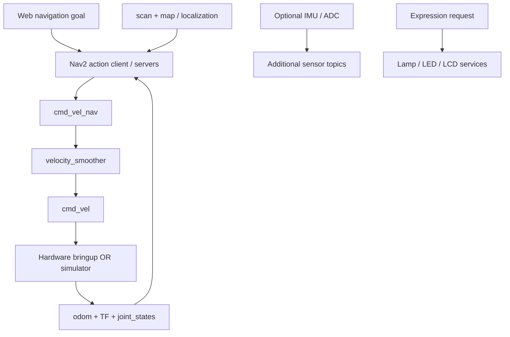

# ROS2 interface atlas — follow a signal instead of a directory

## 1. User learning requirement

Find the producer, consumer and data contract for a behavior without reading raw source. This atlas is the cross-package entry point for **core motion/state, sensing, expression and web navigation**. It records source-declared interfaces, not a complete runtime graph or an exhaustive list of every interface created inside external Nav2/LiDAR packages.

A useful study question is: “What data crosses this boundary, and what component interprets it?” A matching string alone is insufficient: message type, namespace/remapping, frame, time and receiver configuration also matter.

## 2. Technical requirements

Use the following distinctions while reading this repository:

| Interface kind | Role in this source | Example |
|---|---|---|
| Topic | Components create publishers/subscriptions for repeated messages | `cmd_vel`, `odom`, `imu_raw` |
| Service | Callback consumes a request and returns a response | `set_lamp`, `set_led` |
| Action | Client creates a goal-oriented Nav2 connection | Web bridge `navigate_to_pose` |
| TF | Components broadcast/listen to transforms between named frames | Bringup `odom` → `base_footprint` |
| Parameter | Configuration read by a node or passed by launch/YAML | IMU `rate`, wheel `wheel_radius` |

These are study descriptions based on the implementation roles below, rather than an assumption that every interface is live. Static examples: [pinky_bringup/pinky_bringup/bringup.py:84-95](https://github.com/seljb/pinky_pro/blob/014a09f289e6988894fbffde2624fdb1e257815b/pinky_bringup/pinky_bringup/bringup.py#L84-L95) [pinky_imu_bno055/src/main_node.cpp:13-22](https://github.com/seljb/pinky_pro/blob/014a09f289e6988894fbffde2624fdb1e257815b/pinky_imu_bno055/src/main_node.cpp#L13-L22); [pinky_imu_bno055/src/main_node.cpp:95-117](https://github.com/seljb/pinky_pro/blob/014a09f289e6988894fbffde2624fdb1e257815b/pinky_imu_bno055/src/main_node.cpp#L95-L117) [pinky_lamp_control/src/main_node.cpp:62-104](https://github.com/seljb/pinky_pro/blob/014a09f289e6988894fbffde2624fdb1e257815b/pinky_lamp_control/src/main_node.cpp#L62-L104) [pinky_navigation/scripts/nav2_web_server.py:140-175](https://github.com/seljb/pinky_pro/blob/014a09f289e6988894fbffde2624fdb1e257815b/pinky_navigation/scripts/nav2_web_server.py#L140-L175)

## 3. Related pipelines

**[Code confirmed]** The navigation launch remaps controller output to `cmd_vel_nav` and the velocity smoother's output to `cmd_vel`; the wheel node subscribes to `Twist` on `cmd_vel`. The web bridge creates a `NavigateToPose` action client. **[Inference]** The diagram joins these static contracts into the intended end-to-end behavior. Actual activation, type compatibility with installed Nav2 versions and message flow remain unverified. [pinky_navigation/launch/navigation_launch.xml:21-87](https://github.com/seljb/pinky_pro/blob/014a09f289e6988894fbffde2624fdb1e257815b/pinky_navigation/launch/navigation_launch.xml#L21-L87) [pinky_bringup/pinky_bringup/bringup.py:84-95](https://github.com/seljb/pinky_pro/blob/014a09f289e6988894fbffde2624fdb1e257815b/pinky_bringup/pinky_bringup/bringup.py#L84-L95) [pinky_navigation/scripts/nav2_web_server.py:140-175](https://github.com/seljb/pinky_pro/blob/014a09f289e6988894fbffde2624fdb1e257815b/pinky_navigation/scripts/nav2_web_server.py#L140-L175)

### Node, executable, topic and frame are different names

A package groups files. A launch executable starts a program. A ROS node owns interfaces, while a topic name identifies a message channel and a frame ID identifies coordinates inside messages. The names can resemble each other without being interchangeable.

| Component | Program / constructor node identity in checked source | Interfaces to follow |
|---|---|---|
| Hardware wheels | `pinky_bringup` executable `bringup`; constructor node `pinky_bringup` | Receives `cmd_vel`; publishes `odom`, `joint_states` and odometry TF |
| Battery | `pinky_bringup` executable `battery_publisher`; constructor node `battery_publihser` | Publishes `battery/voltage` and `battery/percent` |
| MuJoCo adapter | `Bridge`; constructor node `pinky_mujoco` | Receives `/cmd_vel`; publishes `/odom`, `/joint_states`, `/scan`, `/clock` and TF |
| Web adapter | `Nav2WebBridge`; constructor node `nav2_web_bridge_tf` | Action client, map/path subscriptions and TF listener |
| Model publisher | Launch node `robot_state_publisher` from the external package of the same name | Receives the model as `robot_description` parameter and is configured alongside a joint-state publisher |

`battery_publihser` is the constructor's exact spelling. Constructor identities are source defaults; launch name/namespace overrides may change the effective runtime names. These tables do not claim that every constructor reaches interface initialization: hardware interfaces are created only after the preceding driver initialization checks pass. [Hardware launch:20-27](https://github.com/seljb/pinky_pro/blob/014a09f289e6988894fbffde2624fdb1e257815b/pinky_bringup/launch/bringup_robot.launch.xml#L20-L27), [Pinky constructor:36-95](https://github.com/seljb/pinky_pro/blob/014a09f289e6988894fbffde2624fdb1e257815b/pinky_bringup/pinky_bringup/bringup.py#L36-L95), [Battery constructor and publishers:6-22](https://github.com/seljb/pinky_pro/blob/014a09f289e6988894fbffde2624fdb1e257815b/pinky_bringup/pinky_bringup/battery_publisher.py#L6-L22), [Bridge constructor:127-145](https://github.com/seljb/pinky_pro/blob/014a09f289e6988894fbffde2624fdb1e257815b/pinky_mujoco/pinky_mujoco/bridge.py#L127-L145), [Web constructor:63-65](https://github.com/seljb/pinky_pro/blob/014a09f289e6988894fbffde2624fdb1e257815b/pinky_navigation/scripts/nav2_web_server.py#L63-L65), [Model publisher launch:22-54](https://github.com/seljb/pinky_pro/blob/014a09f289e6988894fbffde2624fdb1e257815b/pinky_description/launch/upload_robot.launch.py#L22-L54)

### Motion and state contracts

| Source literal / frame | Data type or relation | Producer / consumer in checked code | Learning page |
|---|---|---|---|
| `cmd_vel` / `/cmd_vel` | `geometry_msgs/msg/Twist` | Wheel bringup subscriber; GZ ROS→GZ bridge; MuJoCo subscriber | [Bringup](../02_Packages/pinky_bringup.md), [simulation](../01_Architecture/simulation-pipeline.md) |
| `/cmd_vel_stamped` | `geometry_msgs/msg/TwistStamped` | Additional MuJoCo subscription, passes `.twist` to same callback | [MuJoCo](../02_Packages/pinky_mujoco.md) |
| `odom` / `/odom` | `nav_msgs/msg/Odometry` | Wheel bringup, GZ bridge or MuJoCo output depending on execution path | [State publishing](../05_Code_Analysis/pinky_bringup--state-publishing.md) |
| `joint_states` / `/joint_states` | `sensor_msgs/msg/JointState` | Wheel bringup, GZ bridge or MuJoCo output | [Description and TF](../01_Architecture/robot-description-and-tf.md) |
| `odom` → `base_footprint` | Transform frame identifiers in hardware bringup | Bringup broadcast path; distinct from joint names | [Bringup pipeline](../01_Architecture/pinky-bringup-pipeline.md) |
| `scan` / `/scan` | `sensor_msgs/msg/LaserScan` in simulators | GZ bridge/MuJoCo output; AMCL and SLAM configuration name `scan` or `/scan` | [Navigation](../01_Architecture/navigation-pipeline.md) |
| `clock` / `/clock` | `rosgraph_msgs/msg/Clock` | Simulators publish simulation time | [Simulation](../01_Architecture/simulation-pipeline.md) |

Exact motion/state declarations: [pinky_bringup/pinky_bringup/bringup.py:84-95](https://github.com/seljb/pinky_pro/blob/014a09f289e6988894fbffde2624fdb1e257815b/pinky_bringup/pinky_bringup/bringup.py#L84-L95) [pinky_bringup/pinky_bringup/bringup.py:8-34](https://github.com/seljb/pinky_pro/blob/014a09f289e6988894fbffde2624fdb1e257815b/pinky_bringup/pinky_bringup/bringup.py#L8-L34) [pinky_gz_sim/params/pinky_bridge.yaml:1-41](https://github.com/seljb/pinky_pro/blob/014a09f289e6988894fbffde2624fdb1e257815b/pinky_gz_sim/params/pinky_bridge.yaml#L1-L41) [pinky_mujoco/pinky_mujoco/bridge.py:127-146](https://github.com/seljb/pinky_pro/blob/014a09f289e6988894fbffde2624fdb1e257815b/pinky_mujoco/pinky_mujoco/bridge.py#L127-L146). Scan/frame configuration: [pinky_navigation/params/nav2_params.yaml:8-47](https://github.com/seljb/pinky_pro/blob/014a09f289e6988894fbffde2624fdb1e257815b/pinky_navigation/params/nav2_params.yaml#L8-L47) [pinky_navigation/params/mapper_params.yaml:12-17](https://github.com/seljb/pinky_pro/blob/014a09f289e6988894fbffde2624fdb1e257815b/pinky_navigation/params/mapper_params.yaml#L12-L17). A leading slash is preserved when present in source; relative names do not always resolve to the same fully qualified name under a namespace.

### Worked trace: a command is not feedback

Imagine a `Twist` requesting forward motion arrives at the hardware node. `Pinky.twist_callback` reads `linear.x` and `angular.z`, converts them to wheel RPM and asks the driver to send them. Separately, the update timer reads motor feedback, computes encoder displacement and publishes odometry, TF and joint states. **[Code confirmed]** Publishing a command and obtaining feedback are different code paths; neither a command value nor the action client's existence is evidence that the robot moved. [Command conversion:104-125](https://github.com/seljb/pinky_pro/blob/014a09f289e6988894fbffde2624fdb1e257815b/pinky_bringup/pinky_bringup/bringup.py#L104-L125), [Feedback and state update:127-159](https://github.com/seljb/pinky_pro/blob/014a09f289e6988894fbffde2624fdb1e257815b/pinky_bringup/pinky_bringup/bringup.py#L127-L159)

Read the four resulting contracts separately:

1. `cmd_vel` is the requested velocity channel.
2. `odom` is a structured pose/twist estimate, with frame IDs in its fields.
3. `odom` → `base_footprint` is a transform published through a separate broadcaster.
4. `joint_states` carries named joint positions/velocities for the body model.

Items 2 and 3 share computed state in this implementation, yet they are separate publications. The names `odom` and `base_footprint` inside messages are coordinate IDs, not node names or instructions to publish TF. [State publication methods:163-195](https://github.com/seljb/pinky_pro/blob/014a09f289e6988894fbffde2624fdb1e257815b/pinky_bringup/pinky_bringup/bringup.py#L163-L195) Continue with the English [motion and feedback lesson](motion-and-feedback.md) for numerical wheel/encoder examples and the [TF ownership lesson](../01_Architecture/robot-description-and-tf.md#add-the-navigation-layer-who-owns-each-edge) for the full coordinate chain.

### Sensor and battery contracts

| Relative name | Type | Producer | Key interpretation |
|---|---|---|---|
| `imu_raw` | `sensor_msgs/msg/Imu` | `pinky_imu_bno055` | Includes orientation as well as gyro/acceleration; units/calibration unverified |
| `us_sensor/range` | `sensor_msgs/msg/Range` | `pinky_sensor_adc` | Formula-based distance; frame `ultrasonic_link` |
| `ir_sensor/range` | `std_msgs/msg/UInt16MultiArray` | `pinky_sensor_adc` | Raw ADC counts in order 2,1,0, not converted meters |
| `batt_state` | `sensor_msgs/msg/BatteryState` | `pinky_sensor_adc` | Calculated voltage; many other values NaN or fixed constants |
| `battery/voltage` | `std_msgs/msg/Float32` | `battery_publisher` | Separate `pinkylib.Battery` measurement; consumed by wheel bringup |
| `battery/percent` | `std_msgs/msg/Float32` | `battery_publisher` | External library percentage output |

Evidence: [pinky_imu_bno055/src/main_node.cpp:13-22](https://github.com/seljb/pinky_pro/blob/014a09f289e6988894fbffde2624fdb1e257815b/pinky_imu_bno055/src/main_node.cpp#L13-L22); [pinky_imu_bno055/src/main_node.cpp:95-117](https://github.com/seljb/pinky_pro/blob/014a09f289e6988894fbffde2624fdb1e257815b/pinky_imu_bno055/src/main_node.cpp#L95-L117) [pinky_sensor_adc/src/main_node.cpp:27-29](https://github.com/seljb/pinky_pro/blob/014a09f289e6988894fbffde2624fdb1e257815b/pinky_sensor_adc/src/main_node.cpp#L27-L29); [pinky_sensor_adc/src/main_node.cpp:56-91](https://github.com/seljb/pinky_pro/blob/014a09f289e6988894fbffde2624fdb1e257815b/pinky_sensor_adc/src/main_node.cpp#L56-L91) [pinky_bringup/pinky_bringup/battery_publisher.py:6-36](https://github.com/seljb/pinky_pro/blob/014a09f289e6988894fbffde2624fdb1e257815b/pinky_bringup/pinky_bringup/battery_publisher.py#L6-L36) [pinky_bringup/pinky_bringup/bringup.py:84-95](https://github.com/seljb/pinky_pro/blob/014a09f289e6988894fbffde2624fdb1e257815b/pinky_bringup/pinky_bringup/bringup.py#L84-L95). See [IMU](../02_Packages/pinky_imu_bno055.md) and [ADC](../02_Packages/pinky_sensor_adc.md) for scales and limits. The tracked real-robot launch does not start the IMU or ADC nodes. [pinky_bringup/launch/bringup_robot.launch.xml:3-29](https://github.com/seljb/pinky_pro/blob/014a09f289e6988894fbffde2624fdb1e257815b/pinky_bringup/launch/bringup_robot.launch.xml#L3-L29)

### Expression service contracts

| Instance name | Service type | Response meaning in implementation | Owning page |
|---|---|---|---|
| `set_lamp` | `pinky_interfaces/srv/SetLamp` | Stores target and returns `result=true`; later timer renders | [Lamp](../02_Packages/pinky_lamp_control.md) |
| `set_led` | `pinky_interfaces/srv/SetLed` | Branch/exception result with message | [LED](../02_Packages/pinky_led.md) |
| `set_brightness` | `pinky_interfaces/srv/SetBrightness` | Calls external library, catches exceptions | [LED](../02_Packages/pinky_led.md) |
| `set_emotion` | `pinky_interfaces/srv/Emotion` | Text reports cache selection or missing key | [Emotion](../02_Packages/pinky_emotion.md) |

Evidence: [pinky_lamp_control/src/main_node.cpp:62-104](https://github.com/seljb/pinky_pro/blob/014a09f289e6988894fbffde2624fdb1e257815b/pinky_lamp_control/src/main_node.cpp#L62-L104) [pinky_led/pinky_led/led_server.py:8-79](https://github.com/seljb/pinky_pro/blob/014a09f289e6988894fbffde2624fdb1e257815b/pinky_led/pinky_led/led_server.py#L8-L79) [pinky_emotion/pinky_emotion/emotion_server.py:23-34](https://github.com/seljb/pinky_pro/blob/014a09f289e6988894fbffde2624fdb1e257815b/pinky_emotion/pinky_emotion/emotion_server.py#L23-L34); [pinky_emotion/pinky_emotion/emotion_server.py:60-73](https://github.com/seljb/pinky_pro/blob/014a09f289e6988894fbffde2624fdb1e257815b/pinky_emotion/pinky_emotion/emotion_server.py#L60-L73). Full request fields: [service schemas](../02_Packages/pinky_interfaces.md). These are not interchangeable types, and request fields such as brightness or lamp time are not automatically ROS parameters.

### Web navigation contracts

The web bridge subscribes to `map` (`OccupancyGrid`), `plan` (`Path`), and local/global `costmap` and `costmap_raw` names using `nav2_msgs/msg/Costmap`; it creates a TF listener and a 0.1-second pose update timer. The table reflects **its subscription declarations**, not proof that every candidate topic has that type in the installed Nav2 system. [pinky_navigation/scripts/nav2_web_server.py:88-138](https://github.com/seljb/pinky_pro/blob/014a09f289e6988894fbffde2624fdb1e257815b/pinky_navigation/scripts/nav2_web_server.py#L88-L138)

| Name | Kind/type | Web bridge role |
|---|---|---|
| `navigate_to_pose` | Action, `nav2_msgs/action/NavigateToPose` | Goal client |
| `navigate_to_pose/_action/status` | Topic, `action_msgs/msg/GoalStatusArray` | Observes navigation status |
| `navigate_to_pose/_action/cancel_goal` | Service, `action_msgs/srv/CancelGoal` | Cancel client |
| `initialpose` | Topic, `geometry_msgs/msg/PoseWithCovarianceStamped` | Initial-pose publisher |
| `/slam_toolbox/save_map` | Service, `slam_toolbox/srv/SaveMap` | Save-map client |
| `/slam_toolbox/reset` | Service, `slam_toolbox/srv/Reset` | Reset client |

Evidence: [pinky_navigation/scripts/nav2_web_server.py:140-175](https://github.com/seljb/pinky_pro/blob/014a09f289e6988894fbffde2624fdb1e257815b/pinky_navigation/scripts/nav2_web_server.py#L140-L175). These external service/action servers must exist separately; creating a client does not establish a working server connection. See [navigation package](../02_Packages/pinky_navigation.md).

## 4. Related code and parameters

| Boundary | Owning source/configuration | Why it matters | Wiki page |
|---|---|---|---|
| Chassis kinematics | `bringup.py`, wheel radius/separation | Converts velocity to wheel commands and feedback to state | [Bringup parameters](../03_Parameters/pinky_bringup-parameters.md) |
| Nav2 input/output | `navigation_launch.xml`, `nav2_params.yaml` | Remapping, frames and source parameter selection | [Navigation parameters](../03_Parameters/navigation-parameters.md) |
| Sensors | IMU/ADC constructors and callbacks | Sampling periods, channel ordering and scales | [Sensors and expression](../01_Architecture/sensors-and-expression.md) |
| Simulated state | GZ bridge YAML or MuJoCo `Bridge` | Determines the producer selected by execution path | [Simulation](../01_Architecture/simulation-pipeline.md) |
| Expression | Four `.srv` definitions and server callbacks | Distinguishes data schema from hardware behavior | [Interfaces](../02_Packages/pinky_interfaces.md) |

This table locates configuration; it does not duplicate parameter catalogs. Actual active values depend on the chosen entrypoint and overrides.

## 5. Current implementation status

**[Code confirmed]** Core velocity/state interfaces, optional sensor publishers, four custom service schemas and web clients exist in the baseline source. **[Inference]** A learner can trace a goal to a command and feedback through these contracts, but the end-to-end result also depends on external packages and runtime lifecycle/time/TF configuration.

A default launch does not imply every installed package runs. In particular, the optional IMU/ADC/expression nodes are absent from the tracked real-robot launch. [pinky_bringup/launch/bringup_robot.launch.xml:3-29](https://github.com/seljb/pinky_pro/blob/014a09f289e6988894fbffde2624fdb1e257815b/pinky_bringup/launch/bringup_robot.launch.xml#L3-L29)

## 6. Further checks needed

No runtime graph, QoS negotiation, message timestamps, namespace/remapping result, external server availability or hardware behavior was observed. The three untracked navigation files are outside the fixed-SHA baseline; this atlas does not rely on them. See [source baseline](../00_Overview/source-baseline.md).

**Check yourself.** Why cannot `batt_state` be fed directly to the wheel node's battery subscription? **Answer:** Its name and message type differ from `battery/voltage`/`Float32`; a deliberate adapter or matching publisher would be needed. Why can a web page load while navigation still fails? **Answer:** The HTTP layer, action server, state topics and TF chain are separate connections.

## 7. Related documents

- [Bringup pipeline](../01_Architecture/pinky-bringup-pipeline.md)
- [Navigation pipeline](../01_Architecture/navigation-pipeline.md)
- [Simulation pipeline](../01_Architecture/simulation-pipeline.md)
- [Sensors and expression](../01_Architecture/sensors-and-expression.md)
- [Robot description and TF](../01_Architecture/robot-description-and-tf.md)
- [Package inventory](../00_Overview/package-inventory.md)

## 8. Verification status and sources

Repository: `seljb/pinky_pro`; source SHA is recorded in frontmatter and every source link. **[Code confirmed]** means inspected definitions/configurations. **[Inference]** marks the intended combined flow. **[Unverified]** means runtime evidence is absent. No robot, simulator, ROS node or repository test was executed for this atlas.

> 작업 메모: 2026-11-19에 Node 생성자 이름, 명령과 피드백의 별도 경로, MuJoCo 절대 토픽 이름을 재확인했다. 이 표는 실행 중인 ROS 그래프가 아니라 소스 계약 지도다. 이름, 타입, 프레임, 시간, QoS를 각각 확인해야 한다.

[Wiki index](../index.md)
