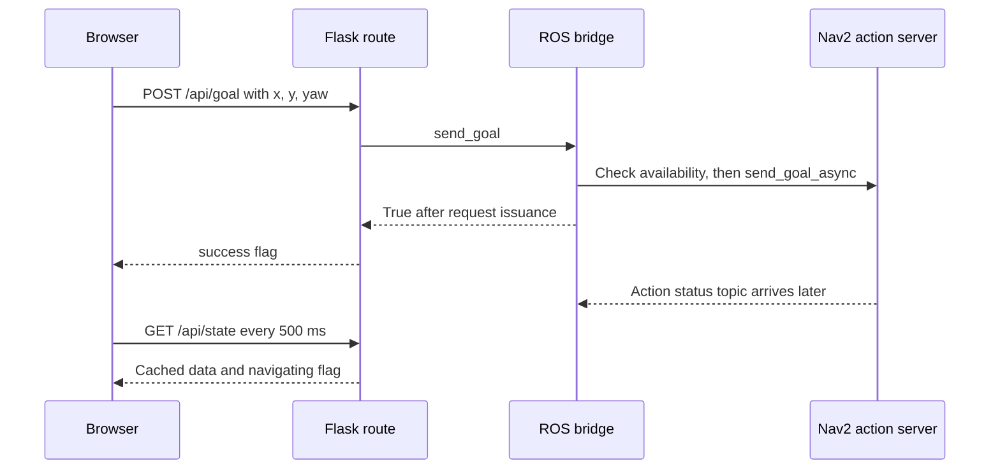

# Web navigation bridge: requests, snapshots and coordinate limits

## 1. Analysis target

- `scripts/nav2_web_server.py`: `Nav2WebBridge`, Flask routes and startup.
- `scripts/index.html`: state polling, canvas conversion, goal/initial-pose requests.
- Repository and commit: metadata above; all linked line ranges refer to that immutable source.
- Verification: **[Code verified / 코드 확인]** unless marked inference; runtime behavior was not exercised.

## 2. Purpose of the code

The bridge keeps the most recent ROS map/path/costmap messages and a TF-derived robot pose, then exposes them as JSON to a browser. Browser clicks send high-level navigation or localization requests. It does not stream wheel commands directly. The browser polls HTTP every `500` ms; there is no WebSocket in this client path. [pinky_navigation/scripts/nav2_web_server.py:63–175](https://github.com/seljb/pinky_pro/blob/014a09f289e6988894fbffde2624fdb1e257815b/pinky_navigation/scripts/nav2_web_server.py#L63-L175); [pinky_navigation/scripts/nav2_web_server.py:239–323](https://github.com/seljb/pinky_pro/blob/014a09f289e6988894fbffde2624fdb1e257815b/pinky_navigation/scripts/nav2_web_server.py#L239-L323); [pinky_navigation/scripts/index.html:745–766](https://github.com/seljb/pinky_pro/blob/014a09f289e6988894fbffde2624fdb1e257815b/pinky_navigation/scripts/index.html#L745-L766); [pinky_navigation/scripts/index.html:1060–1062](https://github.com/seljb/pinky_pro/blob/014a09f289e6988894fbffde2624fdb1e257815b/pinky_navigation/scripts/index.html#L1060-L1062)

## 3. Inputs and outputs

| HTTP route | ROS operation / returned content | Completion meaning | Source |
|---|---|---|---|
| `GET /` | Serve adjacent `index.html` | HTML response only | [pinky_navigation/scripts/nav2_web_server.py:429–432](https://github.com/seljb/pinky_pro/blob/014a09f289e6988894fbffde2624fdb1e257815b/pinky_navigation/scripts/nav2_web_server.py#L429-L432) |
| `GET /api/state` | Cached map, pose, path, costmaps and navigating flag | Snapshot, not synchronized sensor capture | [pinky_navigation/scripts/nav2_web_server.py:239–323](https://github.com/seljb/pinky_pro/blob/014a09f289e6988894fbffde2624fdb1e257815b/pinky_navigation/scripts/nav2_web_server.py#L239-L323); [pinky_navigation/scripts/nav2_web_server.py:435–442](https://github.com/seljb/pinky_pro/blob/014a09f289e6988894fbffde2624fdb1e257815b/pinky_navigation/scripts/nav2_web_server.py#L435-L442) |
| `POST /api/goal` | Read x/y/yaw and call `send_goal` | Availability check plus asynchronous request issuance | [pinky_navigation/scripts/nav2_web_server.py:325–346](https://github.com/seljb/pinky_pro/blob/014a09f289e6988894fbffde2624fdb1e257815b/pinky_navigation/scripts/nav2_web_server.py#L325-L346); [pinky_navigation/scripts/nav2_web_server.py:445–458](https://github.com/seljb/pinky_pro/blob/014a09f289e6988894fbffde2624fdb1e257815b/pinky_navigation/scripts/nav2_web_server.py#L445-L458) |
| `POST /api/initialpose` | Publish `PoseWithCovarianceStamped` in `map` | Message publication, not localization convergence | [pinky_navigation/scripts/nav2_web_server.py:348–369](https://github.com/seljb/pinky_pro/blob/014a09f289e6988894fbffde2624fdb1e257815b/pinky_navigation/scripts/nav2_web_server.py#L348-L369); [pinky_navigation/scripts/nav2_web_server.py:461–474](https://github.com/seljb/pinky_pro/blob/014a09f289e6988894fbffde2624fdb1e257815b/pinky_navigation/scripts/nav2_web_server.py#L461-L474) |
| `GET /api/nav/status` | Return `_is_navigating` | Local flag derived from status topic / optimistic update | [pinky_navigation/scripts/nav2_web_server.py:180–185](https://github.com/seljb/pinky_pro/blob/014a09f289e6988894fbffde2624fdb1e257815b/pinky_navigation/scripts/nav2_web_server.py#L180-L185); [pinky_navigation/scripts/nav2_web_server.py:477–484](https://github.com/seljb/pinky_pro/blob/014a09f289e6988894fbffde2624fdb1e257815b/pinky_navigation/scripts/nav2_web_server.py#L477-L484) |
| `POST /api/nav/stop` | Call action cancellation service | Request all goals canceled; response not awaited | [pinky_navigation/scripts/nav2_web_server.py:376–390](https://github.com/seljb/pinky_pro/blob/014a09f289e6988894fbffde2624fdb1e257815b/pinky_navigation/scripts/nav2_web_server.py#L376-L390); [pinky_navigation/scripts/nav2_web_server.py:487–495](https://github.com/seljb/pinky_pro/blob/014a09f289e6988894fbffde2624fdb1e257815b/pinky_navigation/scripts/nav2_web_server.py#L487-L495) |
| `POST /api/slam/reset` | Call SLAM reset asynchronously | Request sent, not confirmed graph reset | [pinky_navigation/scripts/nav2_web_server.py:392–405](https://github.com/seljb/pinky_pro/blob/014a09f289e6988894fbffde2624fdb1e257815b/pinky_navigation/scripts/nav2_web_server.py#L392-L405); [pinky_navigation/scripts/nav2_web_server.py:498–508](https://github.com/seljb/pinky_pro/blob/014a09f289e6988894fbffde2624fdb1e257815b/pinky_navigation/scripts/nav2_web_server.py#L498-L508) |
| `POST /api/slam/save_map` | Call SLAM SaveMap with requested/default name | Request sent, not confirmed files created | [pinky_navigation/scripts/nav2_web_server.py:407–422](https://github.com/seljb/pinky_pro/blob/014a09f289e6988894fbffde2624fdb1e257815b/pinky_navigation/scripts/nav2_web_server.py#L407-L422); [pinky_navigation/scripts/nav2_web_server.py:511–528](https://github.com/seljb/pinky_pro/blob/014a09f289e6988894fbffde2624fdb1e257815b/pinky_navigation/scripts/nav2_web_server.py#L511-L528) |

The ROS topic names, types and QoS are listed in the [package page](../02_Packages/pinky_navigation.md). The map uses reliable transient-local depth 1; path and costmap subscriptions use depth 10. All four costmap subscriptions request `nav2_msgs/msg/Costmap`, including names ending `/costmap`. Actual publisher types/QoS must be checked before expecting a match. [pinky_navigation/scripts/nav2_web_server.py:81–131](https://github.com/seljb/pinky_pro/blob/014a09f289e6988894fbffde2624fdb1e257815b/pinky_navigation/scripts/nav2_web_server.py#L81-L131)

## 4. Execution flow



The sequence is source-derived; no request was actually sent. Goal acceptance/result handling is not attached to the `send_goal_async` future here. `_is_navigating` is set true immediately, then status messages consider any `ACCEPTED` or `EXECUTING` goal active. This is not a precise progress percentage, goal-specific result or proof of physical motion. [pinky_navigation/scripts/nav2_web_server.py:180–185](https://github.com/seljb/pinky_pro/blob/014a09f289e6988894fbffde2624fdb1e257815b/pinky_navigation/scripts/nav2_web_server.py#L180-L185); [pinky_navigation/scripts/nav2_web_server.py:326–346](https://github.com/seljb/pinky_pro/blob/014a09f289e6988894fbffde2624fdb1e257815b/pinky_navigation/scripts/nav2_web_server.py#L326-L346)

### Goal and initial-pose construction

The goal is stamped with the node clock, assigned frame `map` and quaternion `z=sin(yaw/2)`, `w=cos(yaw/2)`. Initial pose uses the same frame/quaternion construction, with covariance entries x=`0.25`, y=`0.25`, yaw=`0.06853891909122467`. The source describes these as RViz-style values; no estimator convergence was measured. [pinky_navigation/scripts/nav2_web_server.py:331–338](https://github.com/seljb/pinky_pro/blob/014a09f289e6988894fbffde2624fdb1e257815b/pinky_navigation/scripts/nav2_web_server.py#L331-L338); [pinky_navigation/scripts/nav2_web_server.py:349–365](https://github.com/seljb/pinky_pro/blob/014a09f289e6988894fbffde2624fdb1e257815b/pinky_navigation/scripts/nav2_web_server.py#L349-L365)

```python
# 학습용 의사 코드이며 실제 요청은 실행하지 않는다.
goal_frame = "map"
z = sin(yaw / 2)
w = cos(yaw / 2)
# 요청 전송 성공과 목표 도달 성공은 별도로 확인해야 한다.
```

### Snapshot and TF behavior

A `threading.Lock` protects callback updates and snapshot references. The snapshot then serializes separate cached messages outside the lock, returning `None` for unavailable map/pose/costmaps and an empty path if absent. It carries no message timestamps or frame IDs in the resulting JSON. **[Code verified]** [pinky_navigation/scripts/nav2_web_server.py:179–215](https://github.com/seljb/pinky_pro/blob/014a09f289e6988894fbffde2624fdb1e257815b/pinky_navigation/scripts/nav2_web_server.py#L179-L215); [pinky_navigation/scripts/nav2_web_server.py:239–323](https://github.com/seljb/pinky_pro/blob/014a09f289e6988894fbffde2624fdb1e257815b/pinky_navigation/scripts/nav2_web_server.py#L239-L323)

Every `0.1` seconds the TF callback requests the latest `map → base_link` transform. If lookup raises an exception, it silently retains the prior state. Once a pose has been cached, a later TF outage does not clear it or mark it stale. **[Code verified]** [pinky_navigation/scripts/nav2_web_server.py:133–138](https://github.com/seljb/pinky_pro/blob/014a09f289e6988894fbffde2624fdb1e257815b/pinky_navigation/scripts/nav2_web_server.py#L133-L138); [pinky_navigation/scripts/nav2_web_server.py:217–237](https://github.com/seljb/pinky_pro/blob/014a09f289e6988894fbffde2624fdb1e257815b/pinky_navigation/scripts/nav2_web_server.py#L217-L237)

The consequence is that a visually plausible pose can outlive its valid transform. This is a source-derived limitation, not an outage observed in this session. **[Inference]** Source above.

### Browser coordinate conversion

The client fits the map to its canvas, flips y, and converts between cells and world coordinates with resolution and origin x/y. On pointer release, it computes heading with `atan2(end_y-start_y, end_x-start_x)` and sends the drag-start location with that heading. The same drag selects either a goal or an initial pose, depending on click mode. **[Code verified]** [pinky_navigation/scripts/index.html:791–807](https://github.com/seljb/pinky_pro/blob/014a09f289e6988894fbffde2624fdb1e257815b/pinky_navigation/scripts/index.html#L791-L807); [pinky_navigation/scripts/index.html:940–960](https://github.com/seljb/pinky_pro/blob/014a09f289e6988894fbffde2624fdb1e257815b/pinky_navigation/scripts/index.html#L940-L960); [pinky_navigation/scripts/index.html:993–1041](https://github.com/seljb/pinky_pro/blob/014a09f289e6988894fbffde2624fdb1e257815b/pinky_navigation/scripts/index.html#L993-L1041)

For an unrotated map with origin `(-2.05,-1.62)` and resolution `0.05`, cell `(61,42)` maps to `(1.0,0.48)` under the client's formula. This is arithmetic illustrating source conversion, not an actual click or navigation test. [pinky_navigation/map/my_map.yaml:1–4](https://github.com/seljb/pinky_pro/blob/014a09f289e6988894fbffde2624fdb1e257815b/pinky_navigation/map/my_map.yaml#L1-L4); [pinky_navigation/scripts/index.html:954–960](https://github.com/seljb/pinky_pro/blob/014a09f289e6988894fbffde2624fdb1e257815b/pinky_navigation/scripts/index.html#L954-L960)

The server serializes map-origin yaw but the client conversion uses only origin x/y; neither conversion rotates by origin yaw. The bundled maps both have yaw zero, so this particular omission is not exposed by those source metadata. Nonzero-yaw maps would need further review. **[Code verified / effect inferred]** [pinky_navigation/scripts/nav2_web_server.py:253–261](https://github.com/seljb/pinky_pro/blob/014a09f289e6988894fbffde2624fdb1e257815b/pinky_navigation/scripts/nav2_web_server.py#L253-L261); [pinky_navigation/scripts/index.html:803–807](https://github.com/seljb/pinky_pro/blob/014a09f289e6988894fbffde2624fdb1e257815b/pinky_navigation/scripts/index.html#L803-L807); [pinky_navigation/scripts/index.html:954–960](https://github.com/seljb/pinky_pro/blob/014a09f289e6988894fbffde2624fdb1e257815b/pinky_navigation/scripts/index.html#L954-L960); [pinky_navigation/map/my_map.yaml:4–4](https://github.com/seljb/pinky_pro/blob/014a09f289e6988894fbffde2624fdb1e257815b/pinky_navigation/map/my_map.yaml#L4-L4); [pinky_navigation/map/pinklab.yaml:4–4](https://github.com/seljb/pinky_pro/blob/014a09f289e6988894fbffde2624fdb1e257815b/pinky_navigation/map/pinklab.yaml#L4-L4)

Costmap overlays use metadata origin/resolution and call `worldToCanvas` directly. The JSON lacks frame IDs, and the renderer applies no TF to move an odom-frame local costmap into the map frame. Since local costmap is configured in `odom`, overlay alignment is unverified and may differ when map↔odom is nonidentity. **[Code verified / effect inferred]** [pinky_navigation/scripts/nav2_web_server.py:284–314](https://github.com/seljb/pinky_pro/blob/014a09f289e6988894fbffde2624fdb1e257815b/pinky_navigation/scripts/nav2_web_server.py#L284-L314); [pinky_navigation/scripts/index.html:831–881](https://github.com/seljb/pinky_pro/blob/014a09f289e6988894fbffde2624fdb1e257815b/pinky_navigation/scripts/index.html#L831-L881); [pinky_navigation/params/nav2_params.yaml:178–179](https://github.com/seljb/pinky_pro/blob/014a09f289e6988894fbffde2624fdb1e257815b/pinky_navigation/params/nav2_params.yaml#L178-L179)

### Stop, reset and save semantics

`cancel_goal` creates an empty `CancelGoal.Request`, sends it asynchronously and immediately sets `_is_navigating=False`. The code intends to cancel all active goals, including those originating in RViz. It does not publish an immediate zero `cmd_vel` or await cancellation acknowledgment. The UI can consequently display idle before downstream motion has stopped. **[Code verified / effect inferred]** [pinky_navigation/scripts/nav2_web_server.py:376–390](https://github.com/seljb/pinky_pro/blob/014a09f289e6988894fbffde2624fdb1e257815b/pinky_navigation/scripts/nav2_web_server.py#L376-L390); [pinky_navigation/scripts/index.html:641–678](https://github.com/seljb/pinky_pro/blob/014a09f289e6988894fbffde2624fdb1e257815b/pinky_navigation/scripts/index.html#L641-L678)

SLAM reset/save similarly wait up to one second for service availability and issue asynchronous calls, then return true without inspecting the response. The fallback save name is `pinky_map_%Y%m%d_%H%M%S` using server system time. Neither a true HTTP flag nor that name proves that map files exist. **[Code verified]** [pinky_navigation/scripts/nav2_web_server.py:393–422](https://github.com/seljb/pinky_pro/blob/014a09f289e6988894fbffde2624fdb1e257815b/pinky_navigation/scripts/nav2_web_server.py#L393-L422); [pinky_navigation/scripts/nav2_web_server.py:521–528](https://github.com/seljb/pinky_pro/blob/014a09f289e6988894fbffde2624fdb1e257815b/pinky_navigation/scripts/nav2_web_server.py#L521-L528)

## 5. Dependencies

The script imports Flask, ROS Python, TF2, navigation/action/geometry messages and SLAM Toolbox services. `main` initializes ROS, constructs the bridge, starts ROS spinning in a daemon thread, waits one second and runs Flask with the configured host/port. No separate readiness check for map/TF/Nav2 is performed in this startup block. **[Code verified]** [pinky_navigation/scripts/nav2_web_server.py:7–33](https://github.com/seljb/pinky_pro/blob/014a09f289e6988894fbffde2624fdb1e257815b/pinky_navigation/scripts/nav2_web_server.py#L7-L33); [pinky_navigation/scripts/nav2_web_server.py:534–560](https://github.com/seljb/pinky_pro/blob/014a09f289e6988894fbffde2624fdb1e257815b/pinky_navigation/scripts/nav2_web_server.py#L534-L560)

CMake installs HTML and logo beside the server, matching `BASE_DIR` static serving. **[Code verified]** [pinky_navigation/CMakeLists.txt:26–34](https://github.com/seljb/pinky_pro/blob/014a09f289e6988894fbffde2624fdb1e257815b/pinky_navigation/CMakeLists.txt#L26-L34); [pinky_navigation/scripts/nav2_web_server.py:40–46](https://github.com/seljb/pinky_pro/blob/014a09f289e6988894fbffde2624fdb1e257815b/pinky_navigation/scripts/nav2_web_server.py#L40-L46)

## 6. Main parameters

See [navigation parameters](../03_Parameters/navigation-parameters.md) for values. Clock forwarding differs between wrappers: `gz_web_nav2` declares simulated time but passes it only to the included Nav2 launch; `gz_web_slam` also passes it to the web node. Goal/initial-pose timestamps use the web node clock, making this a concrete runtime verification point. **[Code verified / effect unverified]** [pinky_navigation/launch/gz_web_nav2.launch.xml:5–17](https://github.com/seljb/pinky_pro/blob/014a09f289e6988894fbffde2624fdb1e257815b/pinky_navigation/launch/gz_web_nav2.launch.xml#L5-L17); [pinky_navigation/launch/gz_web_slam.launch.xml:5–22](https://github.com/seljb/pinky_pro/blob/014a09f289e6988894fbffde2624fdb1e257815b/pinky_navigation/launch/gz_web_slam.launch.xml#L5-L22); [pinky_navigation/scripts/nav2_web_server.py:331–333](https://github.com/seljb/pinky_pro/blob/014a09f289e6988894fbffde2624fdb1e257815b/pinky_navigation/scripts/nav2_web_server.py#L331-L333); [pinky_navigation/scripts/nav2_web_server.py:351–353](https://github.com/seljb/pinky_pro/blob/014a09f289e6988894fbffde2624fdb1e257815b/pinky_navigation/scripts/nav2_web_server.py#L351-L353)

Frames `map` and `base_link`, polling period and covariance values are hard-coded in this implementation; they are not declared ROS parameters. [pinky_navigation/scripts/nav2_web_server.py:63–68](https://github.com/seljb/pinky_pro/blob/014a09f289e6988894fbffde2624fdb1e257815b/pinky_navigation/scripts/nav2_web_server.py#L63-L68); [pinky_navigation/scripts/nav2_web_server.py:224–225](https://github.com/seljb/pinky_pro/blob/014a09f289e6988894fbffde2624fdb1e257815b/pinky_navigation/scripts/nav2_web_server.py#L224-L225); [pinky_navigation/scripts/nav2_web_server.py:331–363](https://github.com/seljb/pinky_pro/blob/014a09f289e6988894fbffde2624fdb1e257815b/pinky_navigation/scripts/nav2_web_server.py#L331-L363); [pinky_navigation/scripts/index.html:1060–1062](https://github.com/seljb/pinky_pro/blob/014a09f289e6988894fbffde2624fdb1e257815b/pinky_navigation/scripts/index.html#L1060-L1062)

## 7. Related documents

- [Navigation package](../02_Packages/pinky_navigation.md)
- [Navigation and mapping flow](../01_Architecture/navigation-pipeline.md)
- [Navigation parameter catalog](../03_Parameters/navigation-parameters.md)
- [Base command path](pinky_bringup--motor-control.md)
- [Base state / TF](pinky_bringup--state-publishing.md)

## 8. Evidence and verification status

**[Code verified]** All facts above were read from tracked source at the metadata SHA. **[Inference / 추론]** Potential stale pose, display alignment and optimistic status consequences are derived from code. **[Unverified / 미검증]** Web startup, publisher compatibility, actual HTTP responses, goal acceptance/result, SLAM save/reset success, clock behavior and physical stopping. No app/server, ROS, simulator or robot was started.

### Check yourself

1. What does `success: true` mean for save/reset here? **Answer:** The service was available and a request was issued; its completion response is not checked.
2. Is the displayed robot pose read directly from `/odom`? **Answer:** No. The bridge asks TF for `map → base_link`.
3. Why might local-costmap pixels be misleading even if received? **Answer:** Their configured frame is `odom`, while the canvas directly treats overlay coordinates as map coordinates without a TF step.
4. Does the Stop button belong only to the goal created by this browser? **Answer:** No. The code issues cancellation for all active goals through the action cancel service.

> 작업 메모: 성공 플래그의 의미를 요청 발행으로 제한했다. 화면 표시와 실제 ROS 상태·로봇 정지는 별도 검증 대상으로 남겼다.
